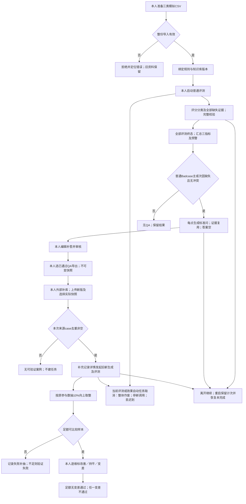

# 完整业务行为 Spec（TASK-004）

### 2026-10-10 F11分组容错及TASK-024旧基线重判（最新，Codex）

本人先对允许少量无关事项误冲突回复“是”，再对“两组分别至少90%、最低正确数向上取整、已保存冲突标记禁QA仍严格执行”回复“是”。F11模型相关事项冲突判断分两组验收：固定真实有冲突样本的识别正确率及固定真实无冲突样本的判断正确率分别≥90%，最低正确数分别向上取整；漏报与误报分别计错，不合成整体比例。无结果/调用最终失败按所属固定组计错，不减分母。系统按已保存冲突标记禁止QA仍严格执行；准确性1和已确认禁止/允许直接冲突归因例外等原规则保持。

确认及复算见 `docs/04_validation/repair/F11-tolerance-change-20261010.md`；新版复审见 `docs/04_validation/final-review-rules-v3.md`。原E-v2第一轮真实冲突4/4（最低4），无冲突45/46（最低42）；038误报仍计错但在已确认容差内。原TASK-024基线按全部新规则50项在已取证范围满足，技术审查通过；不是原缺陷已修复，不是当前E-v3候选验收，最终交付及新版报告认可仍待本人。旧038必要阻塞为此前零容错门槛下状态，新规则下不再单独阻塞原E-v2；当前候选证据缺口、FIX整卡版本处置未自动关闭。

### 2026-10-10 F19确认与四项规则复审（最新，Codex）

本人对“最终草稿覆盖率至少90%，但系统漏调度和违反禁止条件不在容错范围内”回复“接受”。F19端到端草稿覆盖数至少ceil(本人提前固定应生成缺失点数×90%)；漏识别、未生成、调用最终失败计未覆盖且不减分母。正确保存且符合条件的缺失点必须触发Q，系统漏调度不在容错范围；冲突、非缺失、合格、未完成、取消及效果任务等禁止集合不得生成。正常最多3次调用后失败单列，不是漏调度，但计未覆盖；F20文本质量另判。

F06/F09/F11/F19均已逐项确认并同步。详见 `docs/04_validation/repair/F19-rule-change-20261010.md` 和 `docs/04_validation/final-review-rules-v2.md`。第一轮旧E-v2按新规则重判：F06区间50/47/47，F09缺失点17/18，F19覆盖16/17及已保存资格Q交接满足；F11的049按新例外满足，但038无关事项误冲突仍失败。新矩阵为旧版本新规则范围内49通过/1失败，仍不通过、有阻塞；不是当前E-v3已验证。FIX/FR未自动关闭、原缺陷未记修复；F11/FR-02的038及当前候选证据缺口保持，最终交付待本人明确认可。原报告、冻结文件及前面阶段状态作为历史保留，本条更新此前F19未决定及038必导致F19覆盖失败的口径。

### 2026-10-10 F11禁止／允许冲突归因确认（当前增量规则，Codex）

本人对“禁止与允许直接冲突、客服选择允许时，优先归违规，其余冲突规则保持”明确回复“确认”。同一业务对象、同一行为和相同条件下，两份资料分别写禁止与允许，客服选择允许或承诺执行时，主因优先为“违反平台规则，做出不当承诺”；准确性仍1、资料冲突标记仍true、仍不生成QA。仅此直接冲突构成归因例外；其他纯冲突主因仍其他／证据不足，数值期限冲突不自动套用，无关对象条款不得套用。

本人理由：售卖可能有金额损失，不只是用户体验问题；禁止优先用于本例外归因，不宣称已确认哪份资料为事实权威。变更及新预期版本见 `docs/04_validation/repair/F11-rule-change-20261010.md`。ACC-049新主因改违规，旧E-v2输出按新规则符合该子项；原冻结预期/报告不改，不记原缺陷已修复。ACC-038无关事项误冲突仍失败，F11整项及FIX-003/FR-02不关闭；F19尚未变更。本条优先于下文旧纯冲突一律归其他及“049应纠正为其他”的门禁；旧执行事实保留。

### 2026-10-10 F09缺失点识别率确认（当前增量规则，Codex）

本人先回复“接受一定比例”，再对“按提前固定的知识缺失点统计，识别率至少90%，不足整数时向上取整”回复“是”。F09知识缺失识别按本人提前固定的全部知识缺失点统计，识别数至少ceil(N×90%)；漏识别、无结果及调用失败均计未识别，不缩小分母。同回复多点分开，不同回复同点分开；按对象、属性和条件的语义对应，不要求gap字面相同。

确认与复算见 `docs/04_validation/repair/F09-rule-change-20261010.md`。误报不由召回率抵消，原禁止一份资料已有答案仍标缺失及特殊评分保持；F11/F19尚未确认变更。第一轮E-v2全部缺失点18个（含冲突案例019中不得生成QA的1点），识别17个，最低17个；QA分母另为17，不能混用。仅识别率子项满足，不记整个F09、FR-02或FIX-003已关闭。原038误冲突及049归因、漏QA保持。本条更新此前“F09尚未变更”的时点状态，历史证据不改。

### 2026-10-10 F06区间验收确认（当前规则，Codex）

本人对“逐维区间比较、各维至少45/50、其余评分结构/理由/Badcase规则保持”明确回复“同意”。F06按每维1～3（不合格）与4～5（合格）两个区间比较，各维分别≥45/50同区间才达标；缺失或最终失败计错，固定50分母不变。三维独立1～5整数分、共用原档位、理由要求及任一维<4为Badcase保持。精确分差保留展示和诊断，不作为F06计错依据。

来源与新旧规则、复算及FIX/FR影响见 `docs/04_validation/repair/F06-rule-change-20261010.md`。原冻结精确标签及第一轮报告保持历史原样；F09/F11/F19尚未确认变更，特殊评分及归因/QA要求不被F06容差豁免。旧E-v2第一轮按新F06为50/50、47/50、47/50；不是E-v3候选验证、原缺陷已修复或产品通过。FIX-002/FR-01/FR-03产品承接暂不关闭，待逐项规则讨论及版本处置决定；FIX-003/FR-02保持开放。本条覆盖旧文中F06精确一致及其关闭判法，历史执行事实不改。

日期：2026-10-06（Asia/Shanghai）｜执行者：Codex｜档位：S3｜版本：1.0确认稿｜状态：已确认（2026-10-06，用户回复“是”）

## 1. 背景、输入版本与前置

来源任务：[TASK-004](../03_tasks/task-cards/TASK-004.md)。对应PRD：[首版范围](../02_prd/scope.md)。目的是将已确认范围、字段、模型契约及业务规则整理为可逐条审查的行为契约，不执行产品功能。

| 输入 | 核实状态／本稿使用方式 |
|---|---|
| [TASK-001范围](../02_prd/scope.md)、[确认记录](../03_tasks/task-cards/TASK-001.md) | 首版确认稿；真实文件及任务卡记录2026-10-06用户认可，已完成 |
| [TASK-002字典](data-dictionary.md)、[确认记录](../03_tasks/task-cards/TASK-002.md) | 首版确认稿；真实文件及任务卡记录2026-10-06用户认可，已完成；E01～E15逻辑含义沿用 |
| [TASK-003模型契约](model-contract.md)、[确认记录](../03_tasks/task-cards/TASK-003.md) | 首版确认稿；用户对协议及U12技术提案回复“是”，已完成；model-contract-v1及G-v1/E-v1/Q-v1为当前确认依据 |
| [用户](../../RDD/user-map.md)、[场景](../../RDD/scenario-map.md)、[决策](../../RDD/decision-map.md) | 角色、九场景、十一决策及共用档位；2026-10-05已确认决定 |
| [数据](../../RDD/data-map.md)、[输出](../../RDD/output-map.md)、[风险](../../RDD/risk-map.md) | 十五实体、十三输出、二十一风险；U12技术状态已于2026-10-06随003认可同步 |
| [验收清单](../../RDD/验收清单.md)、[未知项](../../RDD/关键未知项.md) | 全50条预期已确认；U10仅耗时上限、U12实际样本尚未关闭；历史“尚未定型号”不覆盖U12最新决定 |
| [总表](../03_tasks/ai-task-master-list.md)、[依赖图](../03_tasks/dependency-map.md) | 24任务、57依赖；本轮仅004执行授权；历史阶段检查点以最新实际产物及本轮记录更新 |

前置001～003实际产物与用户认可均满足。不使用2026-10-02旧设计或旧自审。未决行为详见第12章，不以猜测补定。本文使用package Feature Spec十二章结构，将卡要求的场景、状态、公式、取消恢复、QA快照、补充验证、抽检、展示和逐条GWT合并到同一约定文件。

## 2. 目标、范围与责任

必须描述：三类CSV与版本→普通评测→汇总预警→每缺失点标准问→本人补答审核→选择导出及历史快照→外部手动补库并关联→本次来源去重→旧新分别生成评测→随机抽检及人工效果结论；并覆盖运行、重启、取消、失败及无数据。

运行边界：单人、单机／单台服务器，Windows上的Chrome，验收记录实际版本；每批1～100case；一次一个运行任务、无排队；同任务全阶段同时模型请求最多3个。本人扮演产品经理且是唯一拍板者；观看者只看本人录制视频。会员权益优先，业务含会员、额度积分、API、Skill／Agent交易。

本轮不写产品代码、数据库实现、完整Prompt、页面布局、实际50条样本或标注；不安装SDK或调用模型API。产品首版不增加多租户、访客账号、新手专家双流程、工作台付费、线上客服／真实客户消息、自动补库、自动敏感检测、评分分类人工编辑、额外AI审核、手动重试、超时提醒、平均分告警、pushed状态、独立报告导出或工作台录屏。

测试仅本地AI自动执行；本人QA内容审核、资料有效性、补充选择、业务标注及人工抽检判断仍保留。来源：用户地图、总表首版边界、风险地图；F30/D11/P06/P07，U09/U11。没有真实生产数据／权限／支付操作，不因模拟业务出现合规原因标签而升S4。

## 3. 用户流程、触发及九场景契约

取消边界详见8.3。2026-10-06用户已确认效果G/E阶段也可取消并整体作废。运行窗口覆盖普通评测和全部应生成QA终态；QA人工审核与模型自动生成是不同阶段。

| 场景 | 入口／触发／前置与输入 | 正常动作、状态及输出 | 失败／无数据／后续 | 来源及验收／U |
|---|---|---|---|---|
| S01 准备模拟业务资料 | 本人选择CSV上传；首次或更新；模拟文件符合三类模板 | 校验整份；有效对话保留四字段，规则／库保存版本及上传时间；本人确认资料有效 | 任一错整份拒绝并指出行或表头；资料零新版本且保留旧版本；首次失败无可用版本；有效后可选版本进入S02 | 场景同名；数据导入边界；F01～F04/D01/D02/D11；U01 |
| S02 每日例行上传对话评测 | 本人启动；有效case非空≤100，已绑定各一规则／库版本，无运行任务 | 持久固定输入集与版本，普通评测运行；逐case调用E-v1，完整结果保存成功或耗尽最终异常；全部评测终态后S03及符合条件S04 | 忙碌时阻止提交而不排队；Badcase是有效结果，不重试；三类技术失败重试；未完不能给最终结论；可普通评测取消或S09恢复 | 场景同名；决策评分；F05～F12/F16～F18/F31/F32/D03/D04；U02/U03/U04/U06/U10/U12 |
| S03 从预警排查问题 | 本批最终结果已汇总；本人点击通过率或异常率预警 | 按本批成功／异常计算三指标及结论；预警分别链接本批Badcase和最终异常集合 | 两预警可并存；无成功通过率／平均分无数据，异常100%且异常预警；不能跳错批或将异常当Badcase；不加截止时间／超时提醒 | 场景同名；输出三指标及预警；F13～F15/P02/P03；U05 |
| S04 生成并审核QA | 普通评测全部终态、非取消；成功Badcase主或次因缺失且无资料冲突 | 每个已保存缺失点一个Q-v1项；仅生成标准问，复用该点证据，答案初始空；成功草稿待审核；本人编辑补答、必填完整且确认才已通过 | 合格、非缺失、冲突、效果任务及取消批次不生成；Q独立最多3次，失败另列不可审核，评测不变；QA全终态才释放普通运行窗口；本人不认可留待审核 | 场景同名；数据草稿与证据；F19～F23/D05/P04/P06；U02/U03/U04/U07 |
| S05 导出可用QA | 本人从已通过列表勾选；当前所选四字段完整 | 仅所选已通过内容形成CSV；分类固定缺失；保存当次编号、时间、QA及四字段快照；重复导出形成独立记录 | 待审核／生成失败不可导出；不自动全量导出；当前修改保存后须重新通过；历史快照不改；本人外部编辑进入S06 | 场景同名；输出导出与快照；F23/F24/D06/P04；U13 |
| S06 手动补充知识库 | 本人已取得导出文件，在外部手动补入模拟库，再上传新版；选择实际采用的具体历史快照 | 新库独立版本；本人确认实际加入内容，记录新库→所选快照→QA→case→一个原批次→原规则／旧库 | 未导出不得关联；不同原批次不能混一记录；当前QA待审核不影响历史已通过导出的资格；未确认不验证；导出不等于已入库 | 场景同名；决策补充选择；F25/D07/P04；U12/U13 |
| S07 前后效果验证 | 本人点击补充记录详情按钮；已确认新版及实际快照、单原批次；来源去重非空，无其他运行任务 | 固定本次来源集合，旧新库各G-v1生成，再各E-v1评测；原H／规则／配置不变；各侧结果与同范围指标保存；不生成QA；自动终态进入S08 | 无来源显示无可验证案例且不建任务；每侧G/E独立最多3次；一侧失败不可比；检测后端漂移按003保守门槛记录不可充分归因，不伪装改善；G/E运行中可取消整体作废；自动阶段全终态即释放窗口，人工抽检独立继续 | 场景同名；风险归因；F26/F27/D08/P05；U06/U12 |
| S08 随机人工抽检 | 自动生成及评测完成后，参与总数N固定；本人尚未确认效果结论 | 程序从参与集随机抽ceil(N×10%)且不重复；抽到失败记录原因，再从成功可比且未抽项随机补；足额后本人逐维标记，保存轨迹及结论 | 不缩小目标分母；不能把缺标记当持平；可比不足验证失败；人工未完待确认；任一变差整次不通过；新Badcase不直接否决效果；不自动替人结论 | 场景同名；输出抽检及结论；F28/F29/D09/P05/P06；U08 |
| S09 任务中断与恢复 | 页面离开／刷新、服务器重启或本人取消；持久记录可读 | 离开继续；重启按阶段已保存成功及计次恢复未完成；剩余额度才再发；普通评测取消整批作废 | 成功不重复调用；已发送未保存仍计次；QA阶段禁取消；迟到响应不进入作废批次；仅留取消任务记录，不用于任何下游；效果G/E运行中也可整体取消，来源原批次及补充记录不作废 | 场景同名；数据恢复计次；F17/F18/D04/P03；U06 |

## 4. 功能规则、公式及业务边界

### 4.1 CSV及原上下文（RULE-01）

三类中文表头及顺序严格固定：对话为案例编号、用户问题、客服回答、聊天记录；规则为规则编号、规则名称、规则内容；库为知识编号、知识标题、知识内容。每行各列全部必填。UTF-8接受带／不带BOM，仅去文件开头BOM。引用单元格的换行、逗号及引号按CSV引用解析还原，内容不改写。

表头缺／多／改名／顺序错、空／不可解析／无有效文字、任一行缺必填／格式错、同文件编号重复均整份拒绝。对话不同编号但另外三列全相同也整份拒绝。仅查当前文件，历史编号／内容重复允许；资料不同版本可沿用编号。100条有效可导入，101条拒绝并提示拆分。失败对话零case、零任务；失败资料零版本且旧版保留。来源F01～F04、D01/D02，U01。

“用户：／AI：”起始行表示新消息，其余行续到前消息。最后一条用户消息去角色标记后的正文与用户问题完全一致，否则拒绝并指出案例及行，不自动trim成相等。H已含当前问题而不含当前待评回复；普通评测只追加上传R，效果只追加对应生成R旧／R新。不重复追加问题、不引入未来消息、不改原H或覆盖上传R。F02/F27/F32/D01，U01。

### 4.2 评分及主次因（RULE-02）

2026-10-10｜Codex｜FIX-001文档承接：意图评分同时遵循[RDD已确认意图补充决定](../../RDD/decision-map.md#意图评分补充决定task-021确认fix-001承接)。资料已有答案却未识别提炼正确条目时，意图1；已理解问题而答错不自动意图1。准确性和服务独立判断，不新增档位，不从意图分数直接推出主次因或QA资格。该补充来自已有本人决定；不改冻结预期，不表示当前Prompt已实现或F06通过。具体证据及实现缺口见[承接记录](../04_validation/repair/FIX-001-scoring-alignment.md)。

三维为信息准确性a、意图理解i、服务质量s，各自整数1～5，独立评分、共用档位：5准确完整、步骤时限充分且态度好；4准确基本完整、小瑕疵不影响解决；3方向正确但缺关键信息需追问；2答非所问、明显敷衍或态度不当；1规则冲突、编造事实或违规承诺。不加逐维度细档。每维reason非空≤50 Unicode码点，CRLF/CR统一LF后计；空格、标点、LF各1，组合emoji可能多个。综合分＝(a+i+s)/3，四舍五入两位。Badcase＝a<4或i<4或s<4，均值不能覆盖单维。F05/F06/P01，U04及003第5章。

Badcase主因唯一为：知识库缺少对应信息；AI 理解错了用户意图；回复内容敷衍；违反平台规则，做出不当承诺；其他／证据不足。次因前四类多选、去重复、排除主因且允许空，不允许其他作次因。合规永远优先为主因；其余按实际影响，不删除有依据知识缺失次因。合格协议主因null、次因[]、缺失证据[]；无需独立分类reason或额外改进建议。F07/F08/P01，U02及003第5章。

| 判定情形 | 准确性及主次因边界 | QA边界 | 证据来源 |
|---|---|---|---|
| 两资料联合仍无答案，纯兜底 | 准确性3；按实际原因保留知识缺失 | 普通完成、无冲突、缺失主／次因时每点生成 | 决策特殊规则；F09/F19 |
| 无答案且含任何编造确定信息 | 准确性1；缺失主次因依原规则 | 同上，不因礼貌判合格 | 决策特殊规则；F09 |
| 联合资料已有答案却兜底 | 准确性1、主因敷衍，不标该知识缺失 | 不生成 | 风险已有答案兜底；F10 |
| 违规承诺且有其他有据原因 | 准确性1、合规唯一主因；缺失可次因 | 无冲突且满足普通条件则缺失次因仍触发 | 决策合规优先；F10/F19 |
| 单纯两资料冲突（未命中禁止/允许直接冲突且选择允许例外） | 准确性1、主因其他／证据不足、冲突true | 禁生成，不择一资料当正确 | U02、F11 |
| 冲突同时违规承诺 | 准确性1、合规唯一主因、冲突true | 仍禁生成，合规不能解除禁令 | U02、F11/F19 |

知识缺失由联合两资料判断，不是一份库没写就缺失。每个缺失点必须在评测中包含gap/snippet/reason；片段在原H某消息或target_reply连续原文中定位，reason解释该点且≤50码点。缺失／非法按评测结果不完整重试，不能由QA补证据。模型语义与真实依据是否相符由后续固定标注验证；结构合法不证明语义正确。F09/F12/F20/D05，U03/U04/U07及003第5章。

### 4.3 批次指标、结论及预警（RULE-03）

非取消、全case评测终态后：N输入总数，S成功数，Q合格数，E最终异常数，T成功case三维总分。成功与最终异常互斥，S+E=N；每case一次，不按尝试次数计数。通过率Q/S；平均分T/(S×3)；异常率E/N。S=0时前两项无数据，异常率100%，不能显示0分或0%通过率。空对话不能创建任务，因此不以N=0伪造可完成批次。

批次通过⇔E/N≤5%且无Badcase；通过率预警⇔S>0且Q/S<95%；异常率预警⇔E/N>5%。两预警独立，两位展示不参与阈值。百分比和平均分四舍五入两位，综合分同样两位。恰95%不发通过率预警，恰5%不发异常率预警；存在1个Badcase可导致批次不通过，即使没有预警。平均分没有预警。

验收中的数值边界直接沿用：100中90成功84合格、T=1080→通过率93.33%、平均4.00、异常10.00%，两预警且不通过；100中5异常其余全合格→通过且异常不预警；6异常→不通过且异常预警。5/5/3→综合4.33但Badcase；4/4/4→4.00合格。这些是已确认规则数字，不是新编正式业务样本。来源F05/F13～F15/D03/P02/P03，U05。

效果两侧三指标均从相同固定参与N计算；按003第6章，各侧完整G＋E成功才成功，否则最终没有完整链的case进入该侧异常，一次计数。QA失败不进入普通评测异常率。模型不返回这些计算项，人工效果结论不由这些三指标替代。F27/D08/P05及003第6～8章。

### 4.4 QA证据、审核及不可变快照（RULE-04）

触发＝普通批次全部评测终态、非取消、成功Badcase的主因或次因含缺失、has_material_conflict=false。每已保存缺失点生成一标准问。不同回复相同点不合并，同回复多点不合并。保留原问题、原回复、完整原H及case／批次关联；Q仅生成standard_question，参考答案初始空，分类固定缺失，snippet及reason复用该点保存值。F19/F20/D05，U03/U07及003第5.3章。

Q生成成功→待审核；本人可修改问及填答案。四个导出字段（标准问、参考答案、来源案例编号、问题分类）完整及来源证据可追溯，并由本人确认内容才已通过；不能用留待审核，无驳回、无AI审核、无自动通过。空答案不构成Q生成失败，但阻止审核通过及导出。已通过QA的问或答案实际修改保存→待审核；查看、取消编辑、原样保存不变。F21～F24/P04/P06。

只导出本人勾选的当前已通过QA，分类固定“知识库缺少对应信息”，每次保存当时四字段、QA关联、导出编号及时间；允许重复导出。导出A后编辑再确认并导出B：A与当时文件一致，B与第二次文件一致，两者独立；当前问／答案和状态不覆盖A。当前QA待审核时，A若导出时已通过仍可选实际补充；当前未通过内容不能新导出。F23～F25/D06/D07/P04，U13。

### 4.5 补充及两侧效果验证（RULE-05）

补充行为由本人在外部编辑模拟CSV，再上传新库。系统不自动合并、猜实际加入或认定资料有效。补充记录必须绑定新版、本人实际采用的具体历史导出条目及一个原普通批次；未导出或跨批次选择不得形成有效记录。历史快照资格按U13，不能只读取QA当前内容。

本次参与集合＝已确认实际补充快照的来源case去重；相同case多个QA只验证一次，补一条QA也可成为来源。不得验证全部历史Badcase或未补来源。无来源显示无可验证案例，零任务创建。入口在补充记录详情；无其他运行任务时由本人发起。来源规则／旧库来自原批次，新库来自本次补充记录。

两侧同G配置、同E配置、同各自Prompt正文／版本／支持参数／协议版本／原H及原规则，仅库版本及内容不同。各侧都重新生成，不把上传回复当旧基线；E只替换末尾当前回复，其他历史不改。两侧G/E和原配置输入、实际返回依据分开保存，不相互覆盖；已成功不再调用，不自动换模型。更换其他DeepSeek型号须新配置并确认，不能在同次任务内自动换侧。

技术可比条件：两侧G及E均成功，且满足003配置一致及已检测后端漂移保守门槛。检测returned_model／system_fingerprint变化，保存不可充分归因原因，不把项展示为有效改善对比；如何重新开展交用户决定，不能重调已有成功项规避U06。新回复Badcase仍可比较。相同别名／指纹不能证明零波动，结论仍需人工抽检。F25～F27/D07/D08/P05，U12/U13，003第8章。

### 4.6 抽检、补抽及结论（RULE-06）

N为本次全部参与case数，不因失败／不可比较缩小。目标K=ceil(N×10%)：N为1、5、20、25时K分别1、1、2、3。程序从参与集合随机、轮内不重复抽初始K项；抽中最终失败或不可比项保留身份及原因，再从成功可比且未抽项随机补足，不重复抽已选项。不足K则验证失败，不缩目标或挑方便样本。目标、初始失败、补抽顺序、当前有效样本与人工标记持久可读。

本人对每有效样本的准确性、意图、服务质量各标改善／持平／变差。任一维度变差则该case不通过且整次效果不通过；足额全部三维完成且无变差则通过；尚未全部人工标记为待确认，空标记不等于持平；有效数不足为验证失败。已有变差足以否定通过，不需要等待其他空标记来宣称“通过”。F28规定足额后才进入人工标记，不足则先记验证失败；两者属于不同前置状态，无需增加优先级规则。

效果结论与新回复合格状态分开；新Badcase而人工无变差仍可效果通过。F28/F29/D09/P05/P06，U08。偏选验证仅后续本地：100case、1000独立轮、每轮10且轮内不重复来自候选，每条累计60～140含边界；单次符合不证明绝对随机。不是产品循环抽1000轮，也不是1000条批次。

## 5. 数据结构、持久关系与不变量

本章引用已确认字典，不另设计物理schema。引用类型为可还原来源关系，不能单用案例编号当全局键。原文、版本、快照及阶段配置必须可从持久数据还原。

| 字典对象 | 必需业务输入／字段组与逻辑类型 | 必填条件及生成／修改者 | 行为用途及不变量 |
|---|---|---|---|
| E01/E02 case与H | 四字段文本、原batch/case引用、有序角色正文 | 每行全必填；本人上传，系统保留 | 原文不变；history不重复问题；普通／效果末尾目标区分 |
| E03/E04资料 | 编号、名称／标题、内容文本；版本与上传时间 | 有效上传必填；本人选择，系统保存 | 新版不覆盖旧版；有效性本人确认 |
| E05/E06任务及配置 | 固定case集、两版本、类型／阶段／取消状态、次数整数0～3、进度、配置／Prompt实际内容 | 启动及每请求前必需；系统持久 | 单窗口、全阶段并发≤3；次数重启不归零；旧新配置一致 |
| E07/E08/E09结果证据异常 | 三分及reason、主次因、缺失点snippet/reason、冲突；最终类型／次数 | 成功完整才保存E07；缺失点每点必填；耗尽E09 | 成功／异常互斥；证据正确来源；技术异常不是Badcase |
| E10 QA | 标准问、空初始答案、缺失分类、case／gap关联、证据、生成状态、人工审核状态 | Q成功才有可审核草稿；通过／导出答案必填 | Q失败单列；评测不重做；修改问／答案回待审核 |
| E11历史导出 | 事件编号／时间、QA身份、四字段当时副本 | 每次所选已通过完整QA必填；系统保存 | 各次快照不可变，历史资格不受当前审核状态影响 |
| E12补充 | 新版、实际选定快照集合、一个原批次、确认及来源去重 | 本人确认有效补充才用于验证 | 可追溯至原规则／旧库；上传不等于补充确认 |
| E13对比 | case来源、H、原规则、两库及配置、两侧G/E结果／次数／失败 | 每侧独立；可比须两侧全链成功及003门槛 | 不用上传R充旧基线；范围不扩展；侧结果不覆盖 |
| E14抽检 | 参与N／目标K、初始失败、补抽轨迹、三维标记与效果结论 | 抽样过程保存；本人完成才满足确认条件 | 失败不缩分母；刷新／重启不丢；未填不当持平 |
| E15人工验收 | 固定50条及三维／Badcase／分类、全部应生成QA预期 | TASK-021用户逐条固定，尚未准备 | 调试独立；不向模型提供人工答案；失败计错 |

关键追溯：新库版本→实际补充记录→具体导出事件内容→QA及对应缺失点→来源case及原批次→原H、原规则及旧库→旧新配置及G/E→抽检轨迹与人工结论。源：字典第4～6章；D01～D10。取消后仅取消任务记录有效，不能用链上作废内容产生QA／指标／效果。

## 6. 模型接口契约及业务消费

本稿不发明产品HTTP路由或数据库接口。唯一已确认外部调用方向及参数以003首版为准：官方DeepSeek Chat Completions，固定字段JSON对象、非流式，无工具；本轮不重新选型或调用验证。

| 调用 | 本业务请求依据 | 成功返回／消费 | 失败边界及来源 |
|---|---|---|---|
| G-v1／customer-reply-v1 | 旧或新库、完整原H、原规则；Flash非思考、temperature=0、max_tokens=8192 | 仅非空reply；保存对应侧，再将其作为该侧E的target_reply | G缺失／非法阶段独立三次；失败不调用该侧E；003第3～6章 |
| E-v1／evaluation-v1 | H＋仅一份当前target_reply、联合完整资料、共用规则及协议版本；Flash思考high、32768 | scores三维score/reason、primary_cause、secondary_causes、knowledge_gaps、has_material_conflict；本地校验后保存；工作台算均分、Badcase及指标 | 必填／类型／枚举／码点／条件／片段定位均按003；不完整重试E，不转移给Q；F12/U03 |
| Q-v1／standard-question-v1 | 原问题、原回复、H、一个已保存gap；Flash非思考、temperature=0、2048 | 仅非空standard_question；系统关联原证据，答案空、分类固定、待审核 | 多余answer或重生成reason也违反协议；Q独立三次，不增加E次数；F20/F21/U03 |

严格解析：单JSON对象、禁多对象／围栏／重复键／额外字段及类型转换；score为词法整数1～5，不收4.0、布尔或字符串；reason≤50码点；条件主次因／证据／冲突按003。HTTP200且有效单choice、assistant、finish_reason=stop才允许完整成功；其他终止、空内容、截断不成功。reasoning_content不作回复、理由或证据，不回填H。

CALL_ERROR为调用失败；PARSE_ERROR为解析异常；INCOMPLETE_RESULT为缺字段、非法条件、超长reason、空内容／截断或证据不在原文。提示真实阶段、类型、次数，不能自动补字段、截理由、删缺失点、改分数或切模型。支持参数／Prompt正文／版本及实际输入发送前持久，返回model／fingerprint／id／时间／usage如实保存，不捏造缺失usage。请求等待300秒、失败退避2／5秒，Retry-After优先；这些已获003认可，不能用300秒充U10整批性能上限。

超官方上下文能力时不得静默摘要或截聊天；未发送本地校验不计外部调用。B03已由用户确认：该阶段立即记最终失败，类别CALL_ERROR（调用失败），注明“输入超限，本地能力校验阻断，未发送请求，调用次数0”；不重试相同超限输入，其余case继续。普通评测汇总时该case只计一次异常；Q阶段只计QA生成失败，不改已有评测结果；效果G失败不调用该侧E，效果链路异常按case去重。全部自动阶段终态后按既定规则释放运行窗口，不能伪造已调用三次。完整Prompt正文、校验库、SDK及物理保存留后续获授权技术实现，不在本轮生成。

## 7. 任务、QA及展示状态转换

下表是业务逻辑状态，不额外确定数据库枚举。任务运行状态、case质量、Q生成状态、QA审核状态、效果人工结论分开，不将全部叫“通过”。

### 7.1 执行项与任务阶段

| 原状态／条件 | 触发 | 新状态及持久动作 | 禁止转移／执行窗口 |
|---|---|---|---|
| 无运行任务、有效普通输入 | 本人启动 | 普通评测运行；固定集／版本／配置 | 不允许忙碌时新建排队；占窗口 |
| 阶段pending，次数<3 | 发请求前 | 次数先持久+1，running；发送 | 保存计次失败不能发；全任务并发≤3 |
| 阶段running | 完整有效返回 | succeeded并持久结果 | 不因Badcase重调；不重复成功项 |
| 阶段running，调用／解析／不完整失败，次数<3 | 自动退避后 | 同项下一attempt，保留失败记录及次数 | 不换Prompt／模型／依据；不新建case |
| 阶段失败且次数=3 | 耗尽 | final_failed及最后错误、完整尝试序列 | 无第四次、无手动入口；普通E最终异常一次 |
| 普通E全终态 | 自动汇总 | 三指标及结论固定；判定应生成gap集合 | 普通整批结论不是“QA审核通过” |
| 有应生成集合 | 自动Q | QA自动生成运行；每点独立 | 继续占窗口；不可取消 |
| 无应生成项或全部Q终态 | 自动阶段结束 | 普通运行完成；保存可查看成功及失败项 | 释放窗口；无需等待本人补答审核 |
| 效果G成功 | 自动发对应E | 使用该G保存reply评测 | E重试不重调G；G失败不伪造E次数 |
| 效果两侧全部G/E终态 | 自动汇总 | 同范围侧指标、可比／失败／漂移状态、待人工抽检 | 不生成QA；自动阶段全终态即释放窗口，人工抽检待确认独立保留（2026-10-06用户确认） |
| 普通评测运行 | 本人取消 | 已取消、整批作废、停新调用及重试、丢迟到 | 不保留任何有效下游结果；仅取消记录 |
| 任运行阶段 | 页面离开／刷新／重启 | 离开继续；重启读取原进度，恢复未完成及剩余额度 | 不重置次数；效果G/E阶段可取消并整体作废（2026-10-06用户确认） |

### 7.2 QA生成及审核

| 状态域 | 原状态／动作 | 转移与条件 | 保留／禁止 |
|---|---|---|---|
| 自动生成 | 待生成→发送→成功 | 保存standard_question、原证据与来源→可审核草稿 | 答案空合法，不自动填答 |
| 自动生成 | 最多3次仍失败 | 生成失败单列，不可审核 | 成功E及gap不变，不回滚、不重评 |
| 人工审核 | 成功草稿 | 初始待审核；本人填答及确认、必填完整→已通过 | 不可用仍待审核，无驳回／AI审核 |
| 人工审核 | 已通过，问或答案实际改动并保存 | 回待审核，须再确认才新导出 | 历史快照不变 |
| 人工审核 | 查看、取消编辑、保存相同内容 | 保持原状态 | 不能自动取消旧认可 |
| 导出历史 | 选择当前已通过且完整QA导出 | 新独立快照，当前审核状态不由导出改变 | 已导出不是第三审核状态，无pushed |

### 7.3 效果人工结论及展示状态

自动结果完整不等于人工效果已确认；待抽检／未标完显示待确认；有效不足显示验证失败；足额且全部标记无变差显示通过；任何变差显示不通过。不是模型判断。F28规定足额后才进入人工标记；有效不足不进入该阶段。

| 输出地图十三产物 | 必需呈现数据与状态 | 无数据／异常约束及验收 |
|---|---|---|
| 三类CSV模板及错误提示 | 固定表头、编码说明、具体错误行／案例或模板 | 空、无效、101整份拒绝；首次无版本如实显示；F01～F04 |
| 单条评测结果 | 原问题、当前待评回复、完整H、三分reason、综合分、合格状态 | 无完整成功不能伪造0分；reason口径一致；P01 |
| 主因及次因分类 | Badcase唯一主因及次因；每缺失点片段reason | 合格按null/[]，非缺失不加分类reason；P01 |
| 批次三个指标 | 通过率／平均分／异常率，百分比及两位精度 | 零成功前两项无数据，不显示0；P02/P03 |
| 批次结果及两项预警 | 本批结论、指标名／实值／阈值，独立两项及各自明细跳转 | 不用预警代批次结论，不跳错批，不告警平均分；P02 |
| 任务进度及最终异常明细 | 当前阶段、进度、状态、真实最终错误类别及次数 | 未终态不写最终结论；取消显示已取消，迟到不得重新成功；P03 |
| QA审核草稿 | 标准问与原问题分开、原回复、H、case、每点原证据、本人答案 | 答案初始空；失败不是可审核草稿；P04 |
| QA状态 | 待审核／已通过；生成失败另列 | 无驳回，实际修改保存才回待审核；P04 |
| QA导出文件及快照 | 四字段与选中集合一致；历史导出时间、当时答案／内容可区分 | 当前未通过不可新导出，历史资格保持；P04 |
| 知识库补充关联 | 新版、具体快照、QA／case／原批次、原规则及旧库 | 本人确认实际采用，单原批次；F25/D07 |
| 前后效果对比 | 同来源两侧reply、三维／分类变化、同范围三指标、新回复合格状态 | 失败／不可比如实显示，不伪装改善；P05 |
| 人工抽检及验证结论 | N/K、初始抽项／失败原因／补抽、逐维标记及独立结论 | 未填不持平、不足验证失败、效果通过不等于全部新合格；P05 |
| 模型辅助判断说明 | 审核及效果界面说明模型辅助，QA内容及效果由本人确认 | 不称AI已保证答案或效果；P06 |

用户地图U11：批次列表摘要为三指标／状态／进度；case列表摘要为问题／合格状态／三维分／主因；详情为完整问题／回复／H／理由／主次因／缺失证据。布局留005，不能据本稿宣称UI已测试。空列表、加载、运行、成功、失败、取消、禁止操作都必须与真实持久状态相符；禁止操作含运行时提交新任务、Q生成中取消、未通过导出，不另新增状态。F30/P07，U09/U11。

## 8. 异常、重试、恢复、取消及边界矩阵

### 8.1 分阶段调用与计次

普通case E最多3；每应生成gap Q独立最多3，k点另最多3k；每效果case旧G／旧E／新G／新E独立各3，最高12次；G失败对应E不发。发送前持久attempt_count；计次定位task＋原batch/case＋stage＋side＋Q的gap，沿用003，不选择ID算法／表。全阶段同时最多3请求，不是每侧各3并发。

网络／HTTP、解析和完整性异常按6章同阶段重试。一次／第三次成功即停；耗尽三次最终失败一次记数。业务Badcase不重试。重启后已发未保存成功仍计次，剩余才继续，耗尽记真实阶段终态。若尚未发，只校验失败不计API次数。Q失败只重试标准问，不增加评测或证据生成调用。F12/F17/F21/F27/D03/D04，U03/U06。

### 8.2 低频及无数据矩阵

| 边界／触发 | 预期动作及结果 | 来源／后续验证方式 |
|---|---|---|
| 部分输入行正确、部分错误 | 整份拒绝；不得部分case或新版本 | F02；本地导入边界测试 |
| 历史上传相同文件／编号 | 本文件无重复时允许；旧版／批次依据保留 | F04/D02；来源及版本测试 |
| 全部E三次失败 | S=0，两指标无数据、异常100%且预警、不通过、无QA | F15/P03；最终记录及计算检查 |
| 部分E失败、其他成功 | 成功及最终异常一次计数，QA仅成功符合项；不能从统计总数剔失败 | F12/F13/D03；分母边界测试 |
| Q全失败或部分失败 | 已成功E不变，失败单列；Q全部终态才释放窗口 | F16/F21；调用计次及结果前后比较 |
| 页面关闭／刷新 | 后台继续，回来读持久进度 | F17/D04；后续本地恢复测试 |
| 服务器重启时已发但未保存成功 | 次数不归零、有额度重试、无额度最终失败；可重复外部调用且计费 | U06；恢复前后记录比对 |
| 已成功G后E解析失败 | 只重试E，不重新生成该侧reply | F27/U06及003；分阶段记录 |
| 后端指纹／返回模型漂移 | 保留结果与真实原因，不能当有效改善对比或重调用成功项 | U12/003第8章；后续配置契约检查 |
| 所选来源去重为空 | 显示无可验证案例，不创建效果任务 | F26；集合及任务数检查 |
| 全部或部分不可比导致可比数<K | 不缩K；保存初始失败及补抽；不足验证失败 | F28/F29/D09；抽检轨迹测试 |
| 新回复Badcase且人工全部持平 | 若足额标完，可效果通过；新回复Badcase另显示 | F29/P05；分离结论检查 |
| 实際问／答案编辑后，旧导出A已采用 | 当前回待审核；A内容及实际补充资格不变 | F23/F25/D06/U13；快照对照 |
| 资料／H超官方上下文能力且尚未发送 | 不删原文；该阶段CALL_ERROR最终失败，未发送、调用次数0，不重试；其余case继续，E异常按case一次，Q失败不改评测；全部自动阶段终态按既定规则释放窗口 | 用户B03确认；003第3/6章、F12/F16/F27/P03，U06/U12 |

### 8.3 取消及终态一致性

普通评测阶段本人取消→整批作废；效果G/E运行中取消→本次效果任务整体作废（2026-10-06用户确认），不改来源普通批次、QA、历史快照及补充记录。停止后续模型调用和重试；已发送可能计费，返回迟到全部丢弃。无有效case结果用于指标、QA、补充来源或效果，只取消任务记录用于展示。不能部分成功留作有效批次或把迟到成功复活。QA自动生成阶段不可取消；Q失败终态依旧流程，不新增取消替代。

取消和全E终态／进入Q的交界必须按已持久的真实阶段执行：尚在评测接受的取消导致作废，不再进入Q；已进入Q不得接受取消。具体并发事务实现留工程，不能靠前端旧状态判断。F18/D04/U06。效果G/E取消已由用户明确允许，停止新调用及重试、丢弃迟到响应、仅留取消任务记录，不用于有效指标／对比／抽检。人工效果阶段是否可取消未定，不新增按钮。

已取消终态不可再接收任何有效响应。成功／最终失败／取消相互不能混作同一统计结果；取消不显示三指标正式结论。普通全E终态后指标可用，但Q未终态运行窗口仍占用；这是计算终态和执行终态的区别，F16/P03。

## 9. 人工与自动化边界、数据范围

| 判断／动作 | 自动化承担 | 本人承担／不得替代 | 验收 |
|---|---|---|---|
| 资料导入及有效性 | 格式、必填、重复、角色及原文一致检查；版本保存 | 自编模拟资料、确认事实有效／未过期及无禁止真实数据 | F01～F04/D02/D11 |
| 评分及归因 | 模型E出语义，本地校验及工作台计算 | 后续固定人工预期评估一致率；无产品手改评分分类 | F05～F12/F32 |
| QA | 系统决定应生成集，Q只改问、复用证据、校验完整 | 补正确答案、编辑问、审核认可；最高风险仍错误QA入库 | F19～F24/P06 |
| 补库及来源 | 记录快照及case关联、去重、版本追溯 | 外部手动编辑，选实际采用历史内容及新版，确认单原批次 | F25/F26/D07 |
| 效果 | 同依据两侧G/E、随机抽补、保存及汇总已定结论 | 三维比较、确认效果，不以模型代人；新合格与效果分开 | F27～F29/D09/P05/P06 |
| 验证 | Codex本地自动运行确定性及文档检查 | 业务标注、语义QA质量及最终业务认可不是外包测试 | F06/F08/F20/D10 |

仅本人操作的模拟资料，无新增访客权限／多用户账号或线上可见性。禁止上传／保存真实个人信息、密码、密钥，由本人保证，未约定自动敏感扫描产品功能。模型记录不保存密钥，按003保存实际必要依据。无需新增实际权限／生产回滚设计；本稿不部署，若以后真实敏感工作触发S4须另行审查与授权。F30/D11，U09/U11。

## 10. 全50条验收追溯与 Given-When-Then

每行独立G/W/T定位一个验收编号。G为前置，W为触发，T为必须可观察结果；详细禁止行为仍以当前验收清单原行及本稿相应章节为准。以下均为未来验收契约，不代表本轮产品已通过。

| ID | 当前源条目 | Given | When | Then／可检查结果 | 本稿／U／模型契约关联 |
|---|---|---|---|---|---|
| F01 | 场景准备资料；输出CSV模板 | 三类有效固定模板，有引用多行及BOM对照 | 本人上传 | 内容与原文一致、三类均成功并形成case／版本 | 3/S01、4.1；U01；模型输入原文 |
| F02 | 数据导入边界 | 缺列／多列／改名／错序／缺必填／重复／问题不一致／101任一 | 上传整份 | 零case／任务或零资料新版本，指出错误行或模板；100有效可导入 | 4.1、8.2；U01 |
| F03 | 输出CSV模板及错误 | 首次／有旧版时空、不可解析、无文字 | 上传 | 拒绝，不建新版本；已有旧版保留，首次无可用版 | 3/S01、8.2；U01 |
| F04 | 数据当前文件重复 | 同文件编号重复或不同编号同三列；历史相同对照 | 上传 | 文件内重复拒绝，历史重复允许，不全历史去重 | 4.1、5/E01；U01 |
| F05 | 决策单条是否合格 | 已合法三分5/5/3及4/4/4 | 计算 | 4.33且Badcase／4.00合格，任何<4不能均值覆盖 | 4.2/4.3；E输出及本地计算 |
| F06 | 决策共用档位；业务验收 | 正式50固定标注另有独立调试集 | 后续E评测比对 | 共用档位、reason码点≤50；各维分别≥45/50同区间一致（1～3／4～5），失败计错 | 4.2、11；U04/U12；E-v1 |
| F07 | 决策Badcase主次因 | 五主因及空／多次因结构 | 校验E | 主因唯一、次因前四类且无重复排主因、可空 | 4.2、6；U02；E字段条件 |
| F08 | 输出业务验收依据 | 固定50及其中25人工Badcase | 比较实际输出 | Badcase≥45/50、主因≥23/25、完整次因集合≥23/25，顺序无关、失败计错 | 11；U12；E-v1 |
| F09 | 联合知识缺失 | 两资料无答案，纯兜底及编造对照 | E评测 | 准确性分别3／1，不能一份有答案仍缺失，分类依实际规则 | 4.2；U02；E规则 |
| F10 | 已有答案兜底；违规承诺 | 已有答案仍兜底／合规且有知识缺失 | E评测及QA触发 | 前者1且敷衍、不生成；后者1且合规主因、保留缺失次因 | 4.2/4.4；U02；E/Q条件 |
| F11 | 两资料冲突及组合 | 纯冲突／同时违规承诺 | E评测 | 准确性1，主因其他／合规，冲突true且两者均不生成QA | 4.2/4.4；U02；has_material_conflict |
| F12 | 三类技术异常 | 调用／解析／缺字段及缺证据 | 自动重试至有效或耗尽 | 成功1～3次即停；耗尽恰3次最终异常一次，无第四次／手动 | 6、8.1；U03；003错误及计次 |
| F13 | 批次三个指标 | N100/S90/Q84/T1080且全终态 | 汇总 | 93.33%／4.00／10.00%，双预警不通过；异常不进成功分母 | 4.3；U05；工作台计算 |
| F14 | 阈值边界 | 5%／6%异常、95%通过率、1Badcase对照 | 判定 | ≤5%且零Badcase才通过，95%不预警、5%不异常预警，超过各自原值触发 | 4.3；U05 |
| F15 | 整批无成功 | 非空N全部E三次失败 | 汇总 | 通过率／平均无数据，异常100%且预警、不通过、无QA | 4.3、7；E异常 |
| F16 | 执行窗口 | 有普通评测、Q或效果自动任务运行 | 提交另一任务 | 阻止不排队；普通Q全部终态前窗口占用；未完不定结论；效果自动终态立即释放窗口，人工抽检独立继续 | 7.1；U10；G/E/Q |
| F17 | 中断恢复 | 部分成功、部分发出未保存 | 离开及重启 | 已成功不重调，发出仍计次，余量内恢复，累计≤3，离开继续 | 8.1/8.2；U06；003阶段定位 |
| F18 | 普通取消 | 评测已有部分成功／Q阶段对照 | 本人取消 | 评测全作废停调用及重试丢迟到，仅取消记录；Q禁止取消 | 8.3；U06；效果G/E也可取消，用户2026-10-06已确认 |
| F19 | 自动QA条件 | 普通全E终态、成功缺失主／次因、冲突等对照 | 判定生成 | 每符合gap生成；合格／非缺失／冲突／未完／取消／效果均不生成 | 4.4；U02/U03；E→Q |
| F20 | 草稿粒度及质量 | 单回复多点、跨回复同点、固定应生成集合 | Q生成及后续语义判断 | 点点独立；原问分开、答案空、证据复用、来源一致；语义≥ceil(全部应生成×90%)，漏／失败计错 | 4.4、11；U04/U07；Q-v1 |
| F21 | QA生成失败 | Q调用／解析／缺字段失败 | Q独立重试 | ≤3，成功停、耗尽单列不可审核；E及证据次数不增、空答案不当失败 | 6、7.2、8.1；U03；Q |
| F22 | 人工审核 | 待审核，空答及完整对照 | 本人确认 | 仅完整且本人认可才已通过；否则仍待审核，无驳回／AI审核 | 4.4/7.2；人工，不调用模型 |
| F23 | 修改后的认可 | 已通过QA，修改保存／查看／取消／原样对照 | 相应动作 | 实改保存回待审核，重新确认才可导出；对照不变，旧快照不变 | 4.4/7.2；U13 |
| F24 | 选择导出 | 已通过、待审核、生成失败混合 | 本人选择导出 | 仅已通过完整四字段，集合与选择一致，固定分类缺失，可重复 | 3/S05、4.4；不调用模型 |
| F25 | 实际补库及快照 | 新库及历史已通过导出、当前待审核QA、多批次对照 | 本人确认补充 | 本人外部补库、具体实际快照、单原批次；未导出／跨批拒绝、未确认不验证；旧快照仍有资格 | 4.5；U13 |
| F26 | 验证去重范围 | 本次实际补充来源，含同case多QA或空集 | 发起效果 | 精确来源去重集合，补一条即可，无来源提示且不建任务 | 4.5；U12；G/E输入 |
| F27 | 旧新生成归因 | 同case/H/原规则，旧新库，已确认配置 | 两侧G后E | 两侧均重生成、仅库不同，各G/E≤3，持久依据一致，非上传旧R、E重试不重G | 4.5/6/8；U12；G-v1/E-v1 |
| F28 | 抽样及补抽 | N1/5/20/25及含不可比 | 程序抽检 | K1/1/2/3，不重复；记录失败，随机补可比未抽，不缩N；100×1000轮阈值按U08另验 | 4.6；U08；可比条件承接003 |
| F29 | 人工效果结论 | 足额无变差／有变差／未填／不足／新Badcase | 本人标记及汇总 | 通过／不通过／待确认／验证失败分开；新Badcase仍可比；不足先失败且不进入人工标记，足额后任一变差不通过 | 4.6/7.3；人工，不调用模型 |
| F30 | 首版模拟演示边界 | 单人单机模拟环境 | 使用及演示 | Windows Chrome实际版本记录；本人外部录制，无访客／线上／自动补库／报告导出／提醒功能 | 2/9；U09/U11 |
| F31 | 并发及耗时 | 100有效case、固定机／模型／资料 | 后续连续3批计时 | 全阶段同时≤3；计时至全部E/Q终态，不含补答审核；未定U10上限不判达标 | 8.1、11；U10；G/E/Q预算非耗时上限 |
| F32 | 聊天评分指令 | 同错误回复原样及评分暗示对照，预期已固定 | 独立E测试 | 聊天只作数据，两输入均依原规则；全部独立测试通过、不占50条 | 4.1、6、11；E任务数据封装 |
| D01 | case及上下文原文 | 多轮角色和多行有效输入 | 保存及组装请求 | 四字段逐字可读、顺序一致，问题只一次、目标回复最后、不改H | 4.1、5；U01；003第4章 |
| D02 | 两资料版本及批次 | V1已评测，后上传V2 | 读取原批 | 原V1内容／时间／绑定不变，新版独立；有效性本人确认 | 5/E03/E04；模型用绑定版本 |
| D03 | 最终结果及异常计数 | 重试成功及耗尽混合 | 完成普通批次 | 成功及最终异常不重叠，每case一次，S+E=N；取消作废另处理 | 4.3/8.1；003结果记录 |
| D04 | 持久及取消 | 重启／取消，含已发未保存 | 恢复及查询下游 | 进度可读、计次保留、取消无有效下游、迟到丢弃；无仅前端内存 | 5/8.3；U06 |
| D05 | 草稿与证据来源 | 多case多gap | Q创建草稿及读取 | case／原问／回复／H准确，对应snippet/reason原样复用且可定位，人工答案不被自动覆盖 | 4.4/5；U03/U04/U07；Q |
| D06 | 不可变导出快照 | 导出A，编辑确认再导出B | 读取A/B及当前QA | 各与当时文件相同、互不覆盖，当前待审核不取消A历史资格 | 4.4/5；U13 |
| D07 | 端到端追溯 | 本次单批实际快照及新库 | 验证来源读取 | 新库→快照→QA→case→原批次→原规则／旧库全部可读，范围精确 | 4.5/5；U13 |
| D08 | 两侧模型及数据 | 一次效果任务 | 持久后读取比对 | 配置／Prompt正文／支持参数／原H／规则／两侧reply/E可还原，不互盖，仅库差异 | 4.5/5/6；U12；003第8章 |
| D09 | 抽检记录 | 已抽失败、补抽、部分人工标记 | 刷新／重启 | K及初始失败／补抽轨迹／三维标记均不丢，不静默删失败；U08证据另存 | 4.6/5；U08 |
| D10 | 人工验收固定 | 正式50配额及独立调试要求已定 | 后续021固定再022验收 | 50配额及边界逐项对应、人工答案不进模型，不调试验收题，不改答案迎合模型 | 11；U12样本开放 |
| D11 | 禁止真实数据 | 本人准备模拟文件 | 上传保存及验收核对 | 无真实个人信息／密码／密钥；本人保证，不宣称自动扫描 | 2/9；人工输入边界 |
| P01 | 结果与主次因明细 | 成功合格及Badcase | 查看case详情 | 原问／回复／H／三分reason／均分／主次因／证据与持久一致，≤50码点，无额外分类建议 | 7.3；U04；E持久结果 |
| P02 | 三指标及预警 | 成功、异常及双预警 | 查看并点击 | 本批名值阈值、两位展示、原值判断，各跳本批对应集合，不混异常与Badcase | 4.3/7.3；U05 |
| P03 | 无数据及过程状态 | 全失败、运行、Q失败、取消 | 查看 | 无成功两个无数据、异常100%；真实进度／终态；Q失败另列；取消无有效结果 | 7/8；E/Q状态 |
| P04 | 审核／导出状态 | 两审核态、生成失败、历史多次导出 | 查看及选择快照 | 原证据完整，原问与标准问分开，历史时间答案正确；当前未通过不能新导出，旧快照可选 | 4.4/7.3；U13 |
| P05 | 对比及效果结论 | 同范围两侧，失败及新Badcase | 查看对比和人工结论 | 三指标／三分／分类变化对应；新合格与效果结论独立，不可比不冒充改善、不足失败 | 4.5/4.6/7.3；U05/U12 |
| P06 | 模型辅助说明 | QA审核及效果页面 | 本人操作 | 简短说明且人工确认环节存在，不称模型已保证答案／效果 | 7.3/9；人工责任 |
| P07 | 信息密度及浏览器耗时 | Windows Chrome及未来100case三批 | 展示／后续记录 | 列表摘要、详情完整依据符合U11，实际浏览器／耗时可记录，未定阈值不宣称性能达标 | 2/7.3/11；U09/U10/U11 |

## 11. 本地测试要求与本轮检查范围

后续测试方案归006，具体实现归获授权工程卡，本轮仅文档检查。单元／契约：导入整份、整数／码点／枚举／片段原文、阶段计次、公式及阈值、QA条件、状态转换、历史资格、来源去重、抽补及结论。集成／冒烟：模拟完整链路、部分／全失败、重启恢复、取消／迟到与Q失败不重评。快照／契约：不可变导出A/B、两侧实际请求及结果、来源追溯。全部本地AI执行，无CI及外包；手工业务操作按第9章保留，不假装被单测替代。

正式语义验收分开计：三维分数各≥45/50；Badcase≥45/50；主因、完整次因集合在25人工Badcase上各≥23/25。次因顺序不影响，缺失／失败计错且不剔分母。QA标准问保留原意并对应gap、reason解释该gap，两者均合格才计语义合格；分母为用户提前固定的全部应生成草稿，最低ceil(总数×90%)，漏／失败计不合格。来源、原文定位、reason长度及空初始答案等确定性全部通过，不能拿90%放宽流程。

正式50配额仅承接，不造内容：会员20、额度积分10、API10、Skill／Agent交易10，各类合格与Badcase各半；25主因9缺失／5意图／4敷衍／4违规／3其他；缺失9中7纯兜底、2编造。另覆盖冲突、多次因、空次因、缺失仅次因、多缺失点及相同点不合并；调试集另编。F06/F08/F20/D10，U07/U12。实际50条及应生成QA全集留021用户逐条固定，022才运行；当前没有实际样本或标注。

F32独立评分暗示成对测试按固定预期全部通过，不占50条。F28/U08的100case×1000轮本地测试，每轮10且轮内不重复；每条累计60～140含边界，超界记录失败定位原因，不能重复跑至通过掩盖失败。该数目是测试次数，不改变每批100上限。

U10：同机、同模型配置、固定100对话及两资料、正常联网无其他任务，连续3批，从普通评测启动至全部E及应生成Q成功／最终失败终态，不含本人补答审核；记录机型配置、输入长度、实际模型、每批时间／成功／异常／QA及并发。023实测后由Codex建议、用户确认上限；未定仅记录，不能判性能通过。模型单次300秒等待不是此上限。

### 11.1 二十一风险逐项承接

来源统一为风险地图同名行。下表是行为与后续验证定位，不表示风险已在产品消除。

| 风险原条目 | 行为承接 | 后续证据及验收 |
|---|---|---|
| 错误 QA 入库（已确认最高风险） | 4.4/9：答案本人填、完整且人工确认才能导出 | 审核边界及真实人工操作；F22～F25 |
| 两份资料冲突 | 4.2：准确性1，合规组合主因，冲突禁QA | 固定语义预期及QA动作；F11/U02 |
| 联合知识来源缺少信息 | 4.2：联合两资料，兜底3、编造1 | 固定标注；F09 |
| 已有答案却兜底 | 4.2：准确性1、敷衍，不生成QA | 独立动作及语义；F10 |
| 违规承诺 | 4.2：合规主因优先，不抹缺失次因 | 固定组合及分类；F10 |
| 聊天中的评分指令干扰 | 4.1/6：聊天是数据，不升为评分指令 | 成对独立固定预期；F32 |
| 无效、重复或空输入 | 4.1：整份拒绝，历史不去重 | 导入边界及零任务／版本；F02～F04 |
| 资料过期或不可靠 | 3/S01及5：保存版本／时间，有效性本人确认 | 历史版本及人工确认；D02 |
| 真实个人信息、凭据进入项目 | 2/9：仅模拟资料，本人保证，不加自动扫描 | 实际保存及输入检查；D11 |
| 调用、解析或完整性异常 | 6/8：同阶段最多3、成功停、终态一次 | 分阶段调用及异常记录；F12 |
| QA 生成失败 | 4.4/8：Q独立失败单列，不重做E或证据 | E前后不变及Q次数；F21/U03 |
| 中断、重复执行与资源占用 | 7/8：持久计次，单窗口，无排队，并发≤3 | 离开／重启／取消轨迹；F16～F18 |
| 知识缺失草稿与原意不一致 | 4.4：每点独立、保留原问及完整依据 | 人工语义≥90%及来源确定性；F20/U07 |
| 修改后沿用旧确认 | 7.2：实际保存改动回待审核，对照不变 | 编辑及导出禁用对照；F23 |
| 多次导出版本混用 | 4.4/4.5：不可变历史、按实际具体版选择 | A/B及补充来源；D06/D07/U13 |
| 原因标签与后续行为混淆 | 4.2/4.4：主次因缺失均触发，冲突／效果禁生成 | 条件矩阵；F19 |
| 对比无法归因于知识补充 | 4.5/6：仅换库，双侧重生成，保存配置及漂移状态 | 两侧请求与实际返回；F27/D08 |
| 抽检失败或样本不足 | 4.6：N不缩、补可比未抽，足额才标记 | 失败／补抽轨迹；F28/F29 |
| 将验证通过误解为全部合格 | 7.3：新合格与人工效果分开 | 两个独立状态；P05 |
| 验收集被调试污染 | 11：正式与调试隔离，固定预期不进模型 | 调试／正式输入及标注清单；D10 |
| 项目动作影响真实线上用户 | 2/9：模拟CSV，无线上连接／自动补库／客户消息 | 功能及演示范围；F30 |

### 11.2 本轮检查

本轮只核对12章、9场景、13输出、21风险、全50独立GWT、U01～U13、源链接及前置认可，检查原RDD及001～003文件、其余任务卡保护哈希和50／24／57结构；仅用户逐项明确决定允许同步相关源条目并留痕。用源条目逐项语义自审，检查未把尚未确认行为写成事实。结果见[本轮验证记录](../../.codex/task004-verification.md)。没有API／UI／产品测试、语义一致率、真实恢复、偏选或性能证据，不能凭文档覆盖表声称产品达标。

## 12. 未决问题、确认记录与执行门槛

### 12.1 U项承接

| U项 | 当前决定／本稿位置 | 剩余与确认责任 |
|---|---|---|
| U01 | 已确认CSV原文、模板、编码、角色与问题一致；4.1 | 不重开，技术实现后本地验证 |
| U02 | 已确认合规／冲突组合；4.2/4.4 | 不重开，纯冲突与组合均禁QA |
| U03 | 已确认评测必填证据、Q复用及独立三次；4.4/6/8 | 不重评或自动补证据 |
| U04 | 已确认Unicode码点≤50；4.2/6 | 实现验证，不改字符上限 |
| U05 | 已确认两位展示及原值阈值；4.3 | 无成功时不算0 |
| U06 | 已确认发送前计次、恢复及普通取消；8 | 效果G/E可取消整体作废，用户2026-10-06补充确认 |
| U07 | 已确认QA语义≥90%、确定性全通过；11 | 正式应生成集合留021，本人语义判断 |
| U08 | 已确认抽补及偏选测试规模／阈值；4.6/11 | 当前未运行抽样测试 |
| U09 | 已确认Windows Chrome；2/7.3 | 实际浏览器版本后续验收记录 |
| U10 | 已确认并发3、计时和三批条件；8/11 | 耗时上限仍留023用户确认 |
| U11 | 已确认列表摘要／详情完整及角色；2/7.3/9 | 布局留005，不增加工作台付费 |
| U12 | 型号／G/E/Q及完整协议已在003认可；6 | 正式50样本及标注留021；调试019，均未执行 |
| U13 | 已确认不可变快照历史资格；4.4/4.5 | 当前待审核不取消历史已通过导出资格 |

### 12.2 证据缺口与待确认行为

这些B编号只是本稿问题定位，不新增RDD未知项或擅改已有U编号。B01/B02/B03已向用户逐项提问并获明确决定。每次先复述源证据，再一个问题；没有答复不视为同意。独立明确规则继续完成，受影响路径保留未定。

| 问题 | 来源证据及我的理解 | 影响／当前处理 | 确认人／状态 |
|---|---|---|---|
| B01 效果自动阶段取消 | 003第6章原留004确认；用户2026-10-06确认允许 | 效果G/E运行中取消本次任务整体作废、停新调用及重试、丢迟到、仅留取消记录；不作废来源普通批次及补充记录 | 已确认，用户 |
| B02 人工抽检阶段的运行窗口 | F16/F29原释放时点未明；用户2026-10-06确认立即释放 | 效果自动生成及评测全部终态后释放运行窗口，可启动另一自动任务；本次人工抽检独立保留待确认，不增加人工截止时间 | 已确认，用户 |
| B03 未发送的上下文能力失败 | 003第3/6章禁止截原文、未发送不计次，任务呈现留004；F12针对已调用三次失败 | F12/F16/F27/P03，U06/U12；该阶段CALL_ERROR最终失败、未发送／次数0；其余case继续，E按case一次异常，Q只计生成失败；全部自动阶段终态按既定规则释放窗口 | 已确认，用户2026-10-06回答“是” |
| B04 导出及复用操作细节 | 字典E11～E13没有确定导出CSV编码／顺序、同QA不同快照重复选择UI、新版本关联记录数或重复发验证次数限制 | F24/F25/F27；仅约束四字段／资格／单批次，不新增次数限制或选择规则；布局归005，未定技术格式另确认 | 后续获授权设计，待确认，不在本轮预选 |

### 12.3 Review及门槛

Codex自审（2026-10-06）：已定业务与001～003当前确认版本一致，自动／人工职责分开，阶段及输出可追溯；没有新HTTP接口、数据库schema、SDK依赖或部署。未知以B条目显式保留，不从源空白编规则。规范根为`D:/Codex/home/skills/using-vibe-delivery-kit/references/project-template/ai-delivery-kit/`；已读启动／分级、任务卡、RDD门禁、Feature Spec、测试策略、Review及交付检查。跳过Intake及重做RDD（已有基线）、模型新选型（003已确认）、UI Spec及验证方案（005/006范围）、SDK／实现／API／正式样本（明确不授权）、S4扫描及生产回滚（无真实敏感操作）、多agent（项目禁止自动启动）、CI（本项目禁止）。架构接口及数据含义沿用002/003，不新增选型或ADR决定。

结论：本稿1.0确认稿已获用户整体认可（2026-10-06，用户回复“是”），TASK-004已完成。B01～B03规则已确认，B04技术操作细节仍保留后续确认；文档认可不表示全部路径已实现。本轮文档自审不等于007统一设计审查或Gate通过；用户认可Spec后仍须按真实依赖及阶段授权执行005～007，工程实现须设计／Review认可及单独实现授权。本轮不启动任何后续任务，也不关闭U10阈值／U12正式样本事项。

## TASK-005局部交互语义补充（2026-10-06，用户已确认）

用户回答“允许多选，按实际采用内容分别关联”。对应F25/D06/D07/P04及U13：实际补充选择可同时包含同一QA实际采用的多个具体历史导出快照，分别保留事件与内容来源，不自动选择最新或用当前QA覆盖历史；效果来源case仍按既定规则去重，每次只关联一个原批次。该决定承接TASK-004 B04的快照选择语义，不改变002字段、模型协议或其他业务规则；TASK-005页面布局及整份ui-spec.md仍待用户审查，不构成后续执行授权。

2026-10-06｜Codex｜TASK-005整份产物认可：用户对“是否认可页面与交互Spec及其中设计建议”回复“是”。ui-spec.md 1.0已确认，TASK-005完成；页面导航、布局控件、UTF-8带BOM及四列顺序（标准问、参考答案、来源案例编号、问题分类）和文件名含记录身份/时间的方向已认可。精确文件名及未提出的全局次数限制不因此补定。U10耗时上限与U12正式样本仍未关闭；不执行006～024，不构成开发或产品验收放行。

## TASK-007认可提交、恢复及可比补充

日期：2026-10-06｜执行者：Codex。用户已逐项接受五项业务取舍，并授权核对无遗漏后汇总整体认可、同步设计及复审DG-01/02/05。第12章明确部分已获整体认可；DG-03基数和再次发起规则不在认可范围内，DG-04历史提示仍未决。不构成开发放行或产品验证。

统一技术依据见[设计门禁报告第12章及最新第14章](../03_tasks/design-gate-review.md)。本节为TASK-007认可补充，与原确认基线一起使用；仅替代此前明确留给技术设计的部分，不改变50条验收、人工职责、三次预算及既定业务阈值。

- 自动与人工边界不变：运行窗口在自动终态释放，人工抽检独立继续。任务running/completed/cancelled和phase evaluating/qa_generation/effect_automatic/done是既有语义的机器映射；completed不表示人工通过。
- TX01～TX10列出原子提交。普通最后E终态与Q项/QA阶段交接同事务，和取消竞争：取消先提交不建Q，转Q先提交不能取消。效果G成功与对应E输入引用同事务；终态抽检轨迹与窗口释放一致保存。迟到响应不能恢复作废任务，仍实际进行的HTTP计入全局3名额。
- 次数保存失败不发送；响应保存失败暂停该任务新发送与重试并保留窗口，修复后恢复原任务。已保存成功不重调；已发但结果未持久的未知尝试占预算。存储故障是执行反馈，不新增模型失败类别或手动模型重试。
- 人工提交未知时按同operation_id读回；健康数据库确认无提交才用原ID原内容重传。过期revision拒绝覆盖，先读最新内容再由本人处理；保持本人审核、补充及效果判断。
- 导出仅核对当前已审核所选QA及版本，再将四字段快照、CSV字节、事件和操作结果同事务保存。浏览器下载失败不撤销已提交事件，重新下载该历史原字节不产生新导出事件。
- 4.5可比条件补全为003 TASK-007补充：完整G/E业务结果仍可成功，但任何同类型旧新model/fingerprint缺失、非法或不同均不可比，不能通过重调成功项消除警告；抽检不足仍验证失败。
- 新库可关联多条单原批次补充记录，每条可手动建立多个独立效果任务；网络重传只返回原任务，具体见DG-03确认补充。

关联：F16～F29、D03～D09、P03～P06、U06/U12/U13。恢复/取消/快照/可比故障场景由006 X04～X13及020承接，当前没有产品运行证据。

## DG-03两项业务决定（用户已确认）

日期：2026-10-06｜执行者：Codex。用户分别回复“是”，接受DG-03-A及DG-03-B。完整记录见[设计门禁报告第15章](../03_tasks/design-gate-review.md)。本节更新此前DG-03待定提示；原五项技术认可记录保留历史语境，不再表示这两项业务决定未定。

同一新知识库可关联多条补充记录；每条补充记录只关联一个原普通批次，独立保存本人确认的实际采用快照及去重来源case，不自动合并记录或来源。允许本人对同一补充记录手动再次建立独立效果任务；各任务固定该记录的来源case、旧新知识库、原规则及已确认配置，独立保存结果、抽检及人工结论，不覆盖历史。新任务重新进行旧新生成和评测，可能新增模型费用；不自动重开，不修改旧任务成功结果。前次人工抽检可继续待确认；自动启动仍须窗口空闲、无排队，全局并发最多3。网络重传同operation_id返回原任务/记录，不当成新的业务动作。

关联：F16/F25～F29、D07～D09、P04～P06、U06/U12/U13。同QA多个实际采用历史快照可选的原决定保持；人工补答、审核、补库及效果判断保持。DG-04整理、U10耗时及U12实际50条/逐条预期仍未处理，不构成开发授权。

触发：本人从具体补充记录再次发起，记录已确认、有去重来源且运行窗口空闲。输入固定该记录和原批次依据；输出新task_id，前次任务状态/抽检/结论不变。忙碌、来源空或记录未确认时不创建新任务，不排队。多条记录指向同一新库时，不跨记录取case或混合旧库/原规则；每条单独验证。取消、恢复、重试均限当前任务，其他历史不受影响。

### 2026-10-08 TASK-019兜底表达补充决定（本人已确认，Codex记录）

本人回复“是”确认：资料无答案时，表达自然、提供联系人工核实等明确下一步，避免直接说“无法确认”；商品差异、联系方式及接通入口只使用资料已提供的信息，不编造，也不将联系建议描述为已完成核实或已转接。没有具体渠道时，可以建议联系人工进一步核实，不补电话号码或聊天按钮。只调整回复表达及其既有服务质量评价依据，不新增客服接通功能、固定服务分数或评分档位。两份资料无答案且纯兜底未编造的准确性3规则保持；评分仍三维独立，服务不能仅凭礼貌认定达标。关联F05/F06/F09/F27/U02；TASK-019独立模拟调试使用，不关闭U10或U12正式样本。原DBG-02服务4分异议保留，不改写原模型结果。

2026-10-10｜Codex｜TASK-023最新：用户对“固定实测条件下每批6分钟、三批分别判定”回复“同意”；U10耗时上限及判法已确认，决定项关闭。客户端完整耗时217.110/247.165/241.766秒均≤360秒，原连续三批性能通过，F31/P07性能子项已有通过证据。适用本次机器/代码/模型/Prompt/配置、相近短对话、小资料及约20QA，不能外推任意100条。报告performance-report.md 1.0、threshold-decision.json保存原文和逐批判定；状态“测量、阈值决定及判定完成，报告待用户确认”。整份报告认可尚未获得，原业务失败及产品未通过保持。无新增API调用，不改产品/Prompt/正式集/原测量证据，不启动TASK-024。此前阈值待确认为历史检查点。
