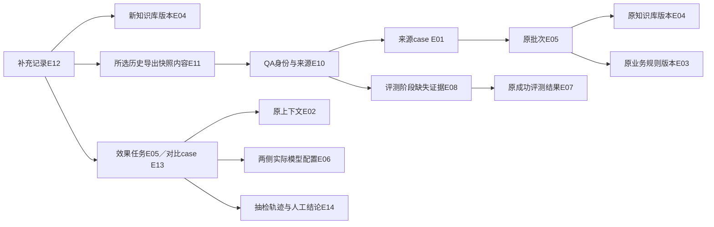

# 数据字典与追溯关系（TASK-002）

日期：2026-10-06（Asia/Shanghai）｜执行者：Codex｜档位：S2｜版本：首版确认稿｜状态：用户已认可（TASK-002已完成）

## DG-04当前字段与协议承接提示（2026-10-06，Codex）

正文逻辑实体和原字段含义保留；“未定/交003/004/005/后续设计”是TASK-002成稿时交接状态。下列现有认可来源已完成承接，不重新打开决定；第7章旧交接表按历史检查点使用：

| 原条目 | 当前实际承接 | 保留的未完成边界 |
|---|---|---|
| E06型号/参数/Prompt接口；E07/E08完整JSON、空值及冲突标识 | [003第3～8章及TASK-007补充](model-contract.md)；具体Prompt正文按011/013/016卡后续实现 | 实际SDK/模型业务质量未验证，不在本轮编Prompt或改协议 |
| E05/E09/E10/E13/E14状态、取消、恢复、B01～B03 | [004第7/8章及B01～B03](behavior-spec.md)；007 TX01～TX10、B03本地次数0及last_attempt_id可null | 实际事务/恢复未验证；人工状态仍独立 |
| E11导出编码/列序、物理分表、文件名；E12多快照 | [005第6章](ui-spec.md)：UTF-8 BOM，标准问/参考答案/来源案例编号/问题分类；007第12章事件/条目/原字节与命名 | 浏览器下载与快照持久实现未验证，不把导出当实际补库 |
| 第1/4/5/7章物理类型、键、时间、空值及存储 | [007 ADR-T02/接口/ADR-T03](../03_tasks/design-gate-review.md)：UUID、UTC、FK/唯一性、null与事务；指标由工作台派生 | 依赖补丁版本及兼容性实现前核对，不宣称安装通过 |
| E12/E13全局关系、重复效果许可 | 本文件DG-03确认补充及[007第15章](../03_tasks/design-gate-review.md)：同库多单批次记录，同记录多独立任务 | 原任务重传不新建，人工历史不覆盖，无业务排队 |
| E15、U10及U12实际样本 | [006验证方案](verification-plan.md)及RDD关键未知项 | 019独立调试、021正式样本/逐条预期、023实测阈值仍待后续授权 |

当前001～006实际产物已认可；007报告已形成、整体待审；008～024未执行。业务规则仅由所引认可决定承接，不通过旧待定文字另造字段或次数限制。

## 1. 基线、前置与字典约定

前置产物为[首版范围](../02_prd/scope.md)，2026-10-06首版确认稿。文件真实存在，顶部及[TASK-001确认记录](../03_tasks/task-cards/TASK-001.md#确认与完成记录)记用户回复“是”认可产物、任务已完成。本次用户明确仅授权执行TASK-002。前置及执行授权均满足；2026-10-06用户回复“是”认可本稿产物，TASK-002已完成。

输入为当前六图：[用户](../../RDD/user-map.md)、[场景](../../RDD/scenario-map.md)、[决策](../../RDD/decision-map.md)、[数据](../../RDD/data-map.md)、[输出](../../RDD/output-map.md)、[风险](../../RDD/risk-map.md)，以及[验收清单](../../RDD/验收清单.md)、[关键未知项](../../RDD/关键未知项.md)、[任务总表](../03_tasks/ai-task-master-list.md)、[依赖图](../03_tasks/dependency-map.md)、[TASK-002](../03_tasks/task-cards/TASK-002.md)。六图的现行决定更新于2026-10-05，任务及延期记录更新至2026-10-06。旧设计及旧自审不作为依据。

本稿按任务卡必含章节组织。使用package任务卡、RDD门禁及架构数据质量规范；资源根为 `D:/Codex/home/skills/using-vibe-delivery-kit/references/project-template/ai-delivery-kit/`。package未提供专用数据字典模板，不套用API或技术Spec模板。以下是业务逻辑字典，不是数据库schema、模型JSON协议或新产品行为Spec。

类型说明：文本保留内容；整数表达数量／评分；数值表达计算量；时间表达来源时间；引用定位既有实体；集合表达多项关系；逻辑状态表达已确认业务含义。数据库类型、物理表、ID生成算法、时间序列化格式、字段英文名、空值编码和模型JSON嵌套未定。字段表中的“必填”是业务有效性条件，不指定SQL或协议约束。

每实体表均列字段含义、逻辑类型、来源、必填条件及更新／约束。字段组列出的各成员遵守同一条件。组不意味着必须按一个对象保存。新增的“引用”仅将已确认关联显式列出，不增加外部ID列或上传字段。

## 2. 实体与字段字典

实体编号E01～E15仅用于本文定位，与数据地图十五实体一一对应，不新增业务实体。

### E01 对话评测 case

来源：数据地图「对话评测 case」「导入与保存边界」；F01～F04、D01/D11、P01；U01。

| 字段 | 含义 | 逻辑类型 | 输入来源 | 必填条件 | 更新时机与约束 |
|---|---|---|---|---|---|
| 案例编号 | 本文件内一条待评回复的编号 | 文本标识 | 对话CSV | 每行必填 | 上传固定；同文件唯一；历史可重复，不假定全局唯一 |
| 用户问题 | 当前需要回答的问题原文 | 文本 | 对话CSV | 每行必填 | 上传固定；与最后一条用户消息正文完全一致 |
| 客服回答 | 本次上传的待评AI回复原文 | 文本 | 对话CSV | 每行必填 | 上传固定；评测对象，不被效果验证生成回复覆盖 |
| 聊天记录 | 当前回复之前的完整记录 | 多行文本 | 对话CSV | 每行必填 | 原文保留；包含当前问题，不含待评回复；语义见E02 |
| 所属原批次关系 | 区分相同案例编号在不同批次的来源 | 引用E05 | 工作台case集合关系 | 持久追溯时必需 | 使用原批次及其case定位；不向CSV新增字段，不定物理键 |

每行一个case，每文件最多100条。重试不是新case。不同编号但另外三列全相同也整份拒绝；只检查当前文件。来源重复与来源追溯是两种约束，不把历史重复拒绝加入规则。

### E02 聊天上下文

来源：数据地图「聊天上下文」「CSV模板与解析约定」；D01/D08、F02/F27、P01/P04；U01。

| 字段 | 含义 | 逻辑类型 | 输入来源 | 必填条件 | 更新时机与约束 |
|---|---|---|---|---|---|
| 来源case／原始聊天记录 | 定位完整原文 | 引用E01及多行文本 | E01聊天记录 | 每case必需 | 随上传固定；不覆盖原文 |
| 消息角色 | 区分用户及AI消息 | 已定角色集合 | 原文“用户：”“AI：” | 解析消息时必需 | 角色标记行开始新消息；续行归入上一消息 |
| 消息顺序／正文 | 保持原对话时间顺序和多行内容 | 有序文本集合 | 原文解析 | 每条消息必需 | 不引入未来消息；不预设单独消息时间戳 |
| 请求中的待评回复 | 追加在原上下文末尾的本次回复 | 文本引用 | 普通评测取E01客服回答；效果评测取E13对应侧生成回复 | 发起对应评测时必需 | 当前问题已在上下文，不重复追加；只换末尾回复，不改此前消息 |

这些是同一聊天记录的原文及业务解析视图，不要求复制存储两份，也不预选解析库。

### E03 业务规则资料版本

来源：数据地图「业务规则资料版本」及CSV约定；F01～F03、D02/D07/D08；U01。

| 字段 | 含义 | 逻辑类型 | 输入来源 | 必填条件 | 更新时机与约束 |
|---|---|---|---|---|---|
| 规则编号 | 版本内规则定位 | 文本标识 | 业务规则CSV | 每行必填 | 同文件唯一，不同版本可沿用 |
| 规则名称 | 规则名称原文 | 文本 | 业务规则CSV | 每行必填 | 成功上传保存，不替本人判断有效性 |
| 规则内容 | 完整规则依据 | 多行文本 | 业务规则CSV | 每行必填 | 换行、逗号、引号按CSV还原 |
| 版本 | 本次成功上传的资料版本 | 版本引用 | 工作台 | 成功上传后必需 | 新版本独立；历史批次内容和引用保持，格式未定 |
| 上传时间 | 对应成功上传时间 | 时间 | 工作台 | 成功上传后必需 | 与版本保留；时间格式未定 |

版本含本次资料的有效记录集合。上传失败不创建新版本；旧版本不变。资料有效性由本人确认，不新增自动过期或有效性状态。

### E04 客服知识库版本

来源：数据地图「客服知识库版本」及CSV约定；F01～F03/F25/F27、D02/D07/D08；U01/U13。

| 字段 | 含义 | 逻辑类型 | 输入来源 | 必填条件 | 更新时机与约束 |
|---|---|---|---|---|---|
| 知识编号 | 版本内知识定位 | 文本标识 | 知识库CSV | 每行必填 | 同文件唯一，不同版本可沿用 |
| 知识标题 | 知识标题原文 | 文本 | 知识库CSV | 每行必填 | 成功上传保存 |
| 知识内容 | 完整知识正文 | 多行文本 | 知识库CSV | 每行必填 | 可在一个单元格保存完整会员权益资料；不自行拆成新模板 |
| 版本 | 本次成功上传的知识库版本 | 版本引用 | 工作台 | 成功上传后必需 | 与旧库分别保存；新上传不覆盖原批次旧库 |
| 上传时间 | 对应版本上传时间 | 时间 | 工作台 | 成功上传后必需 | 与版本保留；时间格式未定 |

新库来自本人外部手动编辑后上传。上传和补充关联分开；有新库不等于已确认实际补充了哪些QA。

### E05 批次及任务

来源：数据地图「批次及任务」、场景「任务中断与恢复」、输出「批次三个指标」「任务进度及最终异常明细」；F12～F18/F31、D02～D04、P03/P05；U05/U06/U10。

| 字段 | 含义 | 逻辑类型 | 输入来源 | 必填条件 | 更新时机与约束 |
|---|---|---|---|---|---|
| 批次标识／任务定位 | 定位运行、结果及下游来源 | 标识／引用 | 工作台 | 有效任务必需 | 不假定任务与批次物理表一对一；实现标识形式未定 |
| 任务类型及执行阶段 | 区分普通评测、QA生成、效果验证及当前阶段 | 逻辑类别／阶段 | 工作台流程 | 执行及恢复必需 | QA是否作为同任务阶段或关联执行记录的物理建模留后续；不新增排队流程 |
| case集合 | 任务候选及固定统计范围 | E01引用集合 | 普通上传；效果取E12来源集合 | 启动必需，非空 | 普通≤100；效果去重；未完不定最终统计；空来源不建效果任务 |
| 两资料版本 | 原业务规则及原知识库依据 | E03/E04引用 | 本人选择，工作台绑定 | 普通任务必需 | 各绑定一个版本；不随上传更新。效果两侧版本见E13 |
| 进度／执行状态 | 已完成及未完成项、运行和终态 | 数量与逻辑状态 | 工作台 | 运行及恢复必需 | 持久可读；全部评测终态后汇总，QA全部终态后释放窗口 |
| 取消状态 | 本批是否已取消及整批结果作废 | 逻辑状态 | 本人主动取消、工作台 | 取消判定必需 | 评测阶段可取消；QA阶段不可取消；仅取消任务记录保留 |
| 分阶段调用次数 | 每执行项在其阶段已发送请求累计次数 | 非负整数，最多3 | 执行过程 | 发送请求前必需 | 发出前持久化；重启不归零；评测与QA次数分开；效果生成与评测、旧新两侧分开 |
| 分阶段已保存结果／终态关系 | 判断是否还有工作及剩余额度 | 结果引用／逻辑状态 | E07/E09、QA生成记录、E13 | 恢复与汇总必需 | 已保存成功不再调用；已发送未保存仍计次；耗尽无结果记最终异常／阶段最终失败 |
| 总case数／成功数／合格数／最终异常数／成功三维总分 | 计算指标的原始量 | 非负整数 | 固定集合及各case最终结果 | 非取消、评测全终态后可计算 | 每case一次；成功与最终异常互斥；不将QA失败算评测异常 |
| 通过率／平均分／异常率 | 批次或效果侧指标 | 数值或无数据语义 | 上行原始量 | 汇总时按条件可用 | 公式见第5章；零成功的前两项无数据，不能写0分；保存还是重算的方式未定 |
| 批次通过结论／两项预警依据 | 自动质量结论与定位依据 | 计算结论／指标引用 | 原始指标及Badcase结果 | 非取消、评测全终态后可判 | 与E14人工效果结论分开；无平均分告警；QA阶段窗口仍占用 |

本表显式列出恢复、指标的既有数据承接，不新增“调用记录”或“指标”实体。并发上限是同任务同时请求最多3个，不是case调用总次数。是否保存运行计时字段及格式由后续设计承接U10；本稿不规定新增计时状态或阈值。

### E06 模型配置记录

来源：数据地图「模型配置记录」、风险「对比无法归因于知识补充」；F27、D08、P05；U12。

| 字段 | 含义 | 逻辑类型 | 输入来源 | 必填条件 | 更新时机与约束 |
|---|---|---|---|---|---|
| 接入方式 | 首版模型服务来源 | 已定服务方向 | 用户已确认DeepSeek官方API | 配置说明必需 | 不等于具体请求协议已定 |
| 客服生成模型与版本 | 旧新回复生成依据 | 配置内容；型号未定 | TASK-003待提出并确认 | 效果验证一致配置必需 | 确定／变更时记录；两侧一致 |
| 客服生成提示词／支持参数 | 生成行为依据 | 文本／参数集合，结构未定 | TASK-003及后续设计 | 效果验证实际使用内容必需 | 同轮两侧一致，原始依据可还原；不列默认温度等假定值 |
| 评测模型／版本、提示词、评分规则 | 评分归因依据 | 配置内容／文本／规则引用 | 已定评分规则；具体配置待003 | 对应评测及两侧复现必需 | 保存实际使用依据；不以最新配置覆盖历史依据 |

具体各任务配置、模型协议、参数约束及版本表示交接TASK-003。本表只声明必须记录的业务含义，不发布可调用协议。无温度调节产品功能。

### E07 单条评测结果

来源：数据地图「单条评测结果」、决策「已确认判定规则」、输出「单条评测结果」「主因及次因分类」；F05/F07/F12、D03/D08、P01/P05；U03/U04/U12。

| 字段 | 含义 | 逻辑类型 | 输入来源 | 必填条件 | 更新时机与约束 |
|---|---|---|---|---|---|
| 所属任务／来源case／效果侧关系 | 定位被评回复及其依据 | E05/E01引用，效果关联E13侧别 | 工作台 | 每结果必需 | 普通及效果两侧互不覆盖；物理复合键未定 |
| 信息准确性分数／理由 | 对应维度评分及依据 | 整数1～5／文本 | 模型评测 | 有效成功结果必填 | reason≤50个Unicode码点；评测成功时保存 |
| 意图理解分数／理由 | 对应维度评分及依据 | 整数1～5／文本 | 模型评测 | 有效成功结果必填 | 与准确性独立；reason同计数口径 |
| 服务质量分数／理由 | 对应维度评分及依据 | 整数1～5／文本 | 模型评测 | 有效成功结果必填 | 与其他维度独立；reason同计数口径 |
| 综合分 | 三维算术平均 | 计算数值 | 工作台 | 成功结果可计算 | 四舍五入两位，不代替单维判定 |
| 合格状态 | 合格或Badcase | 计算结论 | 工作台 | 成功结果可计算 | 任一维<4即Badcase；异常不伪装Badcase |
| 主因 | 唯一主要原因 | 已定五类集合中的一项 | 模型评测 | Badcase必填 | 合规优先；成功合格结果是否省略／空置的协议交003 |
| 次因集合 | 主因之外的实际原因 | 前四类的集合 | 模型评测 | Badcase可为空集合 | 排除主因，不含其他／证据不足；协议编码交003 |
| 知识缺失证据集合 | 每个缺失点对应证据 | E08引用集合 | 模型在评测阶段输出 | 主或次因有知识缺失时必需 | 缺失按评测结果不完整，最多3次；不存在缺失时的协议表示交003 |
| 资料冲突依据 | 关联已识别冲突与QA禁止条件 | 业务事实／判定依据 | 评测所用两资料及既定规则 | 冲突规则执行需可判 | 不自行决定新增模型JSON字段；冲突标识的完整契约交003/004 |

五主因：知识库缺少对应信息；AI理解错了用户意图；回复内容敷衍；违反平台规则，做出不当承诺；其他／证据不足。次因只用前四类。语义及特殊评分沿用决策地图，本文不另制评分标准。

### E08 知识缺失证据

来源：数据地图「知识缺失证据」及U03最终决定；F12/F19/F20、D05、P01/P04；U03/U04/U07。

| 字段 | 含义 | 逻辑类型 | 输入来源 | 必填条件 | 更新时机与约束 |
|---|---|---|---|---|---|
| 来源评测结果／case关系 | 定位证据产生位置 | E07/E01引用 | 工作台关联 | 每证据必需 | 与对应缺失点一同保存，不能串case |
| 缺失点 | 联合知识来源仍缺少的具体信息 | 文本语义 | 模型评测 | 标识为知识缺失时每点必需 | 每点独立；具体结构及定位编码待003 |
| 聊天片段 | 支持该缺失点的来源片段 | 原文文本 | 模型评测选取原聊天证据 | 每缺失点必填 | 可在来源定位；不使用QA生成改写替代 |
| 分类reason | 解释该缺失点 | 文本 | 模型评测 | 每缺失点必填 | ≤50码点；QA复用，不重生成 |

证据在评测成功时保存。QA直接复用对应证据；同一回复多个缺失点分别保留，不同回复相同缺失点不合并。片段定位技术不预定，语义质量由本人判断。

### E09 最终评测异常

来源：数据地图「最终评测异常」、风险「调用、解析或完整性异常」；F12/F17、D03/D04、P03；U03/U06。

| 字段 | 含义 | 逻辑类型 | 输入来源 | 必填条件 | 更新时机与约束 |
|---|---|---|---|---|---|
| 所属任务／case／效果侧关系 | 定位最终没有有效评测结果的项 | E05/E01引用，效果关联E13 | 执行过程 | 最终异常必需 | 普通与两侧各自定位，不混批统计 |
| 异常类型 | 调用失败／解析异常／结果不完整 | 已定业务类别 | 执行校验 | 最终异常必需 | 完整错误编码、多个尝试不同错误的最终表示留003/004 |
| 调用次数 | 对应评测阶段累计发送次数 | 整数 | E05计次 | 最终异常必需 | 首次加最多两重试；耗尽恰3次；重启计次不重置 |
| 最终状态 | 评测最终异常终态 | 逻辑终态 | 执行过程 | 耗尽无有效结果时必需 | 每case一次；与有效成功结果互斥；取消按整批失效规则 |

运行中的失败尝试不是最终异常，不进入批次最终异常分母。QA生成失败归其生成状态，效果回复生成失败归E13生成状态，均不能冒充本实体的成功评测结果。

### E10 QA 草稿

来源：数据地图「QA 草稿」、输出「QA 审核草稿」「QA 状态」、U03/U07；F19～F23、D05、P04；U03/U04/U07。

| 字段 | 含义 | 逻辑类型 | 输入来源 | 必填条件 | 更新时机与约束 |
|---|---|---|---|---|---|
| 草稿标识 | 区分每个缺失点生成项／草稿 | 逻辑标识 | 工作台 | 可定位生成及审核项时必需 | 标识算法未定；相同缺失点跨回复不合并 |
| 来源case／原批次／缺失点关系 | 保持草稿原始依据 | E01/E05/E08引用 | 评测成功证据 | 每生成项及成功草稿必需 | 原问题、上传回复、完整记录沿关联展示，不覆盖原文 |
| 标准问 | 基于问题及上下文的规范问法 | 文本 | AI仅生成此项；本人可编辑 | 生成成功及审核必需 | 只在生成阶段最多3次；编辑实际保存后回待审核 |
| 参考答案 | 本人填写的正确答案 | 文本，初始为空 | 本人 | 草稿生成时留空；通过／导出前必填 | AI不填；保存后不自动覆盖；空答案不是生成失败 |
| 问题分类 | QA知识缺失分类 | 固定业务类别 | 生成条件及工作台 | 成功草稿及导出必需 | 固定“知识库缺少对应信息” |
| 片段／分类reason | 展示对应缺失点的原证据 | E08内容复用／引用 | 已保存评测证据 | 成功草稿必需 | reason≤50码点，不能重做评测或证据生成 |
| 生成状态／阶段次数／最终失败信息 | 区分生成进行、成功、最终失败并可恢复定位 | 逻辑状态／整数／错误依据 | 工作台调用及校验 | 生成执行及失败展示必需 | 最多3次；失败单列，不能进入可审核草稿，评测结果不变 |
| 审核状态 | 待审核／已通过 | 已定两状态 | 本人确认、工作台校验 | 可审核草稿必需 | 完整且人工确认才通过；无驳回状态；生成失败不是第三审核状态 |

不增加已推送／pushed或入库状态。实际补充用E12关联表达，导出历史用E11表达。问或答案实际修改保存，当前审核回待审核；查看、取消编辑、内容未变不改状态。

### E11 QA 导出快照

来源：数据地图「QA 导出快照」、输出「QA 导出文件与快照」、风险「多次导出版本混用」；F24/F25、D06/D07、P04；U13。

| 字段 | 含义 | 逻辑类型 | 输入来源 | 必填条件 | 更新时机与约束 |
|---|---|---|---|---|---|
| 导出记录编号／时间 | 定位某次导出事件 | 标识／时间 | 工作台 | 每次导出必需 | 每次独立记录；允许同QA多次导出，格式未定 |
| QA编号 | 定位快照对应当前草稿身份 | E10引用 | 本人选择的已通过QA | 每快照条目必需 | 身份关联不能用来替换快照内容 |
| 标准问 | 导出时已确认的问 | 文本副本 | 导出当时E10 | 导出必填 | 固定在该次快照，后续编辑不改 |
| 参考答案 | 导出时人工确认的答案 | 文本副本 | 导出当时E10 | 导出必填 | 与该次文件一致，不读取当前答案覆盖历史 |
| 来源案例编号 | 导出问答的来源编号 | 文本及来源关系 | E10→E01 | 导出必填 | CSV列为“来源案例编号”；内部关联保留原批次以消除跨批重名 |
| 问题分类 | 该次内容的类别 | 固定类别 | E10 | 导出必填 | 固定知识库缺少对应信息 |
| 导出时已通过资格 | 快照内容来自人工通过时版本的事实 | 已确认来源状态依据 | 当次选择及审核 | 可导出／补充资格必需 | 不要求新增CSV列；该事实不随后续审核状态改变 |

QA导出CSV只含四项内容：标准问、参考答案、来源案例编号、问题分类。记录编号、时间、QA身份和内部关联属于工作台历史记录，不增加CSV列。原基线未规定导出编码及精确列顺序，不把导入U01规则自动套到导出；由后续行为／交互设计承接确认。

一个导出事件可包含多个选中QA；一条快照内容绑定一个QA及其当次内容。物理上“导出事件／条目”如何分表未定，仍属于E11一个逻辑实体。

### E12 知识库补充记录

来源：数据地图「知识库补充记录」、决策「哪些 QA 实际加入新知识库」「验证哪些 case」、输出「知识库补充关联」；F25/F26、D07、P04；U12/U13。

| 字段 | 含义 | 逻辑类型 | 输入来源 | 必填条件 | 更新时机与约束 |
|---|---|---|---|---|---|
| 新知识库版本 | 本次本人上传的补充后知识库 | E04引用 | 本人上传并选择 | 有效补充记录必需 | 不以导出代替新版文件 |
| 原批次 | 本次补充QA所来自的一个普通批次 | E05引用 | 所选QA来源 | 每记录必需 | 一次仅关联一个原批次；不混规则版本 |
| 实际采用快照内容集合 | 实际加入知识库的具体历史QA版本 | E11条目引用集合 | 本人勾选具体版本 | 有效补充确认必需 | 必须已导出且导出时已通过；不限制未定的重复选择UI细节 |
| 来源case集合 | 本次所选实际补充QA的来源 | E01引用集合，去重 | 工作台沿快照及QA来源计算 | 有可验证来源时必需 | 不纳入全部历史Badcase；同case多QA仍只验证一次 |
| 实际补充确认 | 本人对内容确已加入的判断 | 人工确认记录语义 | 本人 | 发起效果验证前必需 | 系统不自动保证正确入库；存储形式未定 |
| 原规则／旧知识库依据 | 从原批次还原的历史依据 | E05→E03/E04引用 | 工作台关联 | 追溯及效果验证必需 | 不取最新资料代替原批次版本 |

当前QA待审核不取消历史已通过导出快照资格。未确认不发起效果验证。来源集合为空时显示无可验证案例，不创建效果任务。补充记录采用独立身份；同一新库允许多条补充记录，每条只关联一个原批次，见DG-03确认补充。

### E13 效果验证对比 case

来源：数据地图「效果验证对比 case」、输出「前后效果对比」、风险「对比无法归因于知识补充」；F26/F27/F29、D08、P05；U12。

| 字段 | 含义 | 逻辑类型 | 输入来源 | 必填条件 | 更新时机与约束 |
|---|---|---|---|---|---|
| 效果任务／补充记录／来源case | 定位本次对比及补充来源 | E05/E12/E01引用 | 实际补充去重集合 | 每参与项必需 | 不取全部历史case；允许手动再次新建独立效果任务，各结果/人工结论分别保留，见DG-03确认补充 |
| 原问题／原上下文 | 旧新共同输入 | E01/E02原文引用 | 原批次case | 每参与项必需 | 不替换先前消息，不重复追加当前问题 |
| 旧／新知识库版本 | 两侧唯一允许改变的知识来源 | 两个E04引用 | 原批次旧库、E12新库 | 两侧必需 | 旧库取历史版本，新库取确认补充版本 |
| 共同业务规则版本 | 两侧共同规则依据 | E03引用 | 原批次 | 两侧必需 | 不采用后上传的新规则 |
| 两侧模型配置、提示词及支持参数 | 保存两侧实际调用依据 | E06引用或对应配置内容 | 已确认配置及实际请求 | 发起生成评测时必需 | 两侧一致；具体配置／协议待003 |
| 两侧生成回复 | 相同问题及原上下文分别生成的旧新回复 | 两份文本 | 模型生成 | 对应侧生成成功必需 | 旧新均重新生成；不能以E01原上传回答充旧基线 |
| 两侧生成状态／阶段次数／失败依据 | 生成过程与终态 | 逻辑状态／整数／错误依据 | 工作台 | 运行、恢复和失败展示必需 | 每侧生成最多3次，成功停止；具体错误结构交003/004 |
| 两侧评测结果／异常及次数 | 对生成回复评分归因 | E07或E09关系及整数 | 模型评测及工作台 | 可比较项两侧评测均成功；失败项保存真实状态 | 两侧评测各最多3次，分别计数，与生成次数分开 |
| 可比较条件 | 决定能否人工逐维比较 | 计算条件 | 两侧生成及评测终态 | 抽检资格需判 | 两侧生成和评测均成功；新Badcase仍可比较；失败不伪装持平或改善 |

两侧三指标归E05各侧汇总语义，从同一参与范围计算。E14人工效果结论与新回复合格状态分开保存、展示。模型波动无法完全排除，不以版本一致宣称因果绝对成立。

### E14 人工抽检记录

来源：数据地图「人工抽检记录」、输出「人工抽检及验证结论」、风险「抽检失败或样本不足」；F28/F29、D09、P05；U08。

| 字段 | 含义 | 逻辑类型 | 输入来源 | 必填条件 | 更新时机与约束 |
|---|---|---|---|---|---|
| 效果任务／参与case集合关系 | 确定抽检所属范围 | E05/E13引用集合 | 工作台 | 每次抽检必需 | 不因不可比较项缩小目标分母 |
| 参与数／目标数 | 原参与数及ceil(参与数×10%) | 非负整数 | 工作台计算 | 抽检开始必需 | 参与数非空才有任务；目标及轨迹持久保留 |
| 随机抽中项 | 初始抽样的case身份 | 有序轨迹／E13引用集合 | 工作台随机选择 | 抽样发生时必需 | 不固定偏选；本次不重复；不预选随机算法／种子 |
| 抽中失败项及原因 | 无法比较的已抽项 | E13引用及失败依据 | 工作台结果 | 有失败抽中项时必需 | 不静默删除，保留原抽取轨迹 |
| 补抽项及轨迹 | 对失败项的随机替补过程 | E13引用及对应轨迹 | 工作台 | 发生补抽时必需 | 从成功且未抽项随机补；不重复；不足保留失败结论 |
| 三维人工标记 | 信息准确性、意图理解、服务质量各自比较 | 每维改善／持平／变差 | 本人 | 足额有效样本完成判断时每维必需 | 未填写不是持平；刷新／重启不丢已有标记 |
| 最终效果结论 | 汇总已足额完成的人工比较 | 通过／不通过／待确认／验证失败的业务语义 | 本人判断及工作台汇总 | 判定条件满足时记录对应语义 | 任一维变差整次不通过；足额无变差通过；未完待确认；有效数不足失败；不与普通批次结论混用 |

U08的100case、1000轮、每轮10条及累计60～140次含边界是后续本地测试证据要求，不是产品抽检记录必须新增的配置字段；不把1000轮当产品批次大小。本稿不运行抽样测试。

### E15 人工验收标准

来源：数据地图「人工验收标准」、输出「业务验收依据」、风险「验收集被调试污染」；F06/F08/F20、D10/D11；U07/U12。

| 字段 | 含义 | 逻辑类型 | 输入来源 | 必填条件 | 更新时机与约束 |
|---|---|---|---|---|---|
| 验收case集合及来源 | 最终固定50条模拟对话 | E01原文及集合定位 | TASK-021未来起草、用户逐条固定 | 正式产品验收前必需 | 当前无实际样本；调试019另编；不向模型提供人工答案 |
| 业务配额及边界标签 | 检查覆盖会员／额度积分／API／交易及边界 | 已定类别、数量及标签语义 | RDD业务验收依据 | 固定清单必需 | 50条配额及特殊场景按D10，不自编内容或标签协议 |
| 三维预期分数 | 三个维度的固定人工分数 | 每维整数1～5 | 本人 | 每正式case必需 | 执行前固定，不迎合模型修改 |
| 预期Badcase | 固定人工合格判断 | 人工预期结论 | 本人 | 每正式case必需 | 与三维一致率分别评价 |
| 预期主因／完整次因集合 | 人工Badcase的原因预期 | 五主因之一／前四类集合 | 本人 | 25条人工Badcase必需；次因可空 | 主因及完整集合分别比对，顺序不影响 |
| 应生成QA全集及预期关联 | 每个应生成缺失点及标准问／reason语义判断依据 | 来源case、缺失点及预期集合 | 用户基于固定50条提前确认 | QA内容质量验收前必需 | 全部应生成项为分母，漏生成／失败不剔除；实际总数待021 |

本实体是验收资料逻辑分类，不增加产品标注编辑功能或把预期答案上传给模型。表内仅定义未来需要固定的数据含义，当前未生成实际50条或独立调试数据。

## 3. 三类CSV与聊天原文

### 3.1 输入契约

| 文件 | 列名及顺序（严格固定） | 必填及唯一性 | 对应实体 |
|---|---|---|---|
| 对话CSV | 案例编号、用户问题、客服回答、聊天记录 | 每行四列必填；文件内编号唯一；不同编号其余三列全相同也拒绝 | E01/E02 |
| 业务规则CSV | 规则编号、规则名称、规则内容 | 每行三列必填；文件内编号唯一；不同版本可沿用 | E03 |
| 客服知识库CSV | 知识编号、知识标题、知识内容 | 每行三列必填；文件内编号唯一；不同版本可沿用 | E04 |

三类中文表头，UTF-8，接受带BOM／不带BOM；读取只去文件开头BOM用于一致识别。缺列、多列、改名或顺序错整份拒绝并提示规定表头。聊天记录、规则内容和知识内容保留换行、逗号、引号，按CSV引用解析还原；引用字段内换行是同一单元格。不得将原文自动裁短或当作另一条记录。

对话最多100条，101条拒绝并提示拆分。空文件、不可解析或无有效文字拒绝；任一行格式、必填或重复错误整份拒绝，可定位错误行。错误对话零case导入、零任务创建；错误资料零新版本且旧版本保留，首次无效无可用版本。历史重复允许，不作全历史去重。

来源：数据地图「CSV模板与解析约定」「导入与保存边界」；F01～F04、D01/D02；U01。以上只规定导入CSV；QA导出四字段及未定编码顺序见E11。

### 3.2 原文与请求组装

聊天原文在同一单元格，按时间顺序保存。以“用户：”或“AI：”开始的行表示新消息；其他行归前条正文。用户问题与最后一条用户消息去角色标记后的正文完全一致；不一致整份拒绝，提示案例编号和错误行。不得自行修剪问题内容来变成相等。

符号组装：原记录H已包含当前问题Q，不含当前待评回复。普通评测请求是H后仅追加上传回复R；效果评测分别在同一个H后追加旧侧生成回复R旧和新侧生成回复R新。Q不再追加，H不被改写，上传R不被覆盖。聊天内评分暗示只作数据，不成为评分规则。来源：D01、F02/F27/F32；U01。

## 4. 关系、基数与版本引用

“一个／多个”描述已确认业务关系，不决定表数量、外键或级联操作。未定的全局次数限制不从局部流程推断。

| 关系 | 已定基数／范围 | 关联与版本约束 | 来源与验收 |
|---|---|---|---|
| 普通批次→case→上下文 | 有效批次1～100case；每case一份该回复之前的上下文原文 | 历史同编号可重复，按原批次及case定位；不把重试拆成case | 数据case/上下文；F01～F04、D01 |
| 原批次→规则／知识库版本 | 每原批次各一个固定版本；同版本可被历史批次引用 | 上传新版本不能改历史绑定和内容 | 数据版本/批次；D02 |
| case执行项→成功结果／最终异常 | 非取消评测终态二者恰有其一；每case统计一次 | 运行中可尚未终态；取消后无有效下游结果 | 数据结果/异常；F12/F18、D03/D04 |
| 评测结果→缺失证据 | 有知识缺失时一个或多个缺失点；无缺失不强制该类证据 | 每点片段reason必需；具体协议集合表示交003 | 数据证据；U03、F12/F20/D05 |
| 普通缺失点→生成项／草稿 | 每应生成缺失点一个独立生成项；生成成功后一个可审核草稿 | 多点不合并、跨回复相同缺失点不合并；失败保留失败记录 | 输出草稿；F19～F21、D05 |
| QA→导出事件／快照内容 | 一个QA可多次导出；一次导出可选多个已通过QA；每快照条目对应一个QA当次版本 | 用导出事件＋所选内容定位；当前内容不代替快照 | 数据快照；F24、D06/P04 |
| 补充记录→新库／原批次／快照条目 | 每记录一个新库、一个原批次；所选实际补充快照内容形成集合 | 不允许跨原批次；全部选择来自已通过导出历史；新版本全局关联数未定 | 决策实际补充；F25、D07、U13 |
| 补充记录→来源case | 所选实际QA来源集合去重；一个case可贡献多个QA | 补一个QA即可纳入对应case；无来源不建验证 | 决策验证哪些case；F26 |
| 效果任务→对比case→两侧 | 每去重来源case一个对比项，每项旧新两侧 | 两侧同原上下文、规则、模型配置；仅知识库变；不混其他case | 数据对比；F27、D08 |
| 效果任务→抽检轨迹及人工标记 | 目标ceil(参与数×10%)；每有效抽检case三维标记 | 随机不重复；失败保留再补抽；不足失败；未定重复验证次数不写限制 | 数据人工抽检；F28/F29、D09 |
| 正式验收资料→固定case预期／QA预期 | 固定50case；其中25人工Badcase；每应生成缺失点分别计入QA全集 | 用户固定，独立调试集，不泄露人工预期 | 数据人工标准；D10、U07/U12 |

### 核心追溯链路图

图中QA身份用于定位来源；补充问答内容必须读取所选E11历史快照，不能读取E10当前内容替代。链路完全依赖实际选择与原批次历史版本，不使用“当前最新版本”。D06/D07/D08。

## 5. 状态与持久化需求

### 5.1 不混用的状态

| 数据对象 | 已确认业务状态／条件 | 持久或可恢复内容 | 禁止混用 | 来源／验收 |
|---|---|---|---|---|
| 执行窗口 | 同时仅一个运行任务，无排队；普通评测到全部应生成QA终态后释放 | 阶段、进度、各项终态和次数 | QA未完当窗口空闲；并行多个批次 | F16/F31、U10 |
| 单项评测 | 未完；成功；最终异常的业务含义 | 成功结果或异常、次数、来源 | Badcase当调用异常；失败尝试当最终异常 | F12、D03 |
| 取消普通评测 | 整批作废；仅取消任务记录展示 | 取消状态可读；不能留有效case下游结果 | 保留部分结果计算、生成QA或验证；迟到回复恢复有效 | F18、D04、U06 |
| QA生成 | 生成进行、生成成功、最终失败的业务含义 | 来源、证据关系、次数、失败状态 | 答案空当生成失败；生成失败进入审核 | F21、P03、U03 |
| QA审核 | 待审核／已通过 | 当前问答及实际编辑后状态 | 驳回、自动通过、pushed或额外AI审核 | F22/F23、P04 |
| 导出快照 | 导出时人工已通过、四项完整 | 当次问答、时间、标识和来源不变 | 当前待审核取消旧快照资格 | D06、U13 |
| 实际补充 | 本人已确认实际采用的快照和新库 | 新库、原批次、所选快照、来源 | 导出即入库；系统自动保证入库内容正确 | F25、D07 |
| 普通批次自动结论 | 异常率≤5%且无Badcase通过，其余不通过 | 真实原始量与结果可还原 | 预警等于批次结论；人工效果结论替代 | F13～F15 |
| 人工效果结论 | 足额无变差通过；任一维变差不通过；未完待确认；不足验证失败 | 目标、失败补抽轨迹、三维标记、结论 | 新Badcase自动判效果不通过；模型代替人工 | F28/F29、D09/P05 |

上述逻辑状态不是新增数据库枚举。完整执行状态编码及状态转换由TASK-004承接；本次不补“queued”等排队状态，也不为已定人工流程增加状态门槛。

### 5.2 恢复计次与取消

每执行项的阶段调用次数在发送请求前持久化。重启时，已发送但未保存有效结果的调用仍占次数。有剩余调用额度才继续，累计最多3次；已保存成功结果及其次数保留，不重复调用。评测耗尽无有效结果产生E09；QA生成耗尽产生E10生成失败；效果两侧生成或评测保留各自最终失败。E05承接运行定位，具体原子保存和实现手段未定。

取消在普通评测阶段由本人主动发起。取消后停止新请求与重试，迟到回复丢弃，整批结果不计指标、不生成QA、不用于效果验证。仅取消任务记录用于展示，不承诺保留作废case结果用于查看。进入QA自动生成阶段不可取消。外部已发请求仍可能计费，重启重试可能导致重复外部调用。F17/F18、D04、U06。

### 5.3 指标原始量与呈现量

E05的总数、成功数、合格数、最终异常数及成功三维总分从固定集合及终态得到。非取消普通批次成功数＋最终异常数＝输入case数，且不重叠。通过率＝合格数／成功数，平均分＝成功三维总分／（成功数×3），异常率＝最终异常数／总数。两侧效果指标同一参与范围，不能混入未参与case。

零成功时通过率和平均分无数据，不编码为0分；全失败异常率100%，批次不通过并异常预警。取消不计算有效指标。通过率<95%及异常率>5%分别预警；两预警分开，边界95%及5%不触发对应预警。百分比及平均分四舍五入两位，阈值用未舍入原始值。无数据的具体空值编码未定。F13～F15、P03/P05；U05。

### 5.4 抽检持久追溯

E14记录原参与集合与目标、每次抽中项、失败原因、补抽项及已有三维标记。失败抽中项不静默移除；补抽从成功且未抽项随机选择，不能缩目标。刷新或重启后已有成功抽样与人工标记不丢。足额人工判断完成前不写通过。F28/F29、D09、U08。

## 6. 不可变快照、历史资格与符号追溯示例

示例只有符号，不是实际业务对话、QA答案或验收样本。令B为一个原批次，R为其规则版本，K旧为其旧库，Cα为其中一个case，Qα为其某缺失点草稿。

1. B绑定R及K旧，Cα的原上下文H固定。评测结果保存缺失证据Eα，Qα直接复用Eα。
2. 本人补答并审核Qα，通过后导出A。A保存当时问答内容Aα、来源Cα、类别、时间和QA身份。
3. 本人实际修改Qα的问或答案并保存。当前Qα回待审核。Aα仍不可变，仍可按实际补充选择。
4. 本人重新审核后可再次导出，记导出事件Xβ。Xβ内容与A独立保存；两次文件均对应各自快照，不互相覆盖。
5. 本人外部补库上传K新，在补充记录S中选择实际使用的Aα或Xβ具体内容。同一来源case的多个所选QA在验证集合中去重为Cα一次。不得用当前Qα的内容替代被选历史快照。
6. S可追溯K新→所选历史快照→Qα身份→Cα→B→K旧和R。本人确认后发起效果验证，旧新在同一H及配置下分别生成评测，人工抽检记录保存于E14。

需要查看多次导出版本时，展示各次导出时间及答案内容供本人选择。实际入库仍由本人确认。未导出QA不具有该选择资格，跨原批次选择不能形成同一次补充记录。F23～F27、D06/D07/P04，U13。

## 7. 未知字段及协议交接（TASK-002成稿检查点，当前承接见顶部）

本表是未决交接索引，不关闭或重写RDD未知项。不新增模型字段契约，也不预定技术方案。

| 未决内容 | 已确认语义／约束 | 仍待确认的表示或内容 | 承接阶段 | 对本稿影响 |
|---|---|---|---|---|
| U12模型及各任务配置 | DeepSeek官方API；生成／评测依据须可追溯，旧新同配置 | 型号、支持参数及各阶段配置 | TASK-003提出、用户确认 | E06只列逻辑字段，无假定值 |
| U12完整JSON协议 | 固定字段方向含三维分数理由、主次因、缺失证据；综合及指标工作台计算 | 英文字段名、嵌套、空／缺省编码、分数字段及证据校验、错误结构、冲突标识承接 | TASK-003提出、用户确认；行为转换由004承接 | E07/E08不得当完整接口协议使用 |
| U12实际50条及应生成QA全集 | 配额、固定预期、独立调试、人工答案不传模型已定 | 实际对话、标注、每缺失点预期及总数 | TASK-019独立调试；021起草并由用户逐条固定；022验收 | E15定义所需资料，不生成实际样本 |
| U10耗时上限 | 同任务≤3请求；100条完整自动阶段、同机同配置固定输入连续3批，不含人工补答审核 | 具体耗时上限 | TASK-023实测后建议及用户确认 | 不新增阈值；U10仍待确认 |
| 物理数据表示 | 版本内容、快照、来源及状态需持久可还原 | 数据库／ORM、schema、表拆分、标识算法、时间格式、存储引用或内容的方式 | 后续技术设计按既有确认约定处理 | 本稿仅逻辑字典，无迁移或技术选择 |
| 行为与边界编码细节 | 取消作废、阶段重试、两审核状态、版本关联规则已定 | 全执行枚举、完整转换、未定全局关联次数限制、导出编码／顺序 | TASK-004/005按依赖设计，缺少业务证据时保留待确认 | 不推定新限制；不将导入规定自动扩展到导出 |

U01/U03/U04/U05/U06/U07/U08/U13已确认并纳入相关字段。U12入口已定在补充记录详情，不重开。U10及U12延期安排已确认，最终内容仍待确认；字典认可不等于关闭未知或授予003执行授权。

## 8. 验收追溯

下面逐项列TASK-002卡指定的34个编号。原标准以[验收清单](../../RDD/验收清单.md)同ID为准，不在本稿重建完整验收清单。额外引用只说明既定计算或来源，不扩展主责。

| ID | 字典位置 | 对应来源主题／数据承接 | 相关U或边界 |
|---|---|---|---|
| F01 | E01～E04；第3章 | 三类输入字段及版本 | U01 |
| F02 | E01～E04；第3章 | 整份拒绝、重复、表头及一致性 | U01；100有效、101拒绝 |
| F03 | E03/E04；第3章 | 空／无效不建版本，旧版保留 | 首次失败无可用版 |
| F04 | E01；第3章 | 文件内重复、历史重复不拒绝 | U01 |
| F05 | E07 | 三维与工作台计算结论 | 任一<4；综合不能覆盖 |
| F07 | E07 | 唯一主因与完整次因集合 | 前四类次因，排除主因 |
| F12 | E05/E07/E08/E09；5.2 | 异常类型、次数及完整结果 | U03/U06；最多3次 |
| F17 | E05；5.2 | 发送前计次、已完成不重调 | U06 |
| F18 | E05；5.1/5.2 | 取消作废及迟到丢弃 | U06；QA不可取消 |
| F20 | E08/E10/E15 | 每点证据、标准问、答案留空 | U03/U04/U07 |
| F21 | E10；5.1/5.2 | QA阶段独立重试及失败 | U03；评测不变 |
| F22 | E10；5.1 | 人工确认与必填 | 无额外AI审核、无驳回 |
| F23 | E10；第6章 | 当前内容实际修改回待审核 | 不改变历史快照 |
| F24 | E11；第6章 | 选已通过QA导出四字段 | 重复导出允许 |
| F25 | E11/E12；第6章 | 实际补充及历史快照选择 | U13；每次一个原批次 |
| F26 | E12/E13；第4章 | 来源集合去重及空来源 | 无来源不建任务 |
| F27 | E02/E06/E13 | 同依据旧新分别生成评测 | U12；不使用上传旧回答作生成基线 |
| F28 | E14；5.4 | 目标、抽样、失败补抽轨迹 | U08；10%向上取整 |
| F29 | E13/E14；5.1 | 可比较与人工效果结论 | 新合格状态独立 |
| D01 | E01/E02；3.2 | 四字段原文及请求组装 | U01 |
| D02 | E03/E04/E05；第4章 | 固定历史版本引用 | 新上传不覆盖旧依据 |
| D03 | E05/E07/E09；5.3 | 每case成功／最终异常互斥 | 取消例外 |
| D04 | E05；5.2 | 持久进度、计次及取消下游失效 | U06 |
| D05 | E08/E10 | 缺失证据及草稿来源 | U03/U07；人工答案不覆盖 |
| D06 | E11；第6章 | 当次独立不可变快照 | U13；历史资格保留 |
| D07 | E11/E12；第4/6章 | 新库到原case／版本完整追溯 | U13 |
| D08 | E06/E13 | 两侧实际完整配置及结果 | U12 |
| D09 | E14；5.4 | 目标、失败补抽、人工三维标记 | U08 |
| D10 | E15 | 固定正式预期与配额 | U12；独立调试，不传人工答案 |
| D11 | E01～E04/E15；第9章 | 仅模拟输入及保存边界 | 人工保证，不新增检测 |
| P01 | E01/E02/E07/E08 | 完整原文、评分及缺失依据 | U03/U04 |
| P03 | E05/E09/E10；5.1/5.3 | 无数据、进度、失败、取消真实状态 | 不用0分代替无数据 |
| P04 | E10/E11/E12；第6章 | 草稿证据、当前状态、历史时间内容 | U13 |
| P05 | E05/E06/E13/E14；5.3 | 同组指标及独立人工结论 | U05/U12 |

E15保持已定正式配额：会员20、额度积分10、API10、Skill／Agent交易10，各类合格与Badcase各半；25人工Badcase主因9/5/4/4/3，知识缺失7纯兜底、2编造。三维及Badcase各≥45/50一致，主因与完整次因集合各≥23/25；缺结果计错。QA全部应生成项为分母，语义合格数≥ceil(总数×90%)；漏生成和失败计不合格，确定性全部通过。实际内容和总数仍待021固定。以上用于说明预期字段与分母，不在本次执行业务验收。

## 9. 数据边界及后续使用

仅模拟CSV输入和保存，无真实个人信息、密码或密钥，由本人保证。不新增自动敏感检测、自动补库、账户权限或外部客服连接。模型评分、分类与标准问辅助判断；本人补答审核、选择导出、外部手动补库、确认实际快照并人工比较效果。文档逻辑类型不能被当作已实现校验或答案正确性保证。D11、风险地图既定边界。

本稿供TASK-003模型协议、004业务行为、005交互和007设计审查使用。须用户认可本稿并满足相应真实依赖和执行授权后才能推进。本次只提交TASK-002，003～024未执行；没有数据库、API调用、产品代码或产品测试证据。用户已认可本稿；后续仍需单独执行授权。

## TASK-007认可技术承接

日期：2026-10-06｜执行者：Codex。用户已逐项接受五项业务取舍，并授权核对无遗漏后汇总整体认可、同步设计及复审DG-01/02/05。第12章明确部分已获整体认可；DG-03基数和再次发起规则不在认可范围内，DG-04历史提示仍未决。不构成开发放行或产品验证。

统一技术依据见[设计门禁报告第12章及最新第14章](../03_tasks/design-gate-review.md)。本节为TASK-007认可补充，与原确认基线一起使用；仅替代此前明确留给技术设计的部分，不改变50条验收、人工职责、三次预算及既定业务阈值。

- E01～E15的物理类型、主外键、唯一性、不可变历史与版本绑定按报告12.2 ADR-T02；数据库采用本地SQLite、SQLAlchemy 2.0与Alembic，UUID身份和UTC时间不替代原CSV编号。
- E05执行项、尝试计次、任务单窗口及阶段转换按12.3/12.4；计次0～3，尝试序号1～3。E09 final_error.last_attempt_id在B03本地上下文阻断且次数0时允许null，必须记录本地原因；有发送尝试则指向实际最后尝试。
- E06～E09元数据保存及可比资格按003的TASK-007补充；合法业务结果与追溯警告分开。
- E10人工编辑使用revision及同动作operation_id；E11事件、条目与UTF-8 BOM CSV原始字节同事务固化，历史重新下载读取原字节；E12多快照已定，但新库可对应多条补充记录，每条可手动建立多个独立效果任务，见DG-03确认补充。
- 原子提交TX01～TX10及恢复、取消清理按报告12.4。历史快照不因当前QA修改而覆盖；取消仅保留取消记录和必要操作定位，不能残留有效下游。

关联：F01～F04/F16～F29、D01～D09、P03～P06、U01/U06/U12/U13；实现与验证交008～018及020，当前仅设计承接。

## DG-03两项业务决定（用户已确认）

日期：2026-10-06｜执行者：Codex。用户分别回复“是”，接受DG-03-A及DG-03-B。完整记录见[设计门禁报告第15章](../03_tasks/design-gate-review.md)。本节更新此前DG-03待定提示；原五项技术认可记录保留历史语境，不再表示这两项业务决定未定。

同一新知识库可关联多条补充记录；每条补充记录只关联一个原普通批次，独立保存本人确认的实际采用快照及去重来源case，不自动合并记录或来源。允许本人对同一补充记录手动再次建立独立效果任务；各任务固定该记录的来源case、旧新知识库、原规则及已确认配置，独立保存结果、抽检及人工结论，不覆盖历史。新任务重新进行旧新生成和评测，可能新增模型费用；不自动重开，不修改旧任务成功结果。前次人工抽检可继续待确认；自动启动仍须窗口空闲、无排队，全局并发最多3。网络重传同operation_id返回原任务/记录，不当成新的业务动作。

关联：F16/F25～F29、D07～D09、P04～P06、U06/U12/U13。同QA多个实际采用历史快照可选的原决定保持；人工补答、审核、补库及效果判断保持。DG-04整理、U10耗时及U12实际50条/逐条预期仍未处理，不构成开发授权。

物理关系：material_version(kind=kb) 1→N supplement（允许多条，具体上传版本始终固定）；ordinary_task 1→N supplement；每条supplement只有一个new_kb_id和source_batch_id。supplement 1→N effect_task；task_case仅属于一个任务。不得对supplement.new_kb_id或effect_task.supplement_id设全局唯一，不设置一次许可；普通来源身份及历史外键保持。补充条目仍使用(supplement_id,export_item_id)唯一，禁止单记录内同一具体条目重复；case仅在各记录/各任务内部去重，不跨记录合并。
