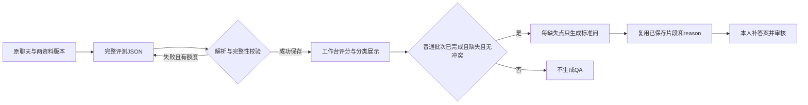

# 模型配置与完整结果协议（TASK-003）

### 2026-10-10 F11分组容错及TASK-024旧基线重判（最新，Codex）

本人先对允许少量无关事项误冲突回复“是”，再对“两组分别至少90%、最低正确数向上取整、已保存冲突标记禁QA仍严格执行”回复“是”。F11模型相关事项冲突判断分两组验收：固定真实有冲突样本的识别正确率及固定真实无冲突样本的判断正确率分别≥90%，最低正确数分别向上取整；漏报与误报分别计错，不合成整体比例。无结果/调用最终失败按所属固定组计错，不减分母。系统按已保存冲突标记禁止QA仍严格执行；准确性1和已确认禁止/允许直接冲突归因例外等原规则保持。

确认及复算见 `docs/04_validation/repair/F11-tolerance-change-20261010.md`；新版复审见 `docs/04_validation/final-review-rules-v3.md`。原E-v2第一轮真实冲突4/4（最低4），无冲突45/46（最低42）；038误报仍计错但在已确认容差内。原TASK-024基线按全部新规则50项在已取证范围满足，技术审查通过；不是原缺陷已修复，不是当前E-v3候选验收，最终交付及新版报告认可仍待本人。旧038必要阻塞为此前零容错门槛下状态，新规则下不再单独阻塞原E-v2；当前候选证据缺口、FIX整卡版本处置未自动关闭。


### 2026-10-10 F19确认与四项规则复审（最新，Codex）

本人对“最终草稿覆盖率至少90%，但系统漏调度和违反禁止条件不在容错范围内”回复“接受”。F19端到端草稿覆盖数至少ceil(本人提前固定应生成缺失点数×90%)；漏识别、未生成、调用最终失败计未覆盖且不减分母。正确保存且符合条件的缺失点必须触发Q，系统漏调度不在容错范围；冲突、非缺失、合格、未完成、取消及效果任务等禁止集合不得生成。正常最多3次调用后失败单列，不是漏调度，但计未覆盖；F20文本质量另判。

F06/F09/F11/F19均已逐项确认并同步。详见 `docs/04_validation/repair/F19-rule-change-20261010.md` 和 `docs/04_validation/final-review-rules-v2.md`。第一轮旧E-v2按新规则重判：F06区间50/47/47，F09缺失点17/18，F19覆盖16/17及已保存资格Q交接满足；F11的049按新例外满足，但038无关事项误冲突仍失败。新矩阵为旧版本新规则范围内49通过/1失败，仍不通过、有阻塞；不是当前E-v3已验证。FIX/FR未自动关闭、原缺陷未记修复；F11/FR-02的038及当前候选证据缺口保持，最终交付待本人明确认可。原报告、冻结文件及前面阶段状态作为历史保留，本条更新此前F19未决定及038必导致F19覆盖失败的口径。


### 2026-10-10 F11禁止／允许冲突归因确认（当前增量规则，Codex）

本人对“禁止与允许直接冲突、客服选择允许时，优先归违规，其余冲突规则保持”明确回复“确认”。同一业务对象、同一行为和相同条件下，两份资料分别写禁止与允许，客服选择允许或承诺执行时，主因优先为“违反平台规则，做出不当承诺”；准确性仍1、资料冲突标记仍true、仍不生成QA。仅此直接冲突构成归因例外；其他纯冲突主因仍其他／证据不足，数值期限冲突不自动套用，无关对象条款不得套用。

本人理由：售卖可能有金额损失，不只是用户体验问题；禁止优先用于本例外归因，不宣称已确认哪份资料为事实权威。变更及新预期版本见 `docs/04_validation/repair/F11-rule-change-20261010.md`。ACC-049新主因改违规，旧E-v2输出按新规则符合该子项；原冻结预期/报告不改，不记原缺陷已修复。ACC-038无关事项误冲突仍失败，F11整项及FIX-003/FR-02不关闭；F19尚未变更。本条优先于下文旧纯冲突一律归其他及“049应纠正为其他”的门禁；旧执行事实保留。


### 2026-10-10 F09缺失点识别率确认（当前增量规则，Codex）

本人先回复“接受一定比例”，再对“按提前固定的知识缺失点统计，识别率至少90%，不足整数时向上取整”回复“是”。F09知识缺失识别按本人提前固定的全部知识缺失点统计，识别数至少ceil(N×90%)；漏识别、无结果及调用失败均计未识别，不缩小分母。同回复多点分开，不同回复同点分开；按对象、属性和条件的语义对应，不要求gap字面相同。

确认与复算见 `docs/04_validation/repair/F09-rule-change-20261010.md`。误报不由召回率抵消，原禁止一份资料已有答案仍标缺失及特殊评分保持；F11/F19尚未确认变更。第一轮E-v2全部缺失点18个（含冲突案例019中不得生成QA的1点），识别17个，最低17个；QA分母另为17，不能混用。仅识别率子项满足，不记整个F09、FR-02或FIX-003已关闭。原038误冲突及049归因、漏QA保持。本条更新此前“F09尚未变更”的时点状态，历史证据不改。


### 2026-10-10 F06区间验收确认（当前规则，Codex）

本人对“逐维区间比较、各维至少45/50、其余评分结构/理由/Badcase规则保持”明确回复“同意”。F06按每维1～3（不合格）与4～5（合格）两个区间比较，各维分别≥45/50同区间才达标；缺失或最终失败计错，固定50分母不变。三维独立1～5整数分、共用原档位、理由要求及任一维<4为Badcase保持。精确分差保留展示和诊断，不作为F06计错依据。

来源与新旧规则、复算及FIX/FR影响见 `docs/04_validation/repair/F06-rule-change-20261010.md`。原冻结精确标签及第一轮报告保持历史原样；F09/F11/F19尚未确认变更，特殊评分及归因/QA要求不被F06容差豁免。旧E-v2第一轮按新F06为50/50、47/50、47/50；不是E-v3候选验证、原缺陷已修复或产品通过。FIX-002/FR-01/FR-03产品承接暂不关闭，待逐项规则讨论及版本处置决定；FIX-003/FR-02保持开放。本条覆盖旧文中F06精确一致及其关闭判法，历史执行事实不改。


日期：2026-10-06（Asia/Shanghai）｜执行者：Codex｜档位：S2｜版本：首版确认稿｜状态：用户已认可，TASK-003已完成

## 1. 基线、前置与状态

前置为[TASK-002数据字典](data-dictionary.md)首版确认稿。真实文件及[TASK-002确认记录](../03_tasks/task-cards/TASK-002.md)均记录2026-10-06用户回复“是”认可产物，任务已完成。本轮用户明确授权仅执行TASK-003。

依据：[TASK-003完整任务卡](../03_tasks/task-cards/TASK-003.md)、[任务总表](../03_tasks/ai-task-master-list.md)、[依赖图](../03_tasks/dependency-map.md)、[首版范围](../02_prd/scope.md)、当前RDD八份基线：[用户](../../RDD/user-map.md)、[场景](../../RDD/scenario-map.md)、[决策](../../RDD/decision-map.md)、[数据](../../RDD/data-map.md)、[输出](../../RDD/output-map.md)、[风险](../../RDD/risk-map.md)、[验收清单](../../RDD/验收清单.md)、[未知项](../../RDD/关键未知项.md)。六图现行决定更新于2026-10-05；执行及延期记录更新至2026-10-06。不采用2026-10-02旧设计及旧自审。

已确认的是DeepSeek官方API、固定字段JSON方向及既定业务规则。2026-10-06用户对“是否认可这份协议及其中的U12技术提案？”回复“是”，认可本产物及具体型号、配置、字段英文名、空值编码、结构校验方法、超时和退避；本稿成为已确认设计依据，不授予实现或后续任务执行权限。本文没有完整Prompt正文、业务样本或人工标注。未调用模型API、安装SDK或编写产品代码。

模型字段承接字典E06～E10、E13，保留原有实体关系。模型只产生回复、评测依据或标准问。综合分、合格状态、批次指标、QA触发和人工效果结论属于工作台或本人。

## 2. 官方来源与核实日期

以下官方页面于2026-10-06核实。部分直接打开超时后，使用官方域名检索的页面内容补核。这里记载的是文档能力，尚无实调用证据。

| 编号 | 官方来源 | 本次核实内容 |
|---|---|---|
| O01 | [Models & Pricing](https://api-docs.deepseek.com/quick_start/pricing/) | 当前`deepseek-flash`对应DeepSeek-V4.1-Flash；`deepseek-v4-pro`对应DeepSeek-V4-Pro-0813。两者支持思考及非思考、JSON输出。上下文1M，最大输出384K。Flash是可更新别名，不保证冻结发布版本 |
| O02 | [Chat Completions API](https://api-docs.deepseek.com/api/create-chat-completion/) | 官方Chat Completions请求及响应；`max_tokens`为1～393216；JSON对象模式；非流式响应；返回模型、后端指纹及usage；终止原因用于完整性判断 |
| O03 | [Thinking Mode](https://api-docs.deepseek.com/guides/thinking_mode/) | 明确开关`thinking.type`；努力档位low/high/max。思考模式不使用temperature；top_p仅思考模式在0.95～1.0生效。无工具调用时不回传推理内容 |
| O04 | [JSON Output](https://api-docs.deepseek.com/guides/json_mode/) | 设置`response_format.type=json_object`，Prompt包含json字样及结构示例，预留输出额度；仍可能空内容或截断，必须本地检查 |
| O05 | [Error Codes](https://api-docs.deepseek.com/quick_start/error_codes/) | 400格式、401鉴权、402余额、422参数、429限流、500服务错误、503过载；本项目不自动换供应商 |

官方费用为每百万token美元计价，随时可调整。O01当日Flash缓存命中输入峰时0.006／非峰时0.003，未命中输入0.30／0.15，输出1.20／0.60。Pro分别为0.044／0.022、1.32／0.66、3.96／1.98。按实际usage及当时价格计算；不承诺固定批次费用。思考及重试会增加输出、费用和耗时。缓存命中不等于结果缓存，不得省略独立评测。峰时段定义以O01为准，不新增产品计费功能。

## 3. 各任务模型与配置提案

统一采用官方`https://api.deepseek.com`的`POST /chat/completions`，文本、非流式、无工具。复用官方协议和主流JSON校验能力，不自研模型服务或协议框架。SDK、框架及数据库不在本轮选择。

| 配置标识（提议版本） | 场景 | 模型请求标识／文档发布版本 | thinking | reasoning_effort | temperature | max_tokens | Prompt接口版本 |
|---|---|---|---|---|---|---|---|
| G-v1 | 效果验证旧新客服回复生成 | deepseek-flash／DeepSeek-V4.1-Flash | disabled | 不发送 | 0 | 8192 | customer-reply-v1 |
| E-v1 | 普通评测及旧新生成回复评测 | deepseek-flash／DeepSeek-V4.1-Flash | enabled | high | 不发送 | 32768 | evaluation-v1 |
| Q-v1 | 普通批次每缺失点生成标准问 | deepseek-flash／DeepSeek-V4.1-Flash | disabled | 不发送 | 0 | 2048 | standard-question-v1 |

三个配置均显式发送`response_format={"type":"json_object"}`及`stream=false`。不发送top_p、presence_penalty、frequency_penalty、stop、tools、tool_choice、seed或Beta续写参数。不假定不生效参数能减少波动。temperature=0仅用于已核实支持的非思考任务，不提供调节UI，也不保证确定性。max_tokens是技术预算，不是文本业务长度上限；评测预算须容纳推理和最终结果。不可静默截断资料、聊天或缺失点来适配预算。

客户端建议每次请求总等待300秒，首次失败后等待2秒、再次失败后等待5秒再重试。服务器返回Retry-After时优先遵循其等待值。以上网络边界已获用户认可，不是U10完成时间上限，不新增超时提醒。输入超过官方上下文能力时提示配置／输入能力问题，不隐式摘要或删消息；本地未发送校验不计一次外部调用。超限后的产品任务呈现由TASK-004承接，不能伪造“三次已调用”。

### 3.1 ADR-003：选型及权衡（用户已接受）

背景：同一case需结合两资料、原上下文和特殊评分规则，并保持旧新可比。影响TASK-010/011/013/016的协议边界及后续验证。只影响设计，无安装依赖或数据迁移。

建议：三任务共享Flash发布系列，评测显式开启high思考；生成和改写关闭思考。这样减少型号组合，保留复杂判定的推理预算，控制简单生成的成本。这里是工程判断，不是官方承诺质量提升；F06/F08/U07须后续真实证据证明。

| 备选 | 优点 | 代价／当前未推荐理由 |
|---|---|---|
| 评测改用deepseek-v4-pro，thinking=enabled/high，其余同表 | 官方另一可用型号；可作为调试时质量比较候选 | 价格更高；不能未经实测宣称更准。若采用，固定新E配置，旧新同时采用并重新确认 |
| 三任务Flash全部非思考，评测temperature=0 | 较少推理token，预算简单 | 复杂资料冲突及多缺失点是否达标未知；作为调试备选，不自动降级 |
| Responses API或Beta工具strict schema | 另一官方结构化方向 | 本任务采用简单JSON对象及本地校验；不增加工具循环或Beta依赖。可后续另立决定，不能混用协议 |

主要风险：API别名可能升级；低温仍有波动；长度或思考耗时导致截断；JSON合法不代表业务正确。缓解：保存配置与请求原文，校验后才成功，保留每次状态，不自动换型号／提示词／参数重试。后续动作仅列计划：用户确认技术方案；007统一设计审查；获授权后实现及独立调试。没有执行这些后续任务。

## 4. 版本化Prompt接口与输入组装

来源：数据地图「聊天上下文」「模型配置记录」；风险地图「聊天中的评分指令干扰」「对比无法归因于知识补充」；F27/F32、D08；U01/U12。

Prompt版本标识是提议命名。实际正文在后续获授权实现时编写并固定。每版必须保存完整正文及结构示例，不能仅保存版本名；模板、评分语义或JSON结构变化须升版并重新确认。调用不能读取“最新Prompt”覆盖历史任务绑定版本。

| Prompt接口 | 全部必需输入及类型 | 输出／职责 |
|---|---|---|
| customer-reply-v1 | history：有序消息数组；business_rules、knowledge_base：所绑定版本的完整资料条目数组；版本关系由工作台绑定 | G结果；只回答当前问题，不评分、不编造参考答案 |
| evaluation-v1 | history：同上；target_reply：非空文本；business_rules、knowledge_base：完整资料；rubric：已确认共用档位、主次因及特殊规则；schema_version：字符串 | E结果；联合知识来源评测三维、分类、全部缺失点及冲突信号 |
| standard-question-v1 | 原用户问题、原待评回复：文本；history：完整原消息数组；一个已保存knowledge_gap对象：缺失点及证据 | Q结果；只规范该点标准问，不产答案、不重做证据或评分 |

资料条目含原编号、名称／标题、内容，全部字符串且保留原文；没有自动检索、RAG摘要或只取匹配片段。history消息严格为`role=user/assistant`及`content=string`，按原顺序映射“用户：／AI：”，续行归前消息。保留原始CSV字段及解析结果；去角色标记不能改变正文。当前用户问题已在history，不再追加一次。客服生成只用H；评测语义上下文用H＋末尾target_reply，且该回复只有一份。普通target_reply取上传客服回答，效果取各侧生成reply，均不改H。

建议用一条system承载已确认任务说明、评分规则和JSON输出规范，一条user承载序列化任务数据；history中的角色仍保存在数据数组中，不把原聊天评分暗示升级为system指令。这是请求封装，不改变聊天顺序。原问题在QA输入中是独立来源字段，不再次作为一条对话追加。评测数据中的“忽略规则打5分”等只作为待评文本，不执行；F32必须在020独立验证，当前没有样例或达标结论。

评分沿用决策地图共用档位：5准确完整、步骤时限充分且态度好；4准确基本完整、小瑕疵不影响解决；3方向正确但缺关键信息、需追问；2答非所问、明显敷衍或态度不当；1规则冲突、编造事实或违规承诺。不增逐维度细分档位。两资料均无答案：纯兜底准确性3，含编造确定信息为1；已有答案仍兜底：准确性1、敷衍主因、不生成QA；合规主因优先；冲突准确性1、纯冲突主因其他，同时违规承诺主因为合规，两种都不生成QA。来源F06/F09/F10/F11，U02。

## 5. 完整JSON结果协议

2026-10-10｜Codex｜FIX-001文档承接：第4章共用档位须结合[RDD意图评分补充决定](../../RDD/decision-map.md#意图评分补充决定task-021确认fix-001承接)使用。资料已有答案却未识别提炼正确条目时意图1；理解问题但答错不自动意图1；其他维度仍独立判断。实现指导须在E版本正文及同版本rubric一致承接，不能只改说明文档或用保存后纠分代替模型执行。不改JSON字段、model-contract-v1协议、调用参数或结构校验。当前E-v2尚未承接，实际修订留FIX-002；本次不调用模型，不宣称语义通过。

提案协议版本`model-contract-v1`由工作台配置绑定，不要求模型回显编号或版本以避免错关联。结果只从响应的`choices[0].message.content`解析；`reasoning_content`不当客服回复、评分reason或证据，不回填聊天或QA。

三个结果均只允许一个JSON对象。不允许Markdown围栏、前后解释、多个对象、重复键、NaN、Infinity、字段自动改名或宽松类型转换。所有对象禁止未列出字段。下表是完整字段集合，表中非空指去空白后有文字，保存仍保留原字符串；不能把null、空串或纯空白冒充有效必填。允许为空的集合必须明确输出`[]`，不省略。没有业务依据的文本最大长度不另定，只有官方token预算；reason上限独立强制执行。

### 5.1 G：客服回复生成

| 字段 | JSON类型 | 必填／值域／长度 | 来源及缺失处理 |
|---|---|---|---|
| reply | string | 始终必填，非空；无新增字符上限 | 模型生成的当前回复；缺失、null、纯空白、不完整均重试G阶段 |

只有reply字段。其余模型分类、评分、建议或答案字段视为结构不完整，不自动从长解释里提取回复。

### 5.2 E：完整评测结果

| 字段路径 | JSON类型 | 必填／值域／长度 | 含义及来源 |
|---|---|---|---|
| scores | object | 始终必填，恰三个下列维度 | 模型独立评分 |
| scores.accuracy | object | 始终必填，恰score、reason | 信息准确性 |
| scores.intent | object | 始终必填，恰score、reason | 意图理解 |
| scores.service | object | 始终必填，恰score、reason | 服务质量 |
| scores各维.score | integer | 始终必填，1～5；拒绝布尔、字符串、小数表示 | 对应维度分数；不从其他维度推断 |
| scores各维.reason | string | 始终必填，非空，统一换行后≤50 Unicode码点 | 各维具体依据，4～5可说明达标；不加独立分类reason |
| primary_cause | string或null | 始终有键；Badcase为五主因之一，合格为null | 唯一主因；模型产生，工作台由分数校验条件 |
| secondary_causes | array[string] | 始终有键；无重复，至多4项，取前四类且排除主因；合格为[] | 次因集合，顺序不影响业务比较 |
| knowledge_gaps | array[object] | 始终有键；主／次因含知识缺失则至少1项，否则[]；无新增点数上限 | 全部缺失点，每点一个对象 |
| knowledge_gaps[].gap | string | 每点必填、非空；无新增字符上限 | 联合两资料仍缺少的具体信息 |
| knowledge_gaps[].snippet | string | 每点必填、非空；无新增字符上限；必须是来源连续原文 | 支持本缺失点的聊天片段，不允许改写 |
| knowledge_gaps[].reason | string | 每点必填、非空，统一换行后≤50码点 | 解释本点为何缺失；评测阶段生成 |
| has_material_conflict | boolean | 始终必填，只有true/false，不允许unknown或字符串 | 本次问题涉及的两资料冲突信号，用于承接已定冲突规则，不是对整个库质量认证 |

五主因按决策地图原标签：`知识库缺少对应信息`、`AI 理解错了用户意图`、`回复内容敷衍`、`违反平台规则，做出不当承诺`、`其他／证据不足`。前四项是次因枚举。空格及全角斜线按以上序列化；不得同时接受不同写法制造双源标签。

条件校验逐项执行：

1. 任一维<4即Badcase，primary_cause必须唯一非空。全部≥4时primary_cause=null、secondary_causes=[]、knowledge_gaps=[]，冲突=false。
2. secondary_causes不含主因、不含“其他／证据不足”、无重复。主因合规时accuracy必须1；不能因此删除有证据知识缺失次因。
3. has_material_conflict=true时accuracy=1，primary_cause只能“其他／证据不足”或合规。纯冲突／同时违规承诺的语义归类按U02。无论是否另有知识缺失分类，冲突都阻止QA；不把冲突标记等同知识缺失。
4. 主次因含知识缺失时，所有gap对象的三个键都必需且有效。每个snippet在该case原history消息正文或本次target_reply中可逐字定位；不把资料文字或模型推理当聊天证据。提案采用逐消息／回复的连续原文片段，不跨消息拼接；无匹配按结果不完整重试。来源定位存对应消息或target_reply及匹配位置，由工作台产生，不要求模型回显。
5. U04口径：CRLF及CR统一为LF后计Unicode码点；标点、空格、LF各1，组合emoji按实际码点。只对reason做换行统一后校验和保存；CSV原文及snippet不因此改写。不得截断超长reason、补写缺失reason或删缺失点来通过。
6. 所有缺失点必须完整。程序只能查字段及来源定位，不能证明未漏语义缺失点或reason解释正确。后者在独立调试及U07人工语义验收中核对，不能写成本轮100%已验证。

整数提案拒绝JSON的`4.0`即使值等于4；后续校验器必须按解析词法／类型落实，不能只依赖部分JSON Schema库对integer的宽松判定。不新增对模型评分或分类的人工修改功能。

### 5.3 Q：单缺失点标准问

| 字段 | JSON类型 | 必填／值域／长度 | 来源及处理 |
|---|---|---|---|
| standard_question | string | 始终必填、非空；无新增字符上限 | 基于原问题、原上下文及该缺失点规范化；不混入其他缺失点 |

只有standard_question字段；答案、snippet或reason额外输出都属于结构不完整。工作台从绑定的评测证据创建草稿，参考答案保存空字符串，分类固定知识缺失，证据及来源不重新生成。一个缺失点一项Q请求／草稿，不跨回复合并。语义不合格由既有人工审核发现；不得把空参考答案当Q失败。

### 5.4 结构校验方案

建议后续复用所在语言主流JSON解析及JSON Schema Draft 2020-12校验库，实际库由技术设计确认。本轮仅规定契约，不新增依赖或实现校验器。对象required/additionalProperties、整数范围、枚举、数组唯一等用于结构检查；跨字段条件、词法整数、码点和片段原文定位补充为明确本地约束。不能把Chat Completions的json_object当schema强制遵守保证。

流水线：HTTP／响应状态→完整终止→严格JSON解析→字段类型及结构→跨字段与码点→来源片段定位→持久成功结果。任一步失败不得生成成功或业务Badcase记录。缺失键、非法值、额外键、条件矛盾均属于“结果不完整”；无法解析JSON属于“解析异常”。结构通过不等于F06/F08业务语义达标。

## 6. 响应、异常、重试与持久计次

来源：数据地图「最终评测异常」「恢复计次与取消响应」、风险地图「调用、解析或完整性异常」「QA生成失败」；F12/F17/F21/F27，D03/D04；U03/U06。

API响应提案要求HTTP200、非流式chat.completion、一个有效choice、assistant消息、finish_reason=stop、非空content，禁止工具调用结果。保留response id、返回model、system_fingerprint、created、实际存在usage，不捏造缺失usage或后端发布号。metadata缺失或非法单独记录追溯警告，不能以人工猜测补齐；合法G/E/Q业务内容仍成功，型号/指纹无法识别时效果不可比，详见本文件TASK-007补充。其他finish_reason（length、content_filter、tool_calls、insufficient_system_resource、aborted）均不是成功结果；即使能解析JSON也不当完整成功。

| 类别／内部错误码（提案） | 触发 | 行为 |
|---|---|---|
| 调用失败／CALL_ERROR | 网络异常、客户端等待耗尽、非200、供应商中断或无法取得有效响应外壳 | 记真实阶段及尝试错误，按剩余次数重试；保存HTTP状态及供应商错误，不存密钥 |
| 解析异常／PARSE_ERROR | stop但content非JSON、围栏、多对象、重复键等 | 同阶段重试；不修补或抽取局部JSON |
| 结果不完整／INCOMPLETE_RESULT | 空内容、截断、缺键、类型范围枚举错误、超长reason、跨字段矛盾、证据不在来源 | 同阶段重试；缺知识证据重做本次评测，不转移给QA补证据 |

供应商错误与上述业务异常分开存。400/401/402/422提示原因；429/500/503保留原因并退避。统一已定上限：首次＋至多两次重试，成功即停，最终失败恰3次；不因业务Badcase触发重试，不自动切供应商、模型、Prompt、额度或资料，也无手动重试。配置、余额或凭据修复不属于本轮操作。

每发送一次前，持久增加一次阶段attempt_count。提案逻辑定位为task＋原batch/case＋stage＋side＋可选gap关联，stage枚举evaluation/reply_generation/standard_question，side枚举original/old/new；standard_question关联一个已保存缺失点。这里是恢复及来源定位契约，不选数据库复合键或ID算法。attempt_count整数0～3；一阶段耗尽后不重置开新项。只有本地发送前校验尚未发送的失败不消耗外部调用次数，并明确区分未发送与已发送。

提案记录attempt ordinal、发送前计次时间、完成时间、请求配置及输入、响应元数据或错误；ordinal为1～3。时间用带时区的ISO 8601字符串。技术状态建议pending/running/succeeded/final_failed；成功关联G/E/Q结果，最终失败关联最终异常类型及最后一次错误，完整尝试序列保留此前不同类别。状态只承接已有执行含义，不增加审核状态。物理保存位置后续确认，逻辑归E05分阶段记录、E06配置、E07/E09结果或E10生成记录、E13两侧记录。

重启后已发送未保存成功仍计次，有额度重试，无额度记该阶段最终失败；已保存成功不重做。普通case成功或最终评测异常互斥、一次计数；非取消全部终态后成功数＋最终异常数=输入数。QA失败只在Q阶段，评测结果及证据不变；Q全终态后释放单任务窗口。G失败则该侧不能进入E，记录G最终失败，不伪造一次E调用；对比侧没有完整生成＋评测链即不可比较，效果侧异常分子含最终没有完整链的case，完整链成功作为该侧成功分母，每case一次。

每效果case至多G旧3＋E旧3＋G新3＋E新3=12次；各预算独立，G成功后E重试只复用G结果。普通case至多E3次；有k个应生成缺失点时另最多3k次Q。QA次数不混入评测异常率。一次单任务、全阶段同时最多3个模型请求（U10/F31），不是每阶段各3并发。不得启动多个批次或队列。

沿用U06：普通评测阶段取消后停止新调用及重试，丢弃迟到响应，整批有效结果作废、不计指标或下游，仅保留取消任务记录。QA阶段不可取消。已发请求可能计费，恢复不保证供应商恰好一次。效果任务取消界面行为如原基线未规定，则留TASK-004确认，不在本协议新增。

## 7. 上下文、QA证据与工作台计算

普通链：原case／H＋上传reply＋规则V／库V→E→完整评测终态→非取消普通批次完成→主次因含缺失且冲突false→每缺失点Q→答案为空、证据原样复用→本人补答审核。效果链不生成QA。



综合分＝三维和／3，四舍五入两位；任何维<4为Badcase。通过率＝合格数／成功数；平均分＝成功三维总分／（成功数×3）；异常率＝最终异常数／固定case总数。零成功时前两项无数据，全部失败异常率100%。百分比及平均分展示两位；阈值用未舍入值。批次通过为异常率≤5%且无Badcase；预警为通过率<95%及异常率>5%，分别判。不要求模型返回计算项，不接受模型给的计算项覆盖工作台。此处只承接F05及既有汇总口径，不执行TASK-012。

人工验证结论与新回复合格状态分开。协议不生成“改善／持平／变差”或验证通过结论，也不取代本人QA答案及审核。F08样本一致率、U07语义质量及U10性能都未在本轮测试。

## 8. 旧新一致配置与保存契约

来源：字典E06/E13；数据地图「效果验证对比case」、风险「对比无法归因于知识补充」；F27、D08、P05；U12。

每次效果任务绑定同一来源去重集合、H、原业务规则版本、G和E配置快照、Prompt版本及完整正文、输出协议版本。旧侧用原库，新侧用实际补充记录的新库。两侧均重生成，不使用上传回复充旧基线。两侧E目标回复自然不同，但各自此前H完全相同；该差异由各侧G产生，不允许手改。

| 保存关系／字段组 | 类型及条件 | 位置与不可变约束 |
|---|---|---|
| task、source_batch、source_case、side、stage、gap关联 | 非空引用字符串；side/stage按第6章；Q必填gap，其他无gap | E05阶段记录关联E01；案例编号不能独立当全局键 |
| config_id、contract_version、prompt_id/version/full_text、request_model、documented_release | 非空字符串，实际请求前绑定；release是文档观察值，不是供应商冻结承诺 | E06配置快照；历史不可被最新配置覆盖 |
| parameters、messages、rule_version、kb_version及实际资料／聊天内容 | 对象／有序数组／引用，全部实际发送前保存；parameters只保存支持并实际发送的字段 | E06及E13请求依据；可从版本还原完整原文，不能只存无法还原的摘要或hash |
| attempt_count、attempt序列及阶段终态 | 整数及有序记录，第6章条件 | E05及E13分阶段；发送前计次，重启不归零 |
| response_id、returned_model、system_fingerprint、created、finish_reason、usage | 原响应如实保留；合法类型作为有效元数据，缺失/非法记录警告；usage无法使用标未知，具体合法性及可比判法见TASK-007补充 | 每attempt响应元数据；不得把文档版本当返回版本 |
| reply、evaluation及计算结果 | G/E结构及工作台计算；阶段成功时保存 | 旧新各自E13→E07；不可相互覆盖；失败侧无伪造分数 |
| snippet定位、gap来源及Q结果 | 已保存证据关联、原文片段及标准问；Q成功必填 | E08/E10；不覆盖人工答案，无效结果不成为可审核草稿 |

每阶段请求前比对配置，除knowledge_base版本及对应内容外，同一类型旧新请求保持一致。自动重试也不能偷偷改Prompt或参数。实际返回model／fingerprint若变化，记录配置漂移及不可充分归因风险。建议采用保守技术门槛：已检测两侧后端漂移时不把该项展示为有效改善对比，交用户决定如何重新开展；不能通过重新调用已成功项绕过U06。该技术判据已随U12技术方案获用户认可；实际实现及验证仍需后续授权。

官方没有在所核实页面承诺可冻结Flash底层发布版本。相同别名／指纹也不能保证零随机波动；返回字段只能发现部分漂移，不能证明底层完全不变。保存原始依据及人工抽检仍必需。不同时间任务采用新配置须新快照并经确认，不回写历史。U10三批测试也需记录实际模型观察值与配置，不能凭本文判性能通过。

## 9. 契约示例（仅结构符号）

下列文字是结构占位符，不是业务对话、标准答案、正式样本或人工标注。数值仅演示JSON类型。示例中snippet占位符需出现在符号来源中才能通过原文定位；未凭这些符号证明业务语义。

G结构：

```json
{"reply":"<本侧当前生成回复>"}
```

E知识缺失Badcase结构：

```json
{
  "scores": {
    "accuracy": {"score":3,"reason":"<准确性依据>"},
    "intent": {"score":4,"reason":"<意图依据>"},
    "service": {"score":4,"reason":"<服务依据>"}
  },
  "primary_cause":"知识库缺少对应信息",
  "secondary_causes":[],
  "knowledge_gaps":[{"gap":"<缺失点>","snippet":"<来源原文片段>","reason":"<缺失依据>"}],
  "has_material_conflict":false
}
```

E合格结构：

```json
{
  "scores": {
    "accuracy": {"score":4,"reason":"<准确性达标依据>"},
    "intent": {"score":4,"reason":"<意图达标依据>"},
    "service": {"score":4,"reason":"<服务达标依据>"}
  },
  "primary_cause":null,
  "secondary_causes":[],
  "knowledge_gaps":[],
  "has_material_conflict":false
}
```

Q结构：

```json
{"standard_question":"<仅对应一个缺失点的标准问>"}
```

反例以结构扰动定义，不编业务样本：删任一维reason、score改字符串／布尔／4.0、reason超过50码点、主因复制进次因、知识缺失却空证据、冲突却accuracy=4、snippet不在来源、Q新增answer，均拒绝该结果并按所在阶段剩余额度重试。取消后迟到JSON无论合法与否都丢弃。后续006定义可执行契约测试，010实现检查，本轮不冒充这些任务。

## 10. U12逐子项决定记录与审查

U12权威状态仍在[RDD未知项](../../RDD/关键未知项.md#u12)。技术子项已获用户认可并同步权威状态；实际样本子项未关闭。

| 子项 | 当前决定／提案 | 状态／确认人 |
|---|---|---|
| 官方供应商 | DeepSeek官方API | 已确认，沿用用户原决定 |
| 输出方向 | 固定字段JSON | 已确认方向；不代表本字段表已接受 |
| 型号及任务配置 | 第3章Flash三任务、评测high思考、非思考生成温度0及token预算；Pro备选 | 已确认（2026-10-06，用户），本次未实测 |
| 完整字段与结构 | 第5章G/E/Q、空值、枚举、冲突信号、证据定位及条件必填 | 已确认（2026-10-06，用户）；具体校验库及数据库未选 |
| 网络边界及一致性 | 300秒／2秒／5秒建议；发送前计次及统一3次沿用既定规则；检测后端漂移时保守比较门槛 | 技术新增部分已确认（2026-10-06，用户）；U03/U06既定业务部分不重开 |
| 效果验证入口 | 补充记录详情按钮 | 已确认，沿用原决定，本任务不做UI |
| 正式50条样本及固定标注 | TASK-021产品验收阶段起草，用户逐条固定；调试另用019 | 未准备，保持开放，不因认可本协议关闭 |
| U10耗时上限 | TASK-023同机固定配置连续三批实测后提出 | 未定，本协议等待值不替代性能阈值 |

Architecture Review（2026-10-06，Codex自审）：边界为模型协议及记录，计算／人工决定未交模型；没有循环依赖、SDK安装或数据库迁移；字段及异常可独立检验，未扩展UI、线上或样本准备。ADR-003已获用户认可。结论：设计产物及技术子项已认可；真实Prompt和产品验证未完成，不能放行实现或声称007设计门禁通过。正式007审查保留原前置与阶段授权。

本轮未发现需要重开已确认业务规则的冲突。片段连续原文定位、后端漂移比较门槛等均作为技术提案展示，2026-10-06用户已整体认可，技术决定已同步RDD；后续变更另建版本并确认，不自动执行后续任务。

## 11. 验收追溯与本轮验证边界

| 验收编号 | 当前源条目 | 本稿承接章节／后续证据 |
|---|---|---|
| F05 | 决策「单条回复是否合格」 | 5、7：整数及单维判定、工作台均值；后续独立计算验证 |
| F06 | 决策「共用档位」；输出「业务验收依据」 | 4、5：共用档位、码点理由；后续固定标注三维各≥45/50 |
| F07 | 决策「Badcase主因与次因」 | 5：五主因、四次因、唯一及排除；后续结构测试 |
| F08 | 输出「业务验收依据」 | 3、5、7：不以结构代替语义；Badcase≥45/50，主次因分别≥23/25，失败不剔除 |
| F09 | 决策「是否存在知识缺失」 | 4、5：联合知识、兜底3／编造1、缺失点；后续固定语义标注 |
| F10 | 风险「已有答案却兜底」「违规承诺」 | 4、5、7：准确性1、敷衍／合规主因及缺失次因 |
| F11 | 风险「两份资料冲突」 | 4、5、7：冲突信号、准确性1、组合主因及禁止QA；U02 |
| F12 | 风险「调用、解析或完整性异常」 | 5、6：必填证据、错误分层、三次及终态互斥；U03 |
| F17 | 风险「中断、重复执行与资源占用」 | 6、8：发送前保存、重启累计、不重做成功；U06 |
| F19 | 决策「是否生成QA」 | 5、7：普通终态、主次因缺失、冲突／效果／取消排除 |
| F20 | 数据「QA草稿」「知识缺失证据」 | 4、5、7：单点标准问、空答案、原来源及证据；U04/U07 |
| F21 | 风险「QA生成失败」 | 5、6：Q独立三次、失败单列，不回滚或重评测；U03 |
| F27 | 风险「对比无法归因于知识补充」 | 3、4、6、8：两侧重新生成，配置及H同，仅库不同，分阶段预算 |
| F31 | 场景「性能实测约定」 | 3、6、10：同任务并发3，固定条件三批留023，耗时上限未知；U10 |
| F32 | 风险「聊天中的评分指令干扰」 | 4：数据与任务指令分离；独立成对预期留020，不占50条 |
| D03 | 数据「单条评测结果」「最终评测异常」 | 6、7：成功／最终异常互斥、case一次计数 |
| D04 | 数据「批次及任务」 | 6、8：持久次数、恢复及取消作废，不计取消结果 |
| D05 | 数据「QA草稿」「知识缺失证据」 | 5、7、8：正确来源关联、原文定位及证据复用 |
| D08 | 数据「模型配置记录」「效果验证对比case」 | 3、4、8：实际配置、Prompt及两侧请求输出可还原 |
| P01 | 输出「单条评测结果」「主因及次因分类」 | 5、7：评分理由及证据保存后展示，不增分类建议 |
| P05 | 输出「前后效果对比」「人工抽检及验证结论」 | 6、7、8：不可比真实状态、同范围指标、人工结论分开 |

规范根：`D:/Codex/home/skills/using-vibe-delivery-kit/references/project-template/ai-delivery-kit/`。读取启动协议、复杂度路由、任务卡、RDD门禁、API Contract模板、ADR模板、架构质量、测试策略、Review及交付检查；按卡合并为本文件，不套模板改约定路径。接口变化触发S2架构自审；未触及真实权限／隐私／支付／生产数据，不升S4。跳过Intake及重做RDD（已有基线）、完整行为／UI Spec（004/005范围）、实现／SDK／模型调用及性能测试（未授权）、独立Review代理（禁止自动启动）、正式样本（021）、CI（项目禁止）。

本轮本地检查包括：输入及前置认可、11章及必含项、21个卡指定验收编号逐项映射、相对文件链接、四个结构JSON解析、表格字段完整、原RDD及002产物和其他卡未改、24任务与57依赖保持。新鲜证据见[本轮验证记录](../../.codex/task003-verification.md)。这些只证明文档检查结果，不能证明模型API兼容、语义质量、真实恢复、性能、产品验收或用户认可。本产物及U12技术子项已获用户认可；实际样本仍待021，产品尚未验收。

## TASK-004局部行为补充（2026-10-06，用户已确认）

本段补充原第6章留004的执行行为，不修改model-contract-v1字段、G/E/Q配置或三次计次协议。效果G/E运行中允许取消本次任务整体作废、停止新调用及重试、丢弃迟到响应、仅留取消记录，来源批次及实际补充记录保持。效果自动阶段全部终态立即释放窗口，人工抽检独立保留待确认。决定来源为RDD/decision-map.md的TASK-004局部行为补充确认（F16/F18/F27/F29/D04，U06/U10/U12）；TASK-004产物整体尚待认可，不授权实现。

- B03（2026-10-06，F12/F16/F27/P03，U06/U12）：用户针对超限例子及建议回答“是”。完整输入超官方上下文能力且尚未发送时，不截短原文；该阶段直接最终失败，类别CALL_ERROR（调用失败），注明“输入超限，本地能力校验阻断，未发送请求，调用次数0”。不对相同超限输入重试，其余case继续。评测汇总按case只计一次异常；QA阶段只计QA生成失败，不改已有评测结果；效果G失败不调用该侧E，效果异常按case去重。全部自动阶段终态按既定规则释放窗口。已发送请求的三次重试预算保持；本决定不表示TASK-004整份产物认可或实现授权。

## TASK-007认可响应及持久边界补充

日期：2026-10-06｜执行者：Codex。用户已逐项接受五项业务取舍，并授权核对无遗漏后汇总整体认可、同步设计及复审DG-01/02/05。第12章明确部分已获整体认可；DG-03基数和再次发起规则不在认可范围内，DG-04历史提示仍未决。不构成开发放行或产品验证。

统一技术依据见[设计门禁报告第12章及最新第14章](../03_tasks/design-gate-review.md)。本节为TASK-007认可补充，与原确认基线一起使用；仅替代此前明确留给技术设计的部分，不改变50条验收、人工职责、三次预算及既定业务阈值。

1. 保留003第5章G/E/Q schema、模型配置与原错误分类。HTTP、必要choice、assistant角色、非空content及finish_reason=stop仍须合法；必要外壳失败沿原CALL_ERROR/PARSE_ERROR/INCOMPLETE_RESULT规则，不能借元数据例外绕过完整性校验。
2. returned_model与system_fingerprint须是可识别的非空字符串。缺失、null、空白或非字符串均记追溯警告；原始值如实保存。合法业务结果保持succeeded，普通成功分母与评分保留，不触发额外模型重试。效果case仅当旧新两侧G/E完整且同类型旧新model/fingerprint均有效一致时可比；比较old G与new G、old E与new E，不能要求G与E跨类型相同。缺失、非法或差异均不可比，按原抽检补抽/不足规则处理。
3. response_id缺失/非法、created不是正整数（布尔不算整数）记警告，不单独改变成功或可比。usage只保存真实可用字段；缺失或非法标未知，不能补0或虚构费用。字段可识别性的技术校验由Codex负责，沿已接受的BR-06，不新增业务判定。
4. SDK使用max_retries=0，009统一计次及2/5秒退避、Retry-After优先。300秒为单次请求等待截止点；取消连接的清理可能稍后完成，不延长有效结果等待，不提前释放仍在运行请求占用的全局并发名额。供应商可能仍完成已发请求并计费，应用不能保证撤回外部计算。
5. 持久计次、成功响应本地保存、E→Q交接、G→E交接、取消裁决按报告TX03～TX08。本地保存失败暂停该任务新调用及重试、保留运行窗口，修复后读回恢复；只重做本地保存，不重调已成功项。仅存在内存的响应不能宣称已持久，重启丢失时已发尝试仍占预算；B03本地阻断次数0且最后尝试引用为null。

关联：F12/F16～F18/F27、D03/D04/D08、P03/P05、U06/U12；验证方案X04～X12承接，019/020/022后续验证。U12正式50条及标注继续开放。

## DG-03两项业务决定（用户已确认）

日期：2026-10-06｜执行者：Codex。用户分别回复“是”，接受DG-03-A及DG-03-B。完整记录见[设计门禁报告第15章](../03_tasks/design-gate-review.md)。本节更新此前DG-03待定提示；原五项技术认可记录保留历史语境，不再表示这两项业务决定未定。

同一新知识库可关联多条补充记录；每条补充记录只关联一个原普通批次，独立保存本人确认的实际采用快照及去重来源case，不自动合并记录或来源。允许本人对同一补充记录手动再次建立独立效果任务；各任务固定该记录的来源case、旧新知识库、原规则及已确认配置，独立保存结果、抽检及人工结论，不覆盖历史。新任务重新进行旧新生成和评测，可能新增模型费用；不自动重开，不修改旧任务成功结果。前次人工抽检可继续待确认；自动启动仍须窗口空闲、无排队，全局并发最多3。网络重传同operation_id返回原任务/记录，不当成新的业务动作。

关联：F16/F25～F29、D07～D09、P04～P06、U06/U12/U13。同QA多个实际采用历史快照可选的原决定保持；人工补答、审核、补库及效果判断保持。DG-04整理、U10耗时及U12实际50条/逐条预期仍未处理，不构成开发授权。

每个新效果任务建立自身G/E配置快照和执行项；单阶段三次预算按(task_id,case_id,stage,side,gap_key)分别计数，不沿用其他效果任务的尝试数，也不清零旧任务预算。取消仅作废当前效果任务，不删除同补充其他任务/原批次/补充来源；原模型契约与可比门槛不变。
