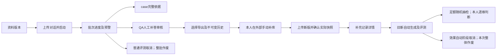

# 页面与交互 Spec（TASK-005）

日期：2026-10-06（Asia/Shanghai）｜执行者：Codex｜档位：S2｜版本：1.0确认稿｜状态：已确认（2026-10-06，用户回复“是”）

## 1. 基线与前置版本

来源任务：[TASK-005](../03_tasks/task-cards/TASK-005.md)。使用package Feature Spec十二章，卡要求的页面、字段、操作、状态、快照、抽检及追溯合并到约定路径。不创建原型网页、产品代码或第二份Spec。

| 输入及实际版本 | 认可与用途 |
|---|---|
| [TASK-002字典](data-dictionary.md)｜2026-10-06首版确认稿 | 文件状态用户已认可、任务卡已完成；E01～E15为字段及关联依据 |
| [TASK-004行为Spec](behavior-spec.md)｜2026-10-06，1.0确认稿 | 用户对完整Spec问题回复“是”，任务已完成；第4～8章及B01～B03为行为依据 |
| [范围](../02_prd/scope.md)｜首版确认稿 | TASK-001认可；其中003前的型号“未定”为历史，最新技术以003/004/U12为准 |
| [模型契约](model-contract.md)｜首版确认稿及004行为补充 | 已获认可；只读显示已有配置、阶段及实际错误，不重定字段或参数 |
| [用户地图](../../RDD/user-map.md)｜2026-10-05更新 | 三角色同一操作人、U11列表摘要与详情完整依据 |
| [场景地图](../../RDD/scenario-map.md)｜九场景及2026-10-06补充 | 页面入口、取消、自动窗口释放、未发送超限规则 |
| [输出地图](../../RDD/output-map.md)｜十三输出及U05/U12更新 | 展示与消费位置，模型辅助说明 |
| [数据地图](../../RDD/data-map.md)、[决策地图](../../RDD/decision-map.md)、[风险地图](../../RDD/risk-map.md)｜当前源 | 字段来源、十一决策与二十一风险；由002/004承接，不因UI改变 |
| [验收清单](../../RDD/验收清单.md)、[未知项](../../RDD/关键未知项.md)｜当前源 | F01～F32、D01～D11、P01～P07预期已定；U12技术已确认，样本仍未决；U10耗时未决 |
| [总表](../03_tasks/ai-task-master-list.md)、[依赖](../03_tasks/dependency-map.md) | 24卡、57依赖；本次仅005获明确执行授权 |

前置002和004的实际文件、完成状态和用户认可均满足。任务卡中的“未来输入／前置未满足”为编卡时检查点，不能覆盖当前证据。业务事实以上述最新已确认源为准；不使用2026-10-02旧设计。

## 2. 目标、角色与设计建议边界

目标：让本人完成上传、评测追溯、人工补答审核、导出、补充确认、效果判断及恢复查看。观看者通过本人录制的视频了解项目，不操作工作台。支持Windows Chrome，实际版本后续验收记录。

**第3章页面划分、布局、导航，第4～7章控件形态、提示文案和保存方式是本次设计建议，均已获用户认可（2026-10-06）。** 来源字段、资格、阈值和状态转换是已确认约束。页面编号V、操作编号A及输出编号O仅用于本稿追溯，不新增业务实体、数据库枚举或功能。

设计原则：批次列表放三指标、状态和进度；case列表放问题摘要、合格状态、三分及主因；详情完整展示原文与判定依据。缩略仅用于列表，不能截断详情或模型输入。以文字标签区分状态，颜色仅辅助。每条详情带所属批次／case，避免跨批重名混淆。

首版不增加账号／访客／付费操作角色、评分分类编辑、额外AI审核、自动补库、手动重试、超时提醒、独立报告导出或录屏。参数只读，不新增调温控件。无线上客户或真实知识库连接。本稿不选前后端框架、校验库、数据库、部署或HTTP接口。

## 3. 页面、入口及九场景导航（已认可设计方案）

建议四个一级入口：评测批次、资料版本、QA审核与导出、知识库补充。效果任务从补充记录详情进入；运行任务通过全局状态条返回。详情采用独立内容页，保留来源返回入口。批次详情内用分栏标签查看case与QA；case完整依据采用纵向区块，不强迫横向阅读长聊天。

| 页面 | 入口／布局建议 | 主要信息与下一步 |
|---|---|---|
| V01 资料版本 | 一级入口；规则／知识库两个分区 | 固定CSV模板说明、上传结果、版本及上传时间、完整资料详情；选择普通评测版本或转V02 |
| V02 批次列表及新评测 | 一级入口；批次摘要表＋新评测区 | 对话上传及有效数、两版本选择、启动；历史批次摘要；点击批次到V03 |
| V03 批次详情／任务进度 | V02行、全局任务条 | 绑定版本、阶段进度、三指标、独立预警、case／异常／QA入口；V04或V05 |
| V04 case完整详情 | V03列表行 | 完整问题、待评回复、H、三分理由、综合分、主次因、逐点证据、阶段错误；回同批原集合 |
| V05 QA审核与导出 | 一级入口或V03对应批次 | 按原批次查看待审核／已通过，生成失败独立区；摘要列表＋完整草稿详情；人工保存、通过、选择导出；到V06 |
| V06 导出历史／快照详情 | V05导出结果与历史入口 | 导出记录时间、QA及当时四字段，不可编辑；与当前内容分开；到V07选择实际采用版本 |
| V07 补充记录列表／确认 | 一级入口或V06后续入口 | 上传／选择有效新版、选择一个原批次及具体快照条目、人工确认实际加入；到V08 |
| V08 补充记录详情 | V07记录行 | 新旧库、原规则、采用快照及来源去重集；“发起效果验证”按钮；到V09 |
| V09 效果对比及人工抽检 | V08发起或关联效果任务 | 自动阶段进度、旧新同范围指标、对比列表／详情、抽补轨迹、逐维人工选择及独立结论 |

| 场景 | 地图原始条目／入口 | 前置及本人操作 | 自动反馈与后续／失败去向 | 验收与U |
|---|---|---|---|---|
| S01 | 准备模拟业务资料；V01 | 本人按模板上传模拟规则／知识库并确认有效 | 成功保存版本；错误整份拒绝保留旧版，修正重传；到V02 | F01～F04/D02，U01 |
| S02 | 每日例行上传对话评测；V02 | 有效≤100case、两版本、无运行任务；本人启动 | 自动E进度→V03，全部E终态后汇总及符合条件Q；禁忙时排队 | F01～F04/F16/F31/D01，U01/U10 |
| S03 | 从预警排查问题；V03 | 汇总完成；本人点击对应预警 | 同批Badcase或最终异常集合→V04；两项可同时独立显示 | F13～F15/P02/P03，U05 |
| S04 | 生成并审核QA；V05 | 普通E全部终态且符合004条件；本人看证据、改问、补答、确认 | Q自动仅标准问；成功待审核、失败另列；通过到导出；无冲突QA、无AI填答 | F19～F23/D05/P04/P06，U03/U04/U07 |
| S05 | 导出可用QA；V05→V06 | 本人勾选当前已通过且四字段完整内容 | CSV及独立快照；重复允许；导出不表示入库 | F24/D06/P04，U13 |
| S06 | 手动补充知识库；外部→V07→V08 | 外部手动加入后上传新版，选具体历史快照及一个原批次，确认实际加入 | 保存补充关联、去重来源；不自动写库；历史资格与当前状态分开 | F25/F26/D07，U12/U13 |
| S07 | 前后效果验证；V08→V09 | 已确认补充、来源非空、无运行任务；本人发起 | 两侧重新G/E，同规则H配置；无来源不建任务；失败保留阶段；不生成QA | F27/D08/P05，U12 |
| S08 | 随机人工抽检；V09 | 自动全终态，系统随机抽补足额后本人逐维选择并保存 | N不缩、K向上取整；不足验证失败，未完待确认，任一变差不通过；人工继续不占自动窗口 | F28/F29/D09/P05/P06，U08/U12 |
| S09 | 任务中断与恢复；全局条／V03/V09 | 离开、刷新、重启返回或本人主动取消 | 读持久阶段次数；成功不重调，未完自动恢复；普通E／效果G/E可取消，Q不可取消 | F16～F18/D04/P03，U06/U10 |

## 4. 逐操作交互契约（控件及文案已认可）

所有写操作提交后显示进行中，等待真实保存结果再显示成功。发生读写失败显示“未确认保存成功，请返回查看实际记录”，不先翻状态或另造结果。无后台手动重试控件；重新读取页面数据不等于重发模型请求。取消上传选择／取消编辑仅退出当前输入，不等于取消后台任务。

| 操作 | 入口／前置及可用条件 | 本人动作／禁用条件 | 状态变化、结果反馈及后续 | 失败处理／证据 |
|---|---|---|---|---|
| A01 查看模板／资料详情 | V01/V02；模板始终可读，详情需已有版本 | 打开对应模板说明或版本；不编辑历史资料 | 展示固定表头、UTF-8±BOM、多行引用及完整正文；返回来源 | 首次无版显示无可用版本；F01/D02/U01 |
| A02 上传资料CSV | V01或V07；本人准备模拟文件 | 选择规则或知识库文件提交；提交中禁重复提交 | 校验成功展示新版本时间，失败零新版本；V07继续快照确认 | 定位行／案例／规定表头，旧版保留；F01～F04 |
| A03 上传对话CSV | V02新评测区 | 选文件提交；校验中不能启动 | 有效输入数及原文查看；与版本一起供启动核对 | 空／格式／重复／101／问题不一致整份拒绝，零任务；F01～F04/D01 |
| A04 选择两版本并启动普通评测 | V02；有效输入、一个规则版本一个知识库版本、无运行任务 | 本人核对后“启动评测”；缺输入／版本或忙时禁用并说明 | 后台确认启动后定位V03，固定来源；显示运行进度 | 状态竞争导致拒绝时不排队，显示正在运行任务入口；F16/D02/U10 |
| A05 返回运行任务／来源详情 | 全局条、V02/V03/V08/V09 | 打开实际task／batch／case／snapshot关联 | 读取持久状态并保留所属批次与返回集合；离开不停止运行 | 读取中加载，读取失败不推断任务终态；F17/D04/P03 |
| A06 查看Badcase／最终异常 | V03对应预警或集合入口；本批结果已存在 | 点击预警，进入同批对应集合及V04 | 分开业务不合格与技术失败；保存的成功case可先看，最终结论须E全部终态 | 无符合项显示空集合，不能跳他批；F13～F15/P02 |
| A07 主动取消自动任务 | V03普通E运行、V09效果G/E运行 | 点击“取消本次任务”后确认；Q阶段禁用并解释，人工抽检阶段不增加取消按钮 | 以服务端实际阶段接受；已取消后本次整体作废、仅取消记录；返回列表 | 确认前说明停新调用／重试、丢迟到，已发可能计费；阶段已变化则重读，不伪称取消；F18/D04/U06 |
| A08 查看QA及证据 | V05成功生成项 | 打开草稿，完整来源只读；失败项只能看失败记录 | 标准问与原用户问分别标名，答案空是待人工补答；每gap独立 | 不显示失败项为可审核草稿；F19～F21/P04/U03 |
| A09 编辑标准问／参考答案 | V05成功草稿；问答可编辑、来源分类证据只读 | 本人输入并“保存修改”；离开未保存建议提示保存或放弃 | 实际修改成功保存→待审核；原样保存／取消／仅查看状态不变 | 保存失败保留当前输入且不声称持久，回看真实状态；F23/U13 |
| A10 确认QA通过 | V05；问、答、来源编号、固定分类完整且已保存 | 本人看完整证据后“确认通过”；空答／未保存修改／生成失败禁用 | 保存已通过，提示可选择导出；无驳回／批量自动通过 | 必填提示就地显示；失败不显示已通过；F22/P06 |
| A11 勾选并导出QA | V05；当前已通过、四字段完整 | 勾选需要的条目后“导出所选”；未通过／失败不可勾选，无选择禁用 | 成功显示文件结果及新导出记录入口V06，审核状态不变 | 失败不声称导出或入库；回看实际历史记录避免误判；F24/D06 |
| A12 查看具体历史快照 | V06导出事件→条目 | 打开导出时间及当时问答；不可编辑 | 看当时答案／QA／case／原批次；当前已改则并列注明差别 | 历史不读取当前答案替换；P04/U13 |
| A13 选择实际快照及原批次 | V07；有有效新库及已通过时导出的条目 | 本人选择一个原批次、实际采用的具体事件／QA条目并核对问答 | 预览旧库／原规则／新库和来源去重数；历史资格不看当前审核状态 | 跨批混选禁止保存并说明；同QA多个实际采用快照可多选并分别关联（用户已确认），见第12章；F25/D07/U13 |
| A14 确认实际补充 | V07；完整关联及本人已外部手动加入 | 本人“确认这些快照内容已实际加入新版”；不是系统匹配判断 | 保存E12→V08完整记录，导出和上传均不自动替代本确认 | 未确认禁发验证；保存失败保持未确认反馈；F25/P06 |
| A15 发起效果验证 | 仅V08；E12确认、来源非空、无自动任务 | 核对同规则、旧新库、快照和范围后点击按钮 | 后台接受后V09自动运行；两侧全终态释放窗口、人工独立待确认 | 来源空显示“无可验证案例”，不建任务；忙时指向当前任务、无排队；F26/F27/U12 |
| A16 查看两侧完整对比 | V09行→对比详情 | 只读同case原H及两侧生成reply、评分理由／主次因／依据配置 | 旧新并列，长聊天共享只读区；显示生成／评测失败或漂移不可比 | 不用原上传回复替旧生成；未成功不填分数、不写改善；D08/P05 |
| A17 逐维效果标记并保存 | V09足额有效抽样、可比样本 | 本人每维选改善／持平／变差并保存；默认均未选；缺项不能计完成 | 读回持久标记；全部完成无变差通过、任一变差不通过、未完待确认 | 保存失败不计完成；不得换样挑结果，无手动重抽；F28/F29/D09 |

取消任务确认框属于本稿交互建议，不改变取消资格。标准问与答案编辑只在QA草稿，评分／分类、证据、历史快照均不可人工改。上传／读取／保存错误消息采用已有业务类别及实际错误，不在本稿发布新API错误码。

## 5. 列表与完整详情字段来源

所有字段从同一已保存关系读取，不以展示摘要回写原文。格式建议：版本和标识显示实际值；时间按Asia/Shanghai完整到秒并注明时区，精度不足用实际可用精度，不捏造；列表问题／问答缩略可展开详情。具体宽度、行数、标识格式不作为新业务限制。

| 展示组 | 字段、来源实体／关联 | 显示格式／必需位置 | 空值与失败处理 |
|---|---|---|---|
| G01 版本资料 | E03/E04：版本、上传时间、CSV条目编号／名称或标题／完整内容 | V01列表版本时间，详情完整正文；普通批次绑定只读 | 无版本提示上传；失败旧版仍列，不造新版本 |
| G02 批次摘要 | E05：批次／任务、类型、阶段、case数、持久进度、三指标及质量结论；实际启动与自动结束时点／耗时承接U10 | V02列表必须三指标／状态／进度；附批次身份；V03显示分阶段明细和实际耗时，单位建议秒；普通计时至全部E/Q终态，不含人工 | 评测未全终态三指标显示“统计待完成”；QA阶段可看已完成E指标，任务仍显示Q运行；时点未读取则显示尚未取得，不伪造0秒；计时持久字段实现留工程 |
| G03 指标及预警 | E05固定集、成功数／合格数／异常数／三维和→计算 | 百分比两位%、平均两位；标签＋计算分母；双预警独立可点击 | S=0：前两项无数据、异常100.00%；取消不显示有效指标／结论 |
| G04 case摘要 | E01→E07/E09：案例编号、问题摘要、合格状态、三维分及主因 | V03列表三分按原整数，成功合格主因显示“不适用”；独立异常集合 | 未完成显示阶段；异常无分数／无质量判定，不显示0或Badcase |
| G05 case完整原文 | E01/E02：原问题、当前待评reply、按时间完整H及角色 | V04完整展示不截原文；H不重复拼接问题／待评reply，后者独立显示 | 若读取失败先提示，不用示意内容；历史原文只读 |
| G06 评分及原因依据 | E07→E08：三维分／reason、综合均值、合格状态、唯一主因、次因全集、资料冲突、每gap片段reason及定位 | V04理由全文，综合两位；空次因显示“无”；知识缺失逐点展示／转来源 | 合格null/[]为不适用；非缺失不强加分类reason／建议；无完整结果转异常 |
| G07 阶段失败与进度 | E05/E09/E10/E13：阶段、侧别、持久次数、真实类别及失败信息 | V03/V09运行进度及失败详情；类别调用失败／解析异常／结果不完整 | B03本地超限写未发送、次数0；Q生成失败单列，不算评测异常；运行尝试不是最终异常 |
| G08 草稿摘要与详情 | E10→E01/E02/E08：QA/gap身份、标准问、人工答案、固定分类、原问题／reply／H、证据、原批次、审核及生成状态 | V05摘要问／来源／状态；详情完整来源和证据，标准问可改／答案人工填 | 初始答案空是正常；无符合QA显示原因或“本批无可生成QA”；失败无审核控件 |
| G09 快照历史 | E11→E10身份／E01／E05：事件时间、QA、当时四字段、导出时通过资格 | V06事件列表＋条目完整答案；当前版本不同仅作提示 | 当前待审核仍允许选历史；不可被当前内容覆盖，不新增CSV列 |
| G10 补充关联 | E12→E04新库、E05原批次→E03规则／E04旧库、E11实际条目→E01去重集、本人确认 | V07预览／V08全链路可点击；明确来源数及快照内容 | 无来源不创建效果任务；未确认不显示已入库保证；无计数上限推断 |
| G11 效果对比 | E13→E01/E02/E06/E07/E09：两侧G回复及阶段状态、三分reason／综合／分类、新合格状态、原依据及实际model/fingerprint | V09列表摘要，对比详情两侧完整；同参与集两侧三指标、差异如实表达 | 一侧链路失败保留，不减参与分母；漂移不可比不伪造持平，模型波动说明 |
| G12 抽检及结论 | E14→E13：N、K=ceil(N×10%)、初始抽取、失败原因、补抽轨迹、有效数、人工三维标记／独立结论 | V09抽样摘要＋轨迹详情；未选文字“未标记” | 有效不足“验证失败”不开放人工判断；足额未完“待确认”；新Badcase与效果结论分开 |

### 5.1 十三输出逐项落点

| 输出 | 输出地图原条目 | 展示／操作及来源 | 验收／U |
|---|---|---|---|
| O01 | 三类CSV上传模板及错误提示 | V01/V02，A01～A03，G01；E01～E04 | F01～F04/U01 |
| O02 | 单条评测结果 | V04，G05/G06；E01/E02/E07 | P01/U04/U12 |
| O03 | 主因及次因分类 | V03摘要／V04完整G06；E07/E08 | P01/U03 |
| O04 | 批次三个指标 | V02/V03，G02/G03；E05 | F13/P02/U05 |
| O05 | 批次结果及两项预警 | V03，A06/G03；E05 | F14/F15/P02 |
| O06 | 任务进度及最终异常明细 | 全局条/V03/V09，A05/A07/G07；E05/E09 | P03/U06/U10 |
| O07 | QA审核草稿 | V05，A08～A10/G08；E10/E08 | P04/U03/U04/U07 |
| O08 | QA状态 | V05；G08；E10 | F22/F23/P04 |
| O09 | QA导出文件与快照 | V05/V06，A11/A12/G09；E11 | F24/D06/P04/U13 |
| O10 | 知识库补充关联 | V07/V08，A13/A14/G10；E12/E11 | F25/D07/U13 |
| O11 | 前后效果对比 | V09，A16/G11；E13/E06 | F27/D08/P05/U12 |
| O12 | 人工抽检及验证结论 | V09，A17/G12；E14 | F28/F29/D09/P05/U08 |
| O13 | 模型辅助判断说明 | V05：“AI生成标准问并提供评测依据，请本人补答并审核”；V09：“模型辅助比较，效果由本人逐维确认”；无新实体 | P06/U11 |

## 6. 交互数据契约及审核导出／补充流程

UI只承接002逻辑字段及003/004结果，不定义新HTTP请求／响应。提交需携带真实目标定位（task、原batch、case、QA、具体snapshot条目或效果sample）和对应本人输入；成功反馈必须能读回同一目标。标识实现与原子保存交后续工程设计，不能由页面缓存替代。

### 6.1 QA编辑、确认及导出

V05建议按原批次进入，分待审核／已通过两组，生成失败另区。成功草稿每个缺失点独立，问题分类固定“知识库缺少对应信息”。本人改问／填答与只读原问题、reply、H、gap证据并列。草稿保存不等于通过；通过动作独立。未保存编辑时通过／导出禁用，先保存并重读真实资格；实际修改后须重新通过。不可用内容继续待审核，无驳回。

导出只选择当前已通过且完整的条目；包含标准问、参考答案、来源案例编号、问题分类四字段。事件编号／时间／内部批次关系只显示在历史，不进入CSV。重复导出允许，新的事件与旧事件独立。文件结果与快照记录如不一致不得报成功，具体恢复协议待工程设计，不设计手动重试模型。

导出精确列顺序、编码是004 B04未定技术格式。用户已认可采用UTF-8带BOM以便本人Excel编辑，列顺序依次标准问、参考答案、来源案例编号、问题分类；**已确认（2026-10-06，用户对整份Spec及设计建议回复“是”）；是本次导出决定，不套用U01导入规则**。下载文件命名方向含实际导出记录身份和时间已认可；精确命名格式未提出，仍留后续技术设计，不新增独立报告。

### 6.2 历史选择与实际补充

V06按导出事件展示时间及完整条目内容。V07建议先选一个原批次，再按QA身份展开不同导出事件；选择值定位到具体事件和内容，展示当时完整答案，不仅显示“QA编号”。当前已改问答并待审核时，历史已通过导出快照仍可选；当前新内容不可新导出。

同一个QA存在多个历史快照时，选择区显式列出各版供本人核对，不自动选最新。用户于2026-10-06确认“允许多选，按实际采用内容分别关联”：可同时选择同一QA实际采用的不同具体快照，分别保留事件及内容来源；效果来源case仍去重。控件建议为逐快照复选框，样式已随整稿获用户认可；不新增选择数量上限。新库能关联多少补充记录、同一补充记录能发多少效果任务没有已定全局限制，不新增限次，也不声明无限次已确认。

保存补充前显示新库、原批次、原规则和旧库、实际采用条目及去重来源数。本人确认这些内容确已在外部加入新库。系统沿来源计算集合，不替本人自动判断答案正确性或实际加入。确认完成到V08；效果按钮严格放V08。

### 6.3 效果对比及抽检

V09头部依次呈现自动执行状态、同参与范围的旧新三指标、新回复合格状态统计、独立人工效果结论。对比详情共享完整原问题H／规则依据，两列展示分别新生成的旧／新reply及E结果，不能用普通上传reply填旧侧。失败／配置漂移与可比结果分开，实际配置只读。

自动全终态后释放窗口，页面写“自动阶段完成；人工抽检待确认”，可到别的任务，人工标记独立保存无截止提醒。系统按固定N抽K并自动补抽，显示初始失败及替补，足额才开放逐维标记；不足验证失败，不缩K、不提供本人挑样。建议每样本三行明确维度名与改善／持平／变差选项，初始不选，点击保存后读回。任一变差即整次不通过；全部标完且无变差通过；否则待确认。不会把新回复Badcase当不可比，也不会把效果通过写成全部新回复合格。

## 7. 运行、空、加载、失败、取消及恢复状态

全局任务条显示当前普通E／Q／效果G/E阶段与持久进度，点击回所属页。是否可启动新任务依据真实自动任务窗口，不依据是否停在当前页面。进度分阶段：E以固定case数为分母、Q以应生成gap数为分母、效果逐侧显示G/E完成／失败，不混成虚假统一百分比。建议用“终态数／应处理数＋成功／最终失败数”表达；正在尝试不提前计最终异常。普通E统计完成后Q仍占窗口；人工补答／抽检不占窗口。运行时可显示实际已用时间，自动阶段结束后显示固定实际耗时；刷新／重启不得从打开页面重新计时。尚未有计时数据时明确未取得。仅记录，不设预估完成时间、耗时达标徽标或超时提醒；模型单次300秒等待不是U10整批阈值。

| 状态 | 页面显示与依据 | 可用／禁用及正常去向 | 异常／恢复约束 |
|---|---|---|---|
| T01 初始／无版本 | V01/V02无可用版本、无批次说明及模板 | 上传可用；缺资料启动禁用 | 资料首次错误不能产生版本 |
| T02 空列表／无QA | V02/V05/V06/V07无历史；V05已完成且无应生成QA注明该事实 | 回来源／上传入口；无选择导出禁用 | 空结果与加载／读失败分开，不编造案例 |
| T03 读取／上传／保存加载 | 显示动作及目标，结果尚未确认；成功后真实值 | 提交中禁重复，详情保留来源路径 | 失败显示实际原因；不把读取失败写成业务0项或任务已取消 |
| T04 普通E运行 | 阶段、终态进度、已保存case；最终统计待完成 | 返回其他页／看依据／取消可用；新自动任务禁用 | E最多3次，Badcase不重试 |
| T05 普通E终态→Q运行 | 已完成E指标及预警；任务“QA生成中”与Q进度 | 可看结果，成功草稿可查看；取消及新自动任务禁用 | Q失败独立单列，全部Q终态释放窗口，不等待人工审核 |
| T06 运行完成 | E指标、已成功及异常、Q各终态如实显示 | 人工补答审核／导出、新任务可用 | 执行完成不代表批次质量通过或QA已通过 |
| T07 全E失败 | 通过率／平均分“无数据”，异常100.00%、异常预警、不通过、无QA | 查看最终异常、回列表 | 不写0分；仍按case一次异常 |
| T08 Q最终失败 | V05失败区：gap来源、类别及Q次数；无标准问可审核控件 | 查看来源E和证据，无手动重试／确认通过 | 不改变成功E、不重评、不自动填答案 |
| T09 普通E或效果G/E已取消 | 列表和详情“已取消／本次结果作废”，仅取消记录 | 返回列表；禁止本次指标／QA／对比／抽检使用 | 迟到不恢复成功；效果取消不作废原普通批次／历史／补充记录 |
| T10 离开／刷新返回／重启恢复 | 读取原task阶段、结果、累计次数和标记；恢复中不显示新任务已建 | 离开继续；后台自动恢复剩余工作，成功不重调 | 未保存已发送仍计次累计≤3，无重置／手动恢复调用按钮 |
| T11 效果G/E运行及部分失败 | V09每侧真实阶段进度，未终态不写最终人工结论 | 只读已保存依据／取消可用；新任务禁用 | G失败不调用对应E，E失败不重生G；全任务并发≤3 |
| T12 效果自动终态／人工待确认 | 两侧同范围指标、可比及失败集、抽补轨迹、独立待确认 | 自动窗口释放；足额可本人标记，可离开／运行另任务 | 不足验证失败，不开放标记；人工无取消、无截止提醒 |
| T13 本地能力校验超限 | 对应阶段CALL_ERROR最终失败；“输入超限、未发送、调用次数0” | 其他case继续，全部自动终态释放窗口 | 不截原文、不伪造3次；Q只计生成失败，E按case一次异常；B03 |
| T14 读取／提交失败 | 明确“加载失败”或“保存未确认”，真实目标保留 | 返回来源重新读取实际记录；编辑输入可保留 | 不把网络失败等同业务未通过、自动重建任务或覆盖历史 |

## 8. 判定与交互边界核对

| 边界 | 界面必须保持的规则 | 后续本地验证 |
|---|---|---|
| 指标舍入与阈值 | 通过率<95%、异常率>5%分别预警，显示指标名／实值／阈值；真实原值判断，展示两位不改判断；≤5%且无Badcase才批次通过 | 同批保存数值与展示／点击集合比对；含舍入临界；F13/F14/P02/U05 |
| 双预警／零成功 | 两项分开、正确批次及集合；零成功前两项无数据，异常100%，不生成QA | 全失败及同时触发；F15/P03 |
| 三维均值与合格 | 任一维<4即Badcase，综合不能覆盖；三理由完整≤50Unicode码点 | V04原持久字段逐项；F05/P01/U04 |
| 单任务边界 | 一次一个自动任务、无排队、最多3同时请求，普通Q结束及效果自动全终态释放；人工独立 | 运行／人工待确认分别检查启动资格；F16/F31/U10 |
| 取消竞争 | 实际阶段确认；普通E可取消、Q不可取消；效果G/E可整体取消；无人工抽检取消功能 | 阶段切换及迟到状态；F18/D04/U06 |
| QA条件和人工分工 | 只普通知识缺失Badcase且无冲突，主／次因都可触发；每gap独立；AI仅标准问，证据复用、答案空 | 不合格／次因／冲突／效果任务场景；F19～F21/U03 |
| 当前与历史 | 实际修改保存回待审核；历史已通过导出仍有资格，新未通过不可导出 | A/B历史答案与当前编辑分开检查；F23～F25/D06/U13 |
| 效果范围与可比 | 去重来源非空，单原批次，旧新仅改库、分别G/E；失败／漂移不伪装改善 | 对比输入配置及状态；F26/F27/D08/U12 |
| 抽检与独立结论 | K向上取整、N不缩、随机不重复、失败补抽轨迹；不足失败、未标不是持平、新Badcase仍可比 | 持久记录与页逐维对照；F28/F29/D09/U08 |
| 用户与模拟边界 | 本人同一操作流程、列表摘要详情完整、无访客／自动线上动作；Chrome实际版本后记 | 后续演示及版本记录；F30/P06/P07/U09/U11 |

## 9. 自动与人工职责及模型说明

自动：导入校验、版本保存、E及符合条件Q、完整性校验及预算内重试、计算指标及预警、恢复、快照固定、来源去重、两侧G/E、随机抽补、按已保存人工标记汇总结论。

本人：准备模拟资料与确认有效、启动／合法阶段取消、补参考答案／改标准问、确认QA通过、选择导出、在外部实际补库、选择正确历史内容并确认加入、从补充详情发起验证、足额样本逐维比较。UI不能将这些动作显示为AI已代办。

模型说明在V05和V09操作旁简短出现（O13），不遮挡证据。QA内容及效果最终由本人确认；模型评分／分类误差仍受原验收阈值约束，不新增人工改分。由本人保证无真实个人信息、密码或密钥；不增加自动敏感扫描。无工作台付费角色，模拟会员业务继续保留。产品人工判断与本地AI自动文档／软件验证是不同职责。

## 10. 验收追溯矩阵

下表独立承接F30与P01～P07，并列出卡指定相关F/D。地图条目在第1章链接文件中按原名称定位。引用仅表示005交互承接，不改变总表主责，不证明产品已满足。

| ID | 来源地图条目 | 本稿定位／对应交互 | 后续本地验证方法及U |
|---|---|---|---|
| F30 | 用户三角色；场景模拟边界 | 2/9；V01～V09、A01～A17 | 单人Windows Chrome链路演示，无线上动作；U09/U11 |
| P01 | 输出单条评测结果／主次因 | 5 G04～G06；V04 | 与E01/E02/E07/E08逐字段对照完整原文理由；U03/U04 |
| P02 | 输出三指标／预警；场景预警排查 | 4 A06、5 G03、8 | 数值精度、原值阈值及点击同批正确集合；U05 |
| P03 | 输出任务进度／异常；无数据 | 7 T01～T14 | 运行、全失败、Q失败、取消、恢复和次数0截图对照持久状态；U06 |
| P04 | 输出草稿／状态／导出快照 | 4 A08～A14、5 G08～G10、6 | 完整证据／两审核态／失败另区／历史时间答案资格；U03/U13 |
| P05 | 输出前后效果／抽检 | 5 G11/G12、6.3、7 T11/T12 | 同范围两侧／失败／新合格与人工结论独立显示；U05/U08/U12 |
| P06 | 输出模型辅助说明；用户拍板者 | 5 O13、9，A10/A14/A17 | 说明可见，人工补答、实际确认和逐维标记真实可用；U11 |
| P07 | 用户信息原则；场景耗时补充 | 2/3/5/7及12 | 列表必需摘要、详情完整，实测Chrome版本及实际耗时；U09/U10/U11，阈值未定不判性能 |
| F01 | 场景准备资料；输出模板 | A01～A03/G01 | 三类有效输入及模板、引用文本显示；U01 |
| F02 | 数据导入边界；风险无效输入 | A02/A03/T03 | 错误行／表头／101拒绝及零部分导入；U01 |
| F03 | 数据导入边界；输出模板 | A02/T01/T02 | 首次失败无版、旧版保留、不建空任务 |
| F04 | 数据重复范围 | A03/8 | 当前文件重复拒绝、历史相同允许；U01 |
| F13 | 决策指标／输出三指标 | G03/8 | 固定分母、两位显示、取消无有效指标；U05 |
| F14 | 决策预警／批次是否通过 | A06/G03/8 | 双预警独立、边界95%／5%、结论不由预警替代 |
| F15 | 输出零成功 | T07/G03 | 无数据与100.00%异常、不通过、无QA |
| F16 | 场景中断恢复；数据任务 | A04/A15/7 | 忙时禁启动、无排队、Q及效果窗口释放不同；U10 |
| F17 | 场景恢复；数据持久计次 | A05/T10 | 原任务进度与次数保留、无手动调用按钮；U06 |
| F18 | 场景取消；004 B01 | A07/T09 | 整体作废、Q禁取消、迟到不翻成功；U06/U12 |
| F22 | 决策QA能否入库；输出QA状态 | A10/6.1 | 本人补答必填完整后确认，失败无审核，无驳回 |
| F23 | 风险修改沿用旧确认 | A09/6.1 | 改动保存回待审核、查看／原样／取消不变；U13 |
| F24 | 场景导出；输出四字段快照 | A11/A12/6.1 | 已通过才能勾选、四字段、重复导出及历史固定 |
| F25 | 决策实际加入哪些QA；数据补充 | A13/A14/6.2 | 实际历史内容和单原批次；当前待审核历史仍可选；U13 |
| F26 | 决策验证哪些case | A15/G10 | 去重范围、空来源不建任务 |
| F27 | 场景前后验证；数据模型记录 | A15/A16/6.3 | V08入口、同配置G/E、阶段失败及依据只读；U12 |
| F28 | 场景随机抽检；输出抽检 | A17/G12/6.3 | K向上取整、失败补抽轨迹、不足失败、不可挑样；U08 |
| F29 | 决策是否变差／整次通过 | A17/6.3/T12 | 三维独立未选态、足额无变差／任变差／未完分开 |
| F31 | 场景性能补充；数据任务 | 7/8/12 | 进度、≤3并发、实际计时至E/Q终态；U10限值留023 |
| D06 | 数据QA导出快照 | G09/6.1/6.2 | 当时四字段和时间、当前编辑不改历史；U13 |
| D07 | 数据补充记录 | G10/A13/A14 | 新库→实际快照→QA→原case／batch／规则／旧库；U13 |
| D08 | 数据模型配置／效果case | G11/A16/6.3 | 两侧实际reply、配置／Prompt依据、阶段结果可还原；U12 |
| D09 | 数据人工抽检记录 | G12/A17/T12 | N/K、初始失败及补抽、已保存人工标记刷新不丢；U08 |

第5章字段另承接D01～D05，004完整50条GWT仍为业务契约；本表31行并非缩减验收清单。F19～F21、F05～F12及F32的显示由A08、G06/G07、T08/T13及完整只读原文承接，不改变评分或生成判定。D10正式集与D11模拟输入边界不在本轮执行。

## 11. 本地文档检查、自审及后续验证要求

本轮文档检查：十二章、九场景、九页面、十七操作、十二展示组、十三输出、十四状态、三十一独立验收行与相关U，链接存在、表格列数、前置认可、源保护及24任务／57依赖一致性。对每个操作核对入口、前置、禁用、动作、状态反馈、失败及后续；对字段核对来源／格式／空失败；人工自动职责及历史资格作语义自审。检查记录落项目.codex，不创建产品验证报告。

适用规范：启动／复杂度、任务卡、RDD门禁、Feature Spec、测试策略、Review、交付；技能using-vibe-delivery-kit、routing-by-risk、verification-before-completion。无专用UI模板时采用卡必含章节和Feature Spec，不迁移到模板默认目录。已有基线不重做RDD／Intake；业务与模型已定不重新选型；无架构／依赖／数据模型变化不新增ADR；无真实敏感操作跳S4规范；无Bug不启动调试；禁止自动多agent、CI及后续任务。sequential-thinking／shrimp／code-index工具未暴露，使用显式分析、计划与rg/PowerShell替代并留痕。

后续获授权后006规划交互测试，018实现，020/022进行本地AI自动验证。需要测试正常链路、空／加载／读写失败、阶段资格竞争、取消迟到、重启恢复、原值预警、QA编辑与历史版本、来源去重及抽补不足。UI截图与真实持久字段逐项比对；组件单测／契约／冒烟需产品可运行后执行。本人QA审核和效果判断保留，不能用自动文档检查替代。

当前未运行产品、浏览器、API、正式样本、恢复实测、随机偏选或性能测试；项目未建立产品运行命令且本轮只授权Spec。文档通过不证明界面已实现、U10达标、U12样本验收或007门禁通过。

## 12. 待确认设计、未决承接及人工认可

| 项目 | 来源／建议及影响 | 确认人与阶段／状态 |
|---|---|---|
| UI-01 页面与导航 | 四一级入口、九视图、全局运行条、来源返回、独立详情；3/4/7 | 已确认，2026-10-06用户认可整份Spec及设计建议 |
| UI-02 布局与控件 | 摘要表／纵向完整依据、两侧对比、三行逐维选择、取消确认框、显式保存与未保存提示；4～7 | 已确认，2026-10-06用户认可整份Spec及设计建议，不改变业务资格 |
| UI-03 导出格式 | 004 B04及002 E11；建议UTF-8带BOM、四列按6.1顺序、记录身份时间命名 | 编码、四列顺序及命名方向已确认；精确文件名格式留后续，不自动继承导入编码 |
| UI-04 同QA多历史快照选择 | 004 B04及002 E11/E12；列出具体事件和当时答案，不自动选最新；允许多个实际采用快照分别关联，case去重保持 | 多选语义已确认（2026-10-06，用户）；复选框布局已随整稿获用户认可，历史资格已定 |
| UI-05 全局复用／记录次数 | 004 B04；新版本补充记录数、重复效果任务次数没有确认限制 | 后续获授权设计提出用户确认；不预设次数，单原批次／单运行任务继续约束 |
| U01 | 模板及完整输入已定；第4章上传 | 不重开；只承接显示 |
| U02 | 冲突／合规组合与QA禁止已定；A08、第8章 | 不重开，不把合规主因当解除冲突禁QA |
| U03 | E证据复用、Q独立次数已定；G07/G08 | 不重开；无额外AI审核 |
| U04 | reason≤50码点已定；G06/G08 | 不截理由；非法由003/004处理 |
| U05 | 两位显示、原值阈值已定；G03/8 | 不重开 |
| U06 | 持久次数、恢复及取消已定；A07/T09/T10 | 004 B01～B03已认可，未发送次数0 |
| U07 | 标准问及reason语义要求、确定性检查已定；G08/9 | 语义≥90%及应生成全集保留原验收口径；正式集合留021，不在本轮编写 |
| U08 | 抽补及偏选测试标准已定；G12 | 005只显示轨迹；测试后续本地执行 |
| U09 | Windows Chrome已定 | 实测版本留后续验收记录 |
| U10 | 并发及计时已定；7/8；普通从启动至全部E/Q终态不含人工 | 耗时上限留023三批实测后用户确认，本轮不关闭 |
| U11 | 信息原则与本人角色已定；2/3/5/9 | 具体布局由本次用户认可，不新增付费角色 |
| U12 | 003协议及V08效果入口已定；G11/6.3 | 019独立调试／021正式50样本及标注／022正式验证均未执行，不关闭样本子项 |
| U13 | 当前与历史资格已定；6.2 | 不重开；多快照语义已在UI-04确认 |

语义自审结论：已定部分承接002及004，没有修改源业务规则或选择技术生态。UI-04多快照语义已确认，UI-01～03布局控件、导出编码及列顺序已随整稿确认；UI-05全局次数和精确文件名格式仍留后续确认，不能把候选方案记为业务事实。布局／交互建议及整份产物已获用户认可（2026-10-06，回复“是”）；TASK-005已完成，不启动006～024，不构成开发放行。发现业务冲突时先引用源条目复述理解，每次只问一个问题；其他独立部分继续。

## TASK-007认可交互及恢复补充

日期：2026-10-06｜执行者：Codex。用户已逐项接受五项业务取舍，并授权核对无遗漏后汇总整体认可、同步设计及复审DG-01/02/05。第12章明确部分已获整体认可；DG-03基数和再次发起规则不在认可范围内，DG-04历史提示仍未决。不构成开发放行或产品验证。

统一技术依据见[设计门禁报告第12章及最新第14章](../03_tasks/design-gate-review.md)。本节为TASK-007认可补充，与原确认基线一起使用；仅替代此前明确留给技术设计的部分，不改变50条验收、人工职责、三次预算及既定业务阈值。

- 沿用既有页面和“列表摘要、详情完整依据”。首页启动前需本机程序运行；离页不取消，关机不运行，重启按真实持久状态恢复。首版本机方案不新增服务器部署或业务入口。
- 提交中阻止同动作重复点击；反馈丢失显示“保存结果待核实”，携原operation_id查询。未确认不能显示成功或换ID自动重复；数据库健康且确认无提交才可原请求重传。revision过期显示已更新，保留本次未提交内容供本人对照最新内容处理。
- 自动任务存储不可用时显示暂停原因及保留窗口；不提供手动模型重试。修复存储并恢复读写后继续原任务，成功内容读回后再显示。300秒请求截止后的连接清理期间不伪报请求已撤回或免计费，不新增超时提醒功能。
- 6.1导出恢复协议落实：先提交事件/快照/CSV字节，后下载。下载未完成显示“已生成，下载未完成”，可重新下载该事件；同一事件原字节不变，不新增事件，也不宣称浏览器文件已落盘。
- 普通合法评分伴随型号/指纹缺失显示追溯警告，不改成功评分；效果详情显示“追溯信息不足，不可比”或实际漂移原因。人工抽检及不足结论沿原规则，不替本人判断。
- 补充及再次效果入口已按DG-03确认补充明确：同库多记录、单记录多独立任务，旧历史分别保留。

关联：既有入口及T04～T14/G04～G12，F16～F29、D04～D09、P03～P06、U06/U12/U13；018/020/022验证真实页面反馈。

## DG-03两项业务决定（用户已确认）

日期：2026-10-06｜执行者：Codex。用户分别回复“是”，接受DG-03-A及DG-03-B。完整记录见[设计门禁报告第15章](../03_tasks/design-gate-review.md)。本节更新此前DG-03待定提示；原五项技术认可记录保留历史语境，不再表示这两项业务决定未定。

同一新知识库可关联多条补充记录；每条补充记录只关联一个原普通批次，独立保存本人确认的实际采用快照及去重来源case，不自动合并记录或来源。允许本人对同一补充记录手动再次建立独立效果任务；各任务固定该记录的来源case、旧新知识库、原规则及已确认配置，独立保存结果、抽检及人工结论，不覆盖历史。新任务重新进行旧新生成和评测，可能新增模型费用；不自动重开，不修改旧任务成功结果。前次人工抽检可继续待确认；自动启动仍须窗口空闲、无排队，全局并发最多3。网络重传同operation_id返回原任务/记录，不当成新的业务动作。

关联：F16/F25～F29、D07～D09、P04～P06、U06/U12/U13。同QA多个实际采用历史快照可选的原决定保持；人工补答、审核、补库及效果判断保持。DG-04整理、U10耗时及U12实际50条/逐条预期仍未处理，不构成开发授权。

沿用V08补充记录及V09效果详情：同一新库下展示各补充记录的原批次、实际快照和去重来源数；从指定记录发起效果。记录内展示历史效果任务的任务编号、发起时间、自动状态及人工结论，可分别打开任务详情并继续旧抽检。再次发起显示将新建任务及产生新调用，沿既有用户动作确认方式办理，不新增页面或强制新审核流程。运行窗口忙碌时禁用发起，不因旧人工待确认禁用；不只展示最新结果，也不替本人合并来源。

2026-10-10｜Codex｜TASK-023最新：用户对“固定实测条件下每批6分钟、三批分别判定”回复“同意”；U10耗时上限及判法已确认，决定项关闭。客户端完整耗时217.110/247.165/241.766秒均≤360秒，原连续三批性能通过，F31/P07性能子项已有通过证据。适用本次机器/代码/模型/Prompt/配置、相近短对话、小资料及约20QA，不能外推任意100条。报告performance-report.md 1.0、threshold-decision.json保存原文和逐批判定；状态“测量、阈值决定及判定完成，报告待用户确认”。整份报告认可尚未获得，原业务失败及产品未通过保持。无新增API调用，不改产品/Prompt/正式集/原测量证据，不启动TASK-024。此前阈值待确认为历史检查点。
