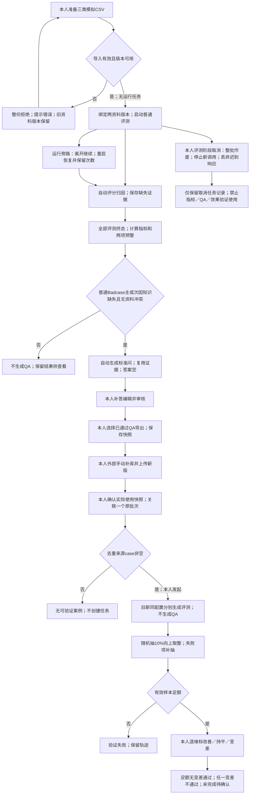

# 首版范围与业务链路说明（TASK-001）

### 2026-10-10 F11分组容错及TASK-024旧基线重判（最新，Codex）

本人先对允许少量无关事项误冲突回复“是”，再对“两组分别至少90%、最低正确数向上取整、已保存冲突标记禁QA仍严格执行”回复“是”。F11模型相关事项冲突判断分两组验收：固定真实有冲突样本的识别正确率及固定真实无冲突样本的判断正确率分别≥90%，最低正确数分别向上取整；漏报与误报分别计错，不合成整体比例。无结果/调用最终失败按所属固定组计错，不减分母。系统按已保存冲突标记禁止QA仍严格执行；准确性1和已确认禁止/允许直接冲突归因例外等原规则保持。

确认及复算见 `docs/04_validation/repair/F11-tolerance-change-20261010.md`；新版复审见 `docs/04_validation/final-review-rules-v3.md`。原E-v2第一轮真实冲突4/4（最低4），无冲突45/46（最低42）；038误报仍计错但在已确认容差内。原TASK-024基线按全部新规则50项在已取证范围满足，技术审查通过；不是原缺陷已修复，不是当前E-v3候选验收，最终交付及新版报告认可仍待本人。旧038必要阻塞为此前零容错门槛下状态，新规则下不再单独阻塞原E-v2；当前候选证据缺口、FIX整卡版本处置未自动关闭。

### 2026-10-10 F19确认与四项规则复审（最新，Codex）

本人对“最终草稿覆盖率至少90%，但系统漏调度和违反禁止条件不在容错范围内”回复“接受”。F19端到端草稿覆盖数至少ceil(本人提前固定应生成缺失点数×90%)；漏识别、未生成、调用最终失败计未覆盖且不减分母。正确保存且符合条件的缺失点必须触发Q，系统漏调度不在容错范围；冲突、非缺失、合格、未完成、取消及效果任务等禁止集合不得生成。正常最多3次调用后失败单列，不是漏调度，但计未覆盖；F20文本质量另判。

F06/F09/F11/F19均已逐项确认并同步。详见 `docs/04_validation/repair/F19-rule-change-20261010.md` 和 `docs/04_validation/final-review-rules-v2.md`。第一轮旧E-v2按新规则重判：F06区间50/47/47，F09缺失点17/18，F19覆盖16/17及已保存资格Q交接满足；F11的049按新例外满足，但038无关事项误冲突仍失败。新矩阵为旧版本新规则范围内49通过/1失败，仍不通过、有阻塞；不是当前E-v3已验证。FIX/FR未自动关闭、原缺陷未记修复；F11/FR-02的038及当前候选证据缺口保持，最终交付待本人明确认可。原报告、冻结文件及前面阶段状态作为历史保留，本条更新此前F19未决定及038必导致F19覆盖失败的口径。

### 2026-10-10 F11禁止／允许冲突归因确认（当前增量规则，Codex）

本人对“禁止与允许直接冲突、客服选择允许时，优先归违规，其余冲突规则保持”明确回复“确认”。同一业务对象、同一行为和相同条件下，两份资料分别写禁止与允许，客服选择允许或承诺执行时，主因优先为“违反平台规则，做出不当承诺”；准确性仍1、资料冲突标记仍true、仍不生成QA。仅此直接冲突构成归因例外；其他纯冲突主因仍其他／证据不足，数值期限冲突不自动套用，无关对象条款不得套用。

本人理由：售卖可能有金额损失，不只是用户体验问题；禁止优先用于本例外归因，不宣称已确认哪份资料为事实权威。变更及新预期版本见 `docs/04_validation/repair/F11-rule-change-20261010.md`。ACC-049新主因改违规，旧E-v2输出按新规则符合该子项；原冻结预期/报告不改，不记原缺陷已修复。ACC-038无关事项误冲突仍失败，F11整项及FIX-003/FR-02不关闭；F19尚未变更。本条优先于下文旧纯冲突一律归其他及“049应纠正为其他”的门禁；旧执行事实保留。

### 2026-10-10 F09缺失点识别率确认（当前增量规则，Codex）

本人先回复“接受一定比例”，再对“按提前固定的知识缺失点统计，识别率至少90%，不足整数时向上取整”回复“是”。F09知识缺失识别按本人提前固定的全部知识缺失点统计，识别数至少ceil(N×90%)；漏识别、无结果及调用失败均计未识别，不缩小分母。同回复多点分开，不同回复同点分开；按对象、属性和条件的语义对应，不要求gap字面相同。

确认与复算见 `docs/04_validation/repair/F09-rule-change-20261010.md`。误报不由召回率抵消，原禁止一份资料已有答案仍标缺失及特殊评分保持；F11/F19尚未确认变更。第一轮E-v2全部缺失点18个（含冲突案例019中不得生成QA的1点），识别17个，最低17个；QA分母另为17，不能混用。仅识别率子项满足，不记整个F09、FR-02或FIX-003已关闭。原038误冲突及049归因、漏QA保持。本条更新此前“F09尚未变更”的时点状态，历史证据不改。

### 2026-10-10 F06区间验收确认（当前规则，Codex）

本人对“逐维区间比较、各维至少45/50、其余评分结构/理由/Badcase规则保持”明确回复“同意”。F06按每维1～3（不合格）与4～5（合格）两个区间比较，各维分别≥45/50同区间才达标；缺失或最终失败计错，固定50分母不变。三维独立1～5整数分、共用原档位、理由要求及任一维<4为Badcase保持。精确分差保留展示和诊断，不作为F06计错依据。

来源与新旧规则、复算及FIX/FR影响见 `docs/04_validation/repair/F06-rule-change-20261010.md`。原冻结精确标签及第一轮报告保持历史原样；F09/F11/F19尚未确认变更，特殊评分及归因/QA要求不被F06容差豁免。旧E-v2第一轮按新F06为50/50、47/50、47/50；不是E-v3候选验证、原缺陷已修复或产品通过。FIX-002/FR-01/FR-03产品承接暂不关闭，待逐项规则讨论及版本处置决定；FIX-003/FR-02保持开放。本条覆盖旧文中F06精确一致及其关闭判法，历史执行事实不改。

日期：2026-10-06（Asia/Shanghai）｜执行者：Codex｜档位：S3｜版本：首版确认稿｜状态：用户已认可（TASK-001已完成）

本稿按 package `04_prd_and_scope/prd-template.md` 的八章组织。范围、非目标及任务卡必含内容归入同一文档。模板根为 `D:/Codex/home/skills/using-vibe-delivery-kit/references/project-template/ai-delivery-kit/`。本稿仅整理已确认需求。业务原文及验收标准仍以 RDD 为准。

## 基线与确认记录

| 输入 | 当前依据 | 本稿用途 |
|---|---|---|
| [用户地图](../../RDD/user-map.md) | 核心用户、唯一操作与拍板者、结果观看者、信息展示原则 | 角色、目标与呈现边界 |
| [场景地图](../../RDD/scenario-map.md) | 全部九场景 | 主链路与恢复取消旁路 |
| [决策地图](../../RDD/decision-map.md) | 全部十一决策、已确认判定规则 | 自动计算与人工判断分工 |
| [数据地图](../../RDD/data-map.md) | 十五实体及表外约定 | 原文、版本、证据与快照追溯 |
| [输出地图](../../RDD/output-map.md) | 十三输出物、业务验收依据、指标精度 | 模块产出与验收输入 |
| [风险地图](../../RDD/risk-map.md) | 全部二十一风险 | 异常、误用及业务边界 |
| [验收清单](../../RDD/验收清单.md) | F01～F32、D01～D11、P01～P07，50条预期已确认 | 唯一详细验收来源 |
| [关键未知项](../../RDD/关键未知项.md) | U01～U09、U11、U13已确认；U10/U12待确认 | 已定子项与未决子项分开 |
| [任务卡](../03_tasks/task-cards/TASK-001.md)、[总表](../03_tasks/ai-task-master-list.md)、[依赖图](../03_tasks/dependency-map.md) | 当前安排确认版；24任务、57依赖 | 本次交付契约及后续承接 |
| [Reviewer记录](../../RDD/Reviewer记录.md)、[Gate结论](../../RDD/Gate结论.md) | 最新“全部24卡确认及FRESH-03关闭复核”；FRESH-01～04关闭 | Gate 0/1通过；Gate 2文档任务化通过；Gate 3限定范围按依赖分阶段设计通过 |

六图当前决定记录更新于2026-10-05。总表及任务安排于2026-10-05～06确认。本次用户于2026-10-06明确授权仅执行 TASK-001，并已同意按 package PRD 格式整理。主要产出统一为 `docs/02_prd/scope.md`；旧 `docs/02_design/scope.md` 约定已同步，不保留重复稿。002～006设计路径保持。

2026-10-06用户对本稿审阅确认回复“是”，本稿已获用户产物认可。Gate成熟度、安排确认、执行授权、产物认可、产品验收各自记录。TASK-002～024未执行。既有RDD不重做，不补Intake，不采用2026-10-02旧设计或旧自审。本稿不形成 TASK-007设计审查或开发放行结论。

## DG-04当前承接提示（2026-10-06，Codex）

本文件是TASK-001首版认可范围。正文中的“未定型号/协议”“002～006未执行”“本次不启动后续”描述其成稿时检查点，不能作为当前状态。历史原文保留，以下是当前承接，不改变范围或50条标准：

- 型号、G/E/Q配置和完整协议已在[TASK-003模型契约](../02_design/model-contract.md)获认可；U12仍开放的是正式50条及逐条预期，见[关键未知项](../../RDD/关键未知项.md)。U10阈值仍留TASK-023实测后确认。
- 十五实体由[002字典](../02_design/data-dictionary.md)承接；[004行为](../02_design/behavior-spec.md)B01～B03、[005交互](../02_design/ui-spec.md)导出格式/多快照及[006验证](../02_design/verification-plan.md)已认可。
- 框架、物理模型、接口及TX01～TX10已在[007报告第12～16章](../03_tasks/design-gate-review.md)承接，DG-03两项也已确认；具体兼容性、产品效果和性能尚未验证。
- 当前001～006产物已认可；007报告已形成及复审，报告整体仍待用户审阅；008～024未执行、开发未授权。第8章阶段表及其历史未执行文字须按此当前索引阅读。

## 1. 产品定位

工作台供本人评测模拟AI商业化客服回复，识别知识缺失，人工补答并更新模拟知识库，再比较更新前后的效果。项目用于个人简历及视频演示。

业务覆盖会员、额度积分、API、Skill／Agent交易。会员权益优先。每日少于1万条是业务背景，不是首版吞吐承诺。首版每批最多100条。

来源：用户地图「核心用户」「唯一操作与拍板者」；场景地图首版边界；F30/F31/D10/P07。

## 2. 目标用户

| 用户 | 核心场景 | 痛点／需要处理的问题 | 成功标准 |
|---|---|---|---|
| 本人扮演产品经理 | 评测、追溯、补充、验证 | 识别不合格回复与知识缺失；判断补充是否变差 | 完成完整链路；评分和分类满足已定验收口径 |
| 本人作为唯一操作与拍板者 | 准备模拟资料、补答审核、选快照、判断效果 | 错误QA入库会持续影响回复；需保持内容与来源对应 | 单人单机可用；人工判断点可操作；版本与来源可追溯 |
| 视频观看者 | 观看本人录制的演示 | 理解功能与流程 | 通过演示了解项目，不参与工作台操作或决定 |

前两角色是同一人。首版无需访客账号、多用户权限或新手专家双流程。工作台付费角色不适用；模拟客服业务的会员身份保留。

列表显示摘要，详情显示完整依据。批次列表显示通过率、平均分、异常率、任务状态及进度。case列表显示问题摘要、合格状态、三维分数及主因。详情显示完整问题、回复、聊天记录、评分理由、主次因及知识缺失证据。本稿不固定页面布局。

来源：用户地图三个角色及「信息展示原则」；U09/U11；F30/P01/P06/P07。

## 3. MVP范围（首版）

### 3.1 必须做

| 功能范围 | 必须纳入的原因 | 验收索引 |
|---|---|---|
| 三类模拟CSV导入及资料版本 | 提供可定位、可复现的评测输入 | F01～F04、D01/D02/D11 |
| 自动三维评分、主次因及知识缺失证据 | 定位回复质量与补充对象 | F05～F12/F32、D03、P01 |
| 批次计算与工作台内两项预警 | 分开质量问题和技术异常 | F13～F15、P02/P03 |
| 单任务执行、进度持久化、恢复及取消 | 执行中保持状态、计次与下游一致 | F16～F18/F31、D04、P03/P07 |
| 自动标准问草稿、人工补答审核 | 补充缺失知识，保留人工内容判断 | F19～F23、D05、P04/P06 |
| 人工选择导出及不可变快照 | 固定实际导出内容，防止版本混用 | F24、D06、P04 |
| 外部手动补库、上传及快照关联 | 记录实际加入的内容与来源 | F25/F26、D07 |
| 旧新分别生成评测、随机抽检及人工结论 | 判断本次补充是否变差 | F27～F29、D08/D09、P05/P06 |
| 单人模拟环境及演示呈现 | 遵守个人作品范围 | F30/F31、D10/D11、P07 |

运行边界：单人单机／单台服务器，Windows上的Chrome；实际浏览器版本留到验收记录。一次只运行一个任务，无排队。同任务模型请求同时最多3个，覆盖评测、QA生成和效果验证。DeepSeek官方API已定，具体型号、各任务配置和完整协议未定。前后端、数据库、部署配置未定。来源：总表「首版边界」、U09/U10/U12。

### 3.2 明确不做

| 排除范围 | 原因与边界 | 未来是否考虑 |
|---|---|---|
| 多租户、访客账号、多用户权限、新手专家双流程、工作台付费角色 | 仅本人操作；观看者通过视频了解项目 | 未决定 |
| 线上客服接入、真实知识库连接、真实客户消息、自动写知识库 | 仅模拟CSV；本人外部手动补库 | 未决定 |
| 自动敏感检测 | 模拟输入与保存边界由本人保证 | 未决定 |
| 评分或分类人工编辑、额外AI审核 | 保留既有评分归因与人工QA审核分工 | 未决定 |
| 手动重试、超时提醒、人工处理截止时间 | 沿用自动最多3次及既有状态展示 | 未决定 |
| 独立报告导出、工作台录屏／视频导出、温度调节功能 | 项目文档报告与本人录制不增加产品功能 | 未决定 |
| 飞书流程、平均分告警、pushed状态 | 当前基线未包含，不引入其他项目流程 | 未决定 |

来源：总表「首版边界」、用户地图、输出地图「业务验收依据」、风险地图末段、数据地图「模型配置记录」；F12/F22/F30、D11。以上“未来未决定”不构成路线图承诺。

### 3.3 延后确定的内容

U10耗时上限、U12型号配置／完整协议、正式样本分别留到023、003、021。延后的是既定范围内的具体内容；不是删除功能，也不是新增下一版需求。详细状态见第8章。

## 4. 核心流程

### 4.1 完整业务链路

图表示业务因果，不定义接口或页面布局。单任务窗口贯穿评测及应生成QA全部终态；QA阶段不能取消。效果验证遵守同一运行窗口和并发上限。来源：场景地图全部九场景；F16～F29；U03/U06/U10/U12。

### 4.2 九场景节点契约

| 节点／场景 | 输入与前置 | 处理与输出 | 本人判断及下一步 | 异常／无数据去向 |
|---|---|---|---|---|
| N1 准备模拟业务资料 | 三类固定模板CSV | 校验并保存case或资料版本、上传时间 | 确认资料有效；选择两版本进入N2 | 任意格式、必填、重复、超限或问题上下文不一致整份拒绝；空／不可解析／无有效文字拒绝；资料失败不建新版本，旧版本保留；首次失败无可用版本 |
| N2 每日例行上传对话评测 | ≤100case，两资料版本，无运行任务 | 逐条三维评分、分类、证据；最多3次取得终态 | 本人启动；全部评测终态进入N3及N4 | 调用／解析／完整性异常自动重试；耗尽记最终异常一次；无手动重试；Badcase不是技术异常 |
| N3 从预警排查问题 | 最终评测记录 | 三指标、批次结论、独立两预警 | 本人分别查看Badcase或异常明细 | 零成功：通过率与平均分无数据，异常率100%且预警，批次不通过；不生成QA |
| N4 生成并审核QA | 普通评测完成的知识缺失Badcase，无冲突 | 每缺失点独立标准问；证据复用；答案空；审核待审核／已通过 | 本人改问、补答并确认；完整且确认才通过 | 非缺失、合格、冲突、取消及效果验证不生成；QA生成最多3次，失败单列，不改变评测或重做证据；不能用的内容留待审核，无驳回状态 |
| N5 导出可用QA | 本人选择已通过QA，四字段完整 | 四字段CSV及不可变导出快照，可重复导出 | 本人选择用于补库的内容，进入N6 | 未通过和生成失败不能导出；标准问或答案实际修改保存回待审核，查看／取消／原样保存不改变状态 |
| N6 手动补充知识库 | 导出快照及本人外部编辑的新库CSV | 新库版本、实际快照、QA、来源case、原批次关联 | 本人确认实际入库及具体历史快照；一次一个原批次；在补充记录详情发起N7 | 未导出QA不能关联；当前QA待审核不取消历史已通过导出快照资格；未确认不发起验证 |
| N7 前后效果验证 | 本次已补QA来源case去重；原规则、原上下文、相同模型配置 | 旧新知识库分别重新生成回复、各自评测、同范围三指标 | 本人核对范围与版本；进入N8 | 无来源显示无可验证案例，不建任务；两侧生成及评测各最多3次；不可比较项保留失败状态；不生成QA |
| N8 随机人工抽检 | 参与case集合，自动阶段完成 | ceil(N×10%)目标，随机不重复；失败与补抽轨迹；人工三维结论 | 本人标改善／持平／变差；足额无变差通过，任一变差不通过 | 抽中最终失败项，从成功且未抽项随机补；目标不缩小；不足验证失败；人工未完待确认；新Badcase仍可比较 |
| N9 任务中断与恢复 | 运行进度、已保存结果、调用次数 | 离开继续；重启恢复未完成，已成功不再调用 | 本人回看状态或在评测阶段主动取消 | 发送前持久计次；已发送未保存仍计次；剩余额度内恢复，累计最多3次；评测取消整批失效，仅记录保留；QA阶段不可取消 |

来源：场景地图同名九条；数据地图「导入与保存边界」「恢复计次与取消响应」；输出地图相应输出。验收：N1 F01～F04/D01/D02；N2 F05～F12/D03；N3 F13～F15/P02；N4 F19～F23/D05；N5 F24/D06；N6 F25/D07；N7 F26/F27/D08；N8 F28/F29/D09；N9 F16～F18/D04。

### 4.3 保持原判定边界

三维是信息准确性、意图理解、服务质量。各维独立1～5整数分，共用既定档位。综合分为算术平均并四舍五入两位。任一维度低于4就是Badcase，不能用综合分覆盖。理由不超过50个Unicode码点；换行统一后计1，标点和空格计入。档位全文以决策地图「已确认判定规则」为准。F05/F06、U04。

Badcase主因唯一，从五类选；次因可空，从前四类多选且排除主因。合规永远优先。两资料共同缺信息才标知识缺失；纯兜底准确性3，含编造确定信息为1。资料已有答案仍兜底，准确性1、敷衍主因、不生成QA。资料冲突准确性1、单纯冲突主因其他／证据不足；同时违规承诺时合规主因，冲突仍阻止QA。每个知识缺失点在评测阶段输出片段及reason，缺失按评测不完整处理。F07～F12/F19、U02/U03。

通过率＝合格数／成功数。平均分＝成功case三维总分／（成功数×3）。异常率＝最终异常数／总case数。重试不新增case。异常率≤5%且无Badcase才整批通过。通过率<95%及异常率>5%分别预警，恰好边界不触发；两预警独立，不设平均分告警。百分比及平均分四舍五入两位，阈值使用未舍入值。F13～F15、U05。

旧新比较只改变知识库，原业务规则、上下文、模型、提示词及支持参数保持一致。旧新均重新生成，不把上传回复当同模型旧基线。效果验证通过只表示足额抽检未发现变差，不表示新回复全部合格。来源：决策地图、输出地图「前后效果对比」「人工抽检及验证结论」；F27/F29、D08、P05。

## 5. 功能模块

### 5.1 模块、输入、输出与验收

下列模块是已有任务包的业务分组，不预设技术架构或新增组件。

| 模块 | 目标 | 输入 | 输出 | 验收标准索引 |
|---|---|---|---|---|
| 导入与版本（008） | 保留输入与评测依据 | 三类CSV | 模板提示、case、版本与时间 | F01～F04、D01/D02/D11 |
| 执行与模型结果（009～011） | 取得可用评测结果与真实异常 | case、资料、配置 | 进度、评分、分类、证据、异常 | F05～F12/F16～F18/F31/F32、D03/D04 |
| 指标预警（012） | 正确汇总并定位问题 | 最终结果 | 三指标、批次结论、两预警 | F13～F15、P02/P03 |
| QA生成审核导出（013～014） | 生成问、人工补答、固定可用内容 | 缺失证据、人工编辑与选择 | 草稿、审核状态、CSV与快照 | F19～F24、D05/D06、P04 |
| 补充关联（015） | 追溯实际补充 | 新库、所选快照 | 补充记录与来源集合 | F25/F26、D07 |
| 效果评测抽检（016～017） | 比较补充效果 | 去重来源、旧新库及原依据 | 对比、抽检轨迹、人工结论 | F27～F29、D08/D09、P05 |
| 工作台呈现（018） | 显示真实摘要与完整依据 | 上述持久结果 | 列表、详情、操作与责任说明 | F30、P01～P07 |

### 5.2 50条F/D/P追溯索引

每行定位范围节点和后续责任，不复制全部详细验收。原标准、阈值、禁止行为及状态见[验收清单](../../RDD/验收清单.md)对应ID；主责及验证承接见[总表“50条验收覆盖”](../03_tasks/ai-task-master-list.md#50条验收覆盖)。本表不表示产品已经满足。

| ID | 范围／源条目主题 | 链路节点 | 后续主责 | U／边界 |
|---|---|---|---|---|
| F01 | 三类有效CSV与解析 | N1 | TASK-008 | U01 |
| F02 | 无效、重复、超限整份拒绝 | N1 | TASK-008 | U01；100有效／101拒绝 |
| F03 | 空输入及旧版本保留 | N1 | TASK-008 | 首次失败无可用版本 |
| F04 | 重复只查当前文件 | N1 | TASK-008 | 历史重复允许 |
| F05 | 三维及Badcase判定 | N2/N7 | TASK-011 | 单维<4；均值不覆盖 |
| F06 | 共用档位及逐维区间一致率 | N2/N7 | TASK-011 | U04/U12；各维≥45/50 |
| F07 | 主次因结构 | N2/N7 | TASK-011 | 五主因唯一；次因前四类 |
| F08 | Badcase与分类一致率 | N2/N7 | TASK-011 | Badcase≥45/50；主因、次因各≥23/25 |
| F09 | 联合缺知识与兜底编造 | N2 | TASK-011 | U02；纯兜底3、编造1 |
| F10 | 已有答案兜底及违规优先 | N2 | TASK-011 | U02；保留缺失次因 |
| F11 | 冲突与违规组合 | N2/N4 | TASK-011 | U02；准确性1，冲突不生成QA |
| F12 | 三类评测异常及自动重试 | N2/N9 | TASK-010 | U03/U12；最多3次 |
| F13 | 批次公式与展示 | N3 | TASK-012 | U05；成功分母、未舍入阈值 |
| F14 | 预警与批次结论边界 | N3 | TASK-012 | ≤5%、<95%、>5%分别使用 |
| F15 | 全失败无数据 | N3/N4 | TASK-012 | 异常100%；不生成QA |
| F16 | 单任务执行窗口 | N2/N4/N7/N9 | TASK-009 | 无排队；QA终态才释放 |
| F17 | 离开继续与重启恢复 | N9 | TASK-009 | U06；发送前计次、成功不重调 |
| F18 | 评测取消整批作废 | N9 | TASK-009 | U06；QA阶段不可取消 |
| F19 | 自动生成QA条件 | N4 | TASK-013 | U02/U03；主或次因均触发，冲突排除 |
| F20 | 草稿粒度及内容质量 | N4 | TASK-013 | U04/U07；每缺失点；语义≥ceil(总数×90%) |
| F21 | QA失败独立于评测 | N4 | TASK-013 | U03；仅标准问重试最多3次 |
| F22 | 人工审核及必填 | N4 | TASK-014 | 无额外AI审核、无驳回 |
| F23 | 实际编辑保存回待审核 | N4/N5 | TASK-014 | 查看／取消／原样保存不变 |
| F24 | 人工选择导出 | N5 | TASK-014 | 四字段、已通过、可重复 |
| F25 | 手动补库与实际快照 | N6 | TASK-015 | U13；一个原批次 |
| F26 | 验证来源集合去重 | N6/N7 | TASK-015 | 无来源不建任务 |
| F27 | 同依据旧新分别生成评测 | N7 | TASK-016 | U12；各阶段最多3次 |
| F28 | 随机抽样、失败补抽 | N8 | TASK-017 | U08；10%向上取整 |
| F29 | 人工效果结论 | N8 | TASK-017 | 足额无变差通过；不足失败 |
| F30 | 单人模拟浏览器演示 | N1～N9 | TASK-018 | U09/U11；无线上动作 |
| F31 | 批内并行与三批耗时 | N2/N4/N7/N9 | TASK-009 | U10；并发≤3；阈值未定 |
| F32 | 聊天评分指令作为数据 | N2 | TASK-011 | 独立成对测试，不占50条 |
| D01 | 四字段原文与上下文 | N1/N2 | TASK-008 | U01；只追加当前回复 |
| D02 | 资料版本保存 | N1/N2/N6 | TASK-008 | 原批次依据不覆盖 |
| D03 | 最终结果一次统计 | N2/N3 | TASK-010 | 成功＋最终异常＝输入数，取消例外 |
| D04 | 持久进度与取消下游失效 | N9 | TASK-009 | U06 |
| D05 | 草稿与缺失证据来源 | N4 | TASK-013 | U03/U07；人工答案不覆盖 |
| D06 | 不可变导出快照 | N5/N6 | TASK-014 | U13；历史资格保留 |
| D07 | 新库到原批完整追溯 | N6/N7 | TASK-015 | U13；不用当前QA替历史快照 |
| D08 | 两侧配置及完整数据 | N7 | TASK-016 | U12；仅知识库差异 |
| D09 | 抽检及补抽轨迹 | N8 | TASK-017 | U08；失败不静默删除 |
| D10 | 正式集固定及覆盖 | 验收准备 | TASK-021 | U12；独立调试、答案不传模型 |
| D11 | 模拟输入及保存边界 | N1～N9 | TASK-021 | 本人保证无真实个人信息、密码、密钥 |
| P01 | 完整评测明细 | N2/N7 | TASK-018 | U03/U04；与保存结果一致 |
| P02 | 指标预警及定位 | N3 | TASK-018 | U05；两条预警分别跳转 |
| P03 | 无数据、运行、失败、取消 | N3/N4/N9 | TASK-018 | 真实状态，未完不显示最终结论 |
| P04 | QA证据、审核与历史导出 | N4/N5/N6 | TASK-018 | U13 |
| P05 | 同组对比与独立人工结论 | N7/N8 | TASK-018 | U05；合格与效果结论分开 |
| P06 | 模型辅助判断责任说明 | N4/N8 | TASK-018 | QA及效果由本人确认 |
| P07 | 信息密度、浏览器、耗时 | N1～N9 | TASK-018 | U09/U10/U11；阈值未定 |

正式语义验收保持50条分母：三维分数及Badcase各自至少45/50一致；25条人工Badcase的主因及完整次因集合各至少23/25一致。缺失结果计错。配额为会员20、额度积分10、API10、交易10，每类合格与Badcase各半；25主因分配9/5/4/4/3，其中知识缺失7兜底、2编造。边界标签按D10和输出地图保留，实际样本未编写。

QA语义以人工预先固定的全部应生成草稿为分母，漏生成与失败计不合格；最低合格数为ceil(总数×90%)。确定性流程和QA确定性检查全部通过，不与语义一致率混算。U08独立随机测试为100case、1000轮、每轮10条无重复，各条累计60～140次含边界。上述是未来验收口径，本次未执行产品测试。

## 6. 数据和权限

需要的数据：case原始四字段、两资料版本与时间、任务进度及调用次数、评分分类及缺失证据、QA人工答案与审核状态、不可变导出快照、实际补充关联、旧新完整结果及配置、抽检轨迹与人工结论。十五实体字段后续由TASK-002设计；本稿不新增数据模型。来源：数据地图实体表；D01～D10。

数据来源仅为本人模拟CSV、工作台计算／模型输出、本人编辑和确认。三类中文固定表头、UTF-8可带BOM。完整解析约定引用数据地图「CSV模板与解析约定」和U01，不在本稿另建模板版本。输入与保存不含真实个人信息、密码或密钥，由本人保证；不新增自动检测。D11。

权限边界：本人是唯一操作与决定者。观看者不登录工作台。本次不设计账户权限或接入真实系统。模拟会员身份不等于工作台付费身份。

### 人工与自动化边界（十一决策集中展示）

| 决策／动作 | 自动化职责 | 本人职责 | 来源／验收 |
|---|---|---|---|
| 单条是否合格 | AI三维评分；工作台按单维阈值计算 | 提前固定验收标注，不编辑产品评分 | 决策同名条目；F05/F06 |
| Badcase主次因 | AI归因并输出证据 | 查看依据；首版无分类编辑 | 决策同名条目；F07/F08 |
| 是否知识缺失 | 联合两资料判断 | 确认资料与业务事实 | 决策同名条目；F09～F11 |
| 整批是否通过 | 工作台按异常率及Badcase计算 | 查看结论 | 决策同名条目；F13～F15 |
| 是否预警 | 工作台计算并显示两预警 | 点击并排查 | 决策同名条目；P02 |
| 是否生成QA | 按普通批次、主次因、冲突规则触发；只生成标准问，复用证据，答案空 | 不需要逐条发起生成 | 决策同名条目；F19～F21 |
| QA是否可导出入库 | 只检查字段完整、保存审核和导出快照 | 补答、编辑、审核、选择导出；外部手动补库 | 决策同名条目；F22～F24 |
| 哪些QA实际加入新库 | 记录新版本及所选历史快照关联 | 确认实际加入的具体快照内容 | 决策同名条目；F25/D06/D07、U13 |
| 验证哪些case | 从实际补充QA来源自动去重 | 确认补充集合、核对版本并发起 | 决策同名条目；F26、U12 |
| 补充后是否变差 | 旧新自动生成评测；随机抽样及补抽 | 逐维比较并标改善／持平／变差 | 决策同名条目；F27/F28 |
| 整次效果是否通过 | 保存人工记录并汇总结论 | 完成足额比较并确认效果 | 决策同名条目；F29/P05/P06 |

本人还负责资料有效性与模拟输入检查、主动取消，以及003协议、021标注、023耗时阈值等阶段决定。本地验证由Codex自动执行，无CI或外包。业务语义、QA正确性和效果判断仍保留人工职责。

## 7. 风险和合规

本章引用模拟业务的既有风险，不增加真实合规系统或安全功能。本次不处理生产数据，不涉及真实支付或权限变更，因此未升S4。后续真实触及该范围时须重新分级。

| 风险（风险地图原条目） | 影响 | 已确认处理方式／责任 | 范围索引 |
|---|---|---|---|
| 错误QA入库（最高风险） | 持续错误回复 | 答案空；本人补答审核、手动补库 | F22～F25 |
| 两份资料冲突 | 错误依据 | 准确性1；冲突禁止QA；合规组合按U02 | F11 |
| 联合知识来源缺少信息 | 兜底或编造 | 纯兜底3、编造1；问自动、答案人工 | F09 |
| 已有答案却兜底 | 已有知识未用 | 准确性1、敷衍主因、无QA | F10 |
| 违规承诺 | 违反模拟规则 | 合规优先、准确性1，保留有证据次因 | F10/F11 |
| 聊天中的评分指令干扰 | 评分偏离 | 对话只作数据；独立测试 | F32 |
| 无效、重复或空输入 | 关联错误 | 整份拒绝，定位错误 | F02～F04 |
| 资料过期或不可靠 | 评测依据错误 | 保存版本时间；本人确认有效 | D02 |
| 真实个人信息、凭据进入项目 | 超模拟边界 | 本人保证输入和保存不含禁用数据 | D11 |
| 调用、解析或完整性异常 | 缺结果、失真 | 最多3次，最终异常一次统计 | F12/D03 |
| QA生成失败 | 漏草稿 | 仅QA重试；失败单列；评测不变 | F21 |
| 中断、重复执行与资源占用 | 丢进度、重复费用 | 单任务、并发≤3；恢复计次；取消迟到丢弃 | F16～F18/F31 |
| 知识缺失草稿与原意不一致 | 标准问失真 | 保留原文、每点独立；本人审核 | F20/D05 |
| 修改后沿用旧确认 | 未审新内容导出 | 实际改动保存回待审核 | F23 |
| 多次导出版本混用 | 实际内容不对应 | 不可变快照；本人选实际版本 | D06/D07 |
| 原因标签与后续行为混淆 | 错生成或漏生成 | 主或次因触发；冲突及效果验证排除 | F19 |
| 对比无法归因于知识补充 | 将波动当改善 | 同依据两侧生成；模型波动仍无法完全排除 | F27/D08 |
| 抽检失败或样本不足 | 无证据通过 | 10%向上取整；失败补抽；不足失败 | F28/F29 |
| 将验证通过误解为全部合格 | 高估改善 | 合格与人工结论分别展示 | P05 |
| 验收集被调试污染 | 一致率虚高 | 独立调试集；用户固定标注；不传答案 | D10 |
| 项目动作影响真实线上用户 | 超授权边界 | 仅模拟CSV，无线上连接或真实消息 | F30 |

既有业务确认边界全部保留。不能以字段完整代替内容正确；不能以文档检查代替效果验证。U06恢复重试可能重复外部调用并产生额外费用，取消前已发送请求可能计费。

## 8. 版本计划

| 版本／阶段 | 范围 | 本阶段不做 | 验收／门槛 |
|---|---|---|---|
| 首版范围（本次001） | 本文范围、链路、追溯及未决阶段 | Spec、技术选型、代码、实际样本 | 本地文档验证通过；2026-10-06用户产物确认 |
| 002～006设计 | 字段追溯、模型协议、行为与交互、验证方案 | 未获授权实现 | 按真实依赖、产物认可及阶段授权；本次未执行 |
| 007设计审查 | 审查001～006真实认可产物 | 替代用户实现授权 | 设计审查结论与实现授权分别记录；本次未执行 |
| 008～020实现与独立验证 | 首版模块、独立调试、确定性证据 | 使用正式验收集调试、CI | 设计认可及明确实现授权；本次未执行 |
| 021～024验收及交付 | 样本固定、业务呈现验收、性能阈值、最终审查 | 无证据宣称产品通过 | 用户逐条固定预期，真实验证及最终确认；本次未执行 |

阶段表只描述已安排任务。不新增第二版计划，也不授权下一任务。

### 8.1 未决子项及解决阶段（TASK-001成稿检查点，当前承接见顶部）

未知项唯一完整源为[关键未知项](../../RDD/关键未知项.md)。本稿只列后续输入和阻塞边界。U01～U09、U11、U13已确认，不重开。其中U01模板解析、U02组合、U03证据复用、U04码点、U05精度、U06恢复、U07质量、U08抽样、U09浏览器、U11信息及角色、U13历史快照分别已纳入上述范围。

| 子项 | 已定内容 | 仍未定内容 | 承接及确认 | 阻塞边界 |
|---|---|---|---|---|
| U10 | 同任务请求≤3；100条完整自动阶段计时；同机同模型配置固定输入连续3批；不含人工补答审核 | 耗时上限 | TASK-023实测，Codex建议，用户确认 | 未定前只能记录耗时，不能判性能达标；延期认可不关闭U10 |
| U12模型／协议 | DeepSeek官方API；固定字段JSON方向；工作台计算综合、合格、指标 | 具体型号、各任务配置、完整字段约束及协议 | TASK-003提出，用户设计确认 | 不得将JSON方向当完整契约供实现；U12保留待确认 |
| U12实际样本 | 50条配额及规则；独立调试；人工答案不传模型 | 实际50条、预期标注、应生成QA全集及总数 | TASK-019独立调试；TASK-021产品验收准备时起草，用户逐条固定；022执行 | 当前不编样本，不能宣称业务验收；延期认可不关闭U12 |
| 技术实现 | 单人单机、Windows Chrome、已定业务及数据边界 | 框架、数据库、工程路径、运行部署配置 | 后续技术设计按任务及既有确认约定提出 | 本稿不预选，不承诺不存在的运行命令 |

U12效果验证入口已经确认：补充记录详情中的“发起效果验证”。不将其重新列为未定。浏览器具体版本由实际验收记录，不预设通过版本。

### 8.2 后续设计输入（TASK-001成稿检查点，当前承接见顶部）

| 承接任务 | 本稿提供 | 后续须产出的内容 | 当前状态 |
|---|---|---|---|
| TASK-002 | 节点输入输出、十五实体源、版本及快照追溯、50索引 | 字段、关系、来源及生命周期字典 | 未执行；001产物已认可，仍需执行授权 |
| TASK-003 | U12已定／未定边界、U03/U04/U06/U10约束 | 具体模型配置及完整协议，经用户确认 | 未执行；依赖002 |
| TASK-004 | 九场景、十一决策、二十一风险、异常与无数据去向 | 基于001～003的完整业务行为Spec | 未执行；依赖真实认可产物 |
| TASK-005 | 摘要／完整依据原则、输出及人工动作 | 页面与交互Spec；不由本文预定布局 | 未执行；依赖002/004 |
| TASK-006 | 原验收来源、语义及确定性分工、未决边界 | 适配设计的本地验证方案 | 未执行；依赖003～005 |
| TASK-007 | 一个主要范围文档及源引用、50追溯、状态记录 | 审查001～006实际产物和门禁 | 未执行；不因本文产生就认为审查通过 |

2026-10-06用户已确认本文对已定范围、完整链路、人工边界及未决阶段的组织。TASK-001已完成；后续仍须按约定获得阶段执行授权。当前不启动TASK-002～024。
