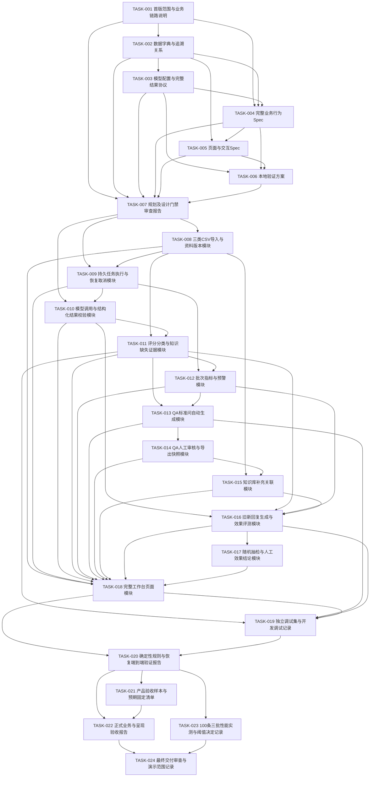

# 任务依赖与阶段门槛（总表及全部24卡安排已确认）

### 2026-10-10 E-v2最终交付选择与TASK-024通过（最新，Codex）

本人明确：“E-v2作为验收和交付版本，TASK-024按新标准通过，并将默认评分版本切回E-v2”。已将DeepSeek默认evaluation及Prompt manifest切回原evaluation-v2，保留E-v3资产和历史恢复许可；Q-v2/G-v4、参数、业务代码及原始证据不变。最终代码225项相关本地验证通过，无失败/错误/跳过。TASK-024按本人已确认新规则及明确交付选择通过，验收/交付对象固定E-v2；当前版本选择不再待定，不再以E-v3未验证阻塞本次交付。

交付认可与证据见 `docs/04_validation/task024-e2-delivery-confirmation.md`。原50项新规则重判满足；038误冲突、漏点/漏QA和同区间分差按已确认容差保留，不记原缺陷已修复。FIX-002/003候选不纳入本次交付，停止作为本次交付必要阻塞跟进，非“候选修复成功”；未验证E-v3/DBG-06及原非阻塞限制保留，后续改版或真实补验另需范围授权。不启动受拒服务动作、不调用模型、不部署；原报告及历史状态不覆盖，本条为最新交付状态。

日期：2026-10-05｜更新：2026-10-07｜整理者：Codex｜当前001～018实际产物已完成且获用户认可；019～024未执行且未获本次授权。

总表及50条覆盖见[任务总表](ai-task-master-list.md)。全部24卡安排已确认，001～018真实产物已完成且获用户认可；019已获本任务授权，真实E/Q完成，等待人工及旧新链路；020～024未执行。依赖表示真实前置产物完成且认可，不只是卡片安排确认。RDD Gate和007设计审查按各自源记录区分；本次模块验证不代表产品最终验收。

状态说明：“待分发”表示安排已确认但未执行；“实现及本地验证完成，待用户确认”表示已有实际产物和模块证据，用户认可仍待办理；“已完成（实际产物已获用户认可）”不等于产品最终验收。阶段推进仍须真实前置及单独授权；018产物已认可，不自动启动019/020。

## 依赖总览

| 任务 | 前置依赖 | 后续任务 | 阻塞原因 | 状态 |
|---|---|---|---|---|
| TASK-001 | 无 | TASK-002、TASK-004、TASK-007 | 范围产物已获用户认可；002本次已授权，其他任务授权分别记录 | 已完成（产物已获用户认可） |
| TASK-002 | TASK-001 | TASK-003、TASK-004、TASK-005、TASK-007 | 前置001已认可；002产物已获用户认可；后续未授权 | 已完成（用户已认可产物） |
| TASK-003 | TASK-002 | TASK-004、TASK-006、TASK-007 | 前置002及003实际产物已获认可；后续授权分别记录 | 已完成（用户已认可产物及U12技术方案） |
| TASK-004 | TASK-001、TASK-002、TASK-003 | TASK-005、TASK-006、TASK-007 | 前置001～003已认可，本轮004获授权，Spec已认可 | 已完成（用户已认可产物） |
| TASK-005 | TASK-002、TASK-004 | TASK-006、TASK-007 | 002/004产物已完成且认可；005本轮已授权，UI Spec已认可 | 已完成（用户已认可产物） |
| TASK-006 | TASK-003、TASK-004、TASK-005 | TASK-007 | 003～005实际产物已认可；006本轮已授权，方案已获认可 | 已完成（产物已获用户认可） |
| TASK-007 | TASK-001、TASK-002、TASK-003、TASK-004、TASK-005、TASK-006 | TASK-008、TASK-009、TASK-010 | 真实产物已完成且获用户认可；后续执行另获授权 | 已完成（实际产物已获用户认可） |
| TASK-008 | TASK-007 | TASK-009、TASK-011、TASK-015、TASK-018 | 真实产物已完成且获用户认可；后续执行另获授权 | 已完成（实际产物已获用户认可） |
| TASK-009 | TASK-007、TASK-008 | TASK-010、TASK-012、TASK-018 | 真实产物已完成且获用户认可；后续执行另获授权 | 已完成（实际产物已获用户认可） |
| TASK-010 | TASK-007、TASK-009 | TASK-011、TASK-016、TASK-018 | 前置007/009实际产物及认可满足；仅010执行已授权 | 已完成（实际产物已获用户认可；真实API未验证） |
| TASK-011 | TASK-008、TASK-010 | TASK-012、TASK-013、TASK-016、TASK-018、TASK-019 | 前置008/010及011实际产物均已认可；后续执行须另获授权 | 已完成（实际产物已获用户认可；真实模型语义未验证） |
| TASK-012 | TASK-009、TASK-011 | TASK-013、TASK-016、TASK-018 | 前置009/011及012实际产物均已认可；后续执行须另获授权 | 已完成（实际产物已获用户认可） |
| TASK-013 | TASK-011、TASK-012 | TASK-014、TASK-018、TASK-019 | 前置011/012及013实际产物均已认可；后续执行须另获授权 | 已完成（实际产物已获用户认可） |
| TASK-014 | TASK-013 | TASK-015、TASK-018 | 前置013及014实际产物均已认可；后续执行须另获授权 | 已完成（实际产物已获用户认可） |
| TASK-015 | TASK-008、TASK-014 | TASK-016、TASK-018 | 本卡已整批确认（2026-10-06）；前置产物/阶段授权未满足 | 已完成（实际产物已获用户认可） |
| TASK-016 | TASK-010、TASK-011、TASK-012、TASK-015 | TASK-017、TASK-018、TASK-019 | 前置010/011/012/015及016产物已认可；后续执行须另获授权 | 已完成（实际产物已获用户认可；真实API/语义未验证） |
| TASK-017 | TASK-016 | TASK-018 | 前置016及017实际产物已认可；后续执行须另获授权 | 已完成（实际产物已获用户认可） |
| TASK-018 | TASK-008、TASK-009、TASK-010、TASK-011、TASK-012、TASK-013、TASK-014、TASK-015、TASK-016、TASK-017 | TASK-019、TASK-020 | 008～017及018实际产物已认可；后续执行须另获授权 | 已完成（实际产物已获用户认可） |
| TASK-019 | TASK-011、TASK-013、TASK-016、TASK-018 | TASK-020 | 真实前置已认可；仅019执行授权已获得 | 进行中（真实E/Q已完成；等待人工及旧新链路） |
| TASK-020 | TASK-018、TASK-019 | TASK-021、TASK-022、TASK-023 | 本卡已整批确认（2026-10-06）；前置产物/阶段授权未满足 | 待分发（安排已确认，未执行） |
| TASK-021 | TASK-020 | TASK-022 | 本卡已整批确认（2026-10-06）；前置产物/阶段授权未满足 | 待分发（安排已确认，未执行） |
| TASK-022 | TASK-020、TASK-021 | TASK-024 | 本卡已整批确认（2026-10-06）；前置产物/阶段授权未满足 | 待分发（安排已确认，未执行） |
| TASK-023 | TASK-020 | TASK-024 | 本卡已整批确认（2026-10-06）；前置产物/阶段授权未满足 | 待分发（安排已确认，未执行） |
| TASK-024 | TASK-022、TASK-023 | 无 | 本卡已整批确认（2026-10-06）；前置产物/阶段授权未满足 | 待分发（安排已确认，未执行） |

## 依赖图

## 门槛与拆分理由

- 总表及全部24卡已完成安排确认：001～007逐卡确认，008～024按本次约定整批确认。004依赖范围、字段和模型契约；005交互依赖行为，006验证依据设计产物。执行仍须满足各卡前置产物与阶段授权，不需重复编卡或重复确认既定安排。
- 当前RDD文档Review已记录FRESH-01～04关闭、Gate 2任务化条件通过、Gate 3允许在明确范围内按依赖分阶段写Spec，以[最新门禁记录](../../RDD/Gate结论.md)为准。007和024是后续Review工作包：007须审查001～006真实设计产物，024须审查实际验证证据；当前RDD文档Review不代表007或024已执行，也不授予实现权限。
- 008～018工程执行须设计/Spec认可、007问题处理及用户明确实现授权。单人顺序执行，没有多agent并行安排；依赖图仅表达关系，不表示自动发起实现。
- 009提供执行窗口、持久调用计次及恢复，010提供模型适配/结构校验；011评测产证据，012聚合，013仅生成标准问复用证据，014人工补答审核导出，015实际补充及快照来源关联，016旧新生成评测，017人工抽检结论，018呈现真实数据。
- 每卡一个主要文档或可验证模块；模块可包含为其服务的前后端接口和本地测试，不新增通用自研框架。具体路径/生态工具由后续技术设计说明理由影响，本轮不预选。
- 019另编独立调试集；020记录独立确定性测试，包括F32成对样例及U08抽样；实际正式50条仅021在产品验收阶段准备，用户逐条固定再022运行。每批至多100条；1000轮抽样是本地随机函数验证次数，不是1000条批次。
- 023可在020之后开展，与正式50条验收没有前置关系；固定100条模拟数据及两资料、机器和模型配置，连续3批完整自动阶段计时。用户决定耗时上限是023完成性能判定的门槛，未决定保留待确认。
- 024依赖022、023真实证据及未决项记录。U12模型协议待003、实际样本待021；U10耗时待023。卡确认、产物完成、门禁通过与产品验收通过分开留痕。

2026-10-06更新｜Codex：用户逐卡确认TASK-005安排；依赖边及业务范围保持，任务未执行，产品未验收。

2026-10-06更新｜Codex：TASK-006已获用户逐卡安排确认；依赖关系及业务标准保持，任务未执行。

2026-10-06更新｜Codex：TASK-007安排已获用户逐卡确认，任务未执行；依赖边及业务标准保持。

2026-10-06更新｜Codex：008～024任务卡安排已整批确认，全部24任务均未执行；图中依赖边保持，前置完成与阶段执行授权仍是执行门槛。

2026-10-06本次执行更新｜Codex：仅TASK-001获执行授权。唯一主要产物为docs/02_prd/scope.md，首版已获用户认可。上述历史检查点不覆盖本次状态；57条依赖保持，002～024未执行。

2026-10-06产物确认｜Codex：TASK-001已获用户产物认可，001前置产物条件已满足；002仍需执行授权，其他真实依赖保持。上方待确认记录为执行时检查点。
2026-10-06｜Codex｜TASK-002产物已获用户认可；其前置产物条件已满足，TASK-003仍须单独执行授权；其余真实依赖与57条边保持。

2026-10-06｜Codex｜TASK-003本轮已获单独执行授权，前置002真实产物已认可；模型协议提案待审查，尚不满足后续要求其产物认可的门槛。57条依赖边保持，不执行004～024。

2026-10-06｜Codex｜TASK-003模型协议及U12技术方案已获用户认可，003已完成；依赖边保持。仅其真实产物前置满足，不授权004～024。U12正式样本未准备、未关闭。

2026-10-06｜Codex｜本轮004已完成且Spec获用户认可，真实前置001～003已完成且认可；57条依赖边保持，005～024不启动。局部行为决定不代替Spec整体认可。

2026-10-06｜Codex｜用户对TASK-004完整Spec认可问题回复是。behavior-spec.md升级1.0确认稿，TASK-004已完成；局部B01～B03及整体认可分别留痕。B04技术细节、U10耗时上限、U12正式样本仍保留后续事项；005～024未执行，本次认可不构成后续执行或开发授权。

2026-10-06｜Codex｜最新：001～004已完成且产物认可；本轮仅TASK-005获执行授权，ui-spec.md 0.1稿待审查；006～024未执行。本轮文档检查不表示产品验收或设计门禁通过。

2026-10-06｜Codex｜TASK-005整份产物认可：用户对“是否认可页面与交互Spec及其中设计建议”回复“是”。ui-spec.md 1.0已确认，TASK-005完成；页面导航、布局控件、UTF-8带BOM及四列顺序（标准问、参考答案、来源案例编号、问题分类）和文件名含记录身份/时间的方向已认可。精确文件名及未提出的全局次数限制不因此补定。U10耗时上限与U12正式样本仍未关闭；不执行006～024，不构成开发或产品验收放行。

2026-10-06｜Codex｜最新：001～005产物已完成且获认可；本次仅006获执行授权，verification-plan.md 0.1待审查；007～024未执行。不新增依赖、不启动后续、不表示产品验收通过。

2026-10-06｜Codex｜用户回复“是”认可TASK-006本地验证方案。1.0确认稿已认可，006已完成；U10/U12保持开放，007～024未执行且未获本次授权。

### 2026-10-07 TASK-009执行记录（最新状态，Codex）

本次用户明确仅授权TASK-009代码实现与本地验证；007最新整体报告及008实际产物/已披露影响认可已核对。TASK-009实现及本地验证完成，待用户确认。路径：backend/app/{domain,models,services}/execution.py、runtime/executor.py、api/tasks.py、main.py及0002_execution迁移；测试为backend/tests/test_task_*.py，命令./backend/run-task009-tests.ps1。模块说明backend/TASK009.md，验收逐项证据.codex/task009-verification.md。

103项本地测试通过（009规则/故障27、真实重启1；008回归74、HTTP冒烟1），源码/保护源及diff复核留.codex/task009-review-results.json和task009-code.diff。共享窗口无排队，全局最多3请求，发送前持久计次，重启保留成功项，取消作废及QA保留窗口均由本地替身验证。不调用真实模型API，不准备正式样本，不接CI、不推送或部署。后续010/011/013/016业务接入及020/022全链路验证未执行；U10性能阈值留023，U12实际样本事项开放。用户产物认可及产品最终验收均未记通过。TASK-010～024未获本次执行授权。

### 2026-10-07 TASK-009产物认可（最新状态，Codex）

用户针对TASK-009代码及本地验证交付明确回复“确认”。TASK-009已完成，实际产物已获用户认可。范围为已展示的共享任务窗口、持久计次、恢复取消、事务交接接口与103项本地证据；不是全产品最终验收或后续执行授权。之前“待用户确认”是交付时历史检查点，本条为最新认可记录。

010单次模型调用与截止/清理、后续业务接入和020/022全链路验证仍留原任务；U10耗时阈值留023，U12正式样本事项开放。已披露的Windows隔离验证、依赖弃用提示、008接受的限制及未保存响应可能重复处理/费用边界继续保留。TASK-010～024未启动，未获本次执行授权。本次只更新认可状态，不修改产品代码、业务设计或原测试运行快照。

### 2026-10-07 TASK-010执行记录（最新状态，Codex）

用户明确授权仅TASK-010实现及本地验证，007/009实际产物及认可记录已核对。当前为“实现及本地验证完成，待用户确认”。代码：backend/app/model_client/deepseek.py、domain/model_contract.py、services/model_results.py及既有main/009快照接入；无新数据库迁移。测试：backend/tests/test_model_*.py，命令./backend/run-task010-tests.ps1。运行/职责见backend/TASK010.md；逐项F12/D03及U03/U04/U12证据见.codex/task010-verification.md。

实际188项本地测试通过：010协议/SDK/009集成84、009规则故障回归27、008回归74，以及3项真实本地HTTP/进程恢复冒烟。结构、计次、取消/恢复及终态由本地替身和SQLite验证，不表示真实模型语义通过。缺DEEPSEEK_API_KEY，真实API未验证。12保护输入、既有依赖pin和迁移字节不变，审查结果见.codex/task010-review-results.json。U10留023、U12正式样本留021且开放；TASK-011～024未执行、未获本次授权。用户产物认可及产品最终验收均未记通过。此前“010未执行/未授权”仅为历史检查点。

### 2026-10-07 TASK-010产物认可（最新状态，Codex）

用户针对TASK-010实际代码与本地验证交付明确回复“确认”。TASK-010已完成，实际产物已获用户认可。认可范围为已交付的DeepSeek单次调用、完整结构校验、009统一调度接入、异常与终态追溯，以及188项本地验证证据；不是真实模型语义通过或整产品最终验收。

真实DeepSeek调用因密钥缺失未验证；API兼容性及token计数差异仍待真实核对，既有依赖弃用提示保留。U10耗时阈值留TASK-023，U12正式样本留TASK-021且开放。TASK-011～024未执行、未获本次授权。此前“待用户确认”为交付时历史检查点，本条为最新认可记录。本次仅同步认可状态，不修改实现或原测试运行快照。

### 2026-10-07 TASK-011执行记录（最新状态，Codex）

用户仅授权TASK-011代码、版本化Prompt和本地验证。007审查及008/010实际产物与认可记录已核对；009调度沿用。当前为“实现及本地验证完成，待用户确认”。实现：backend/app/{domain,models,services}/evaluation.py、app/prompts/evaluation-v1.md及版本清单/加载器、0003_evaluation增量迁移。测试：backend/tests/test_evaluation*.py及明确测试入口/F32预期，命令./backend/run-task011-tests.ps1；343项通过（339单元/集成/契约与008～010回归＋4独立进程冒烟），无跳过。模块说明backend/TASK011.md；逐项F05～F11/F32证据.codex/task011-verification.md；输入16文件哈希task011-inputs.json；diff/审查task011-review-results.json及task011-code.diff。

011提供完整组装、单条派生和结果/逐点缺失证据事务保存，009唯一计次/恢复/取消、010唯一SDK/校验及失败职责不变。真实Q配置与后续hooks由012/013提供，生产main尚未装配整条普通批次链路；测试替身仅在tests，不冒充后续完成。缺真实API密钥，模型评分/归因/知识缺失/F32抗暗示语义未验证，mock不计业务通过。F06/F08正式阈值保持，失败计错不减分母；U10留023，U12实际样本留021且开放。当前不记用户产物认可或产品最终验收，不启动TASK-012～024；旧“011未执行/未授权”文字为历史检查点。

### 2026-10-07 TASK-011产物认可（最新状态，Codex）

用户对TASK-011实际模块、evaluation-v1版本化Prompt及本地验证交付明确回复“确认”。TASK-011已完成，实际产物已获用户认可。认可范围为已交付的评分分类与知识缺失证据模块、原文/资料/Prompt/模型配置追溯及343项本地证据；不是真实模型语义通过或整产品最终验收。

真实DeepSeek API因密钥缺失未验证，评分、归因、知识缺失与F32抗评分暗示效果仍未验证。完整普通批次链路待012/013真实配置和阶段接口接入。U10耗时阈值留023，U12正式样本留021且开放；既有Windows验证隔离及依赖弃用提示保留。TASK-012～024未启动、未获本次授权。此前“待用户确认”是交付时历史检查点，本条为最新认可记录。本次仅同步认可状态，不修改代码、需求/设计基线或原测试证据，不重跑产品测试。

### 2026-10-07 TASK-012执行记录（最新状态，Codex）

用户明确仅授权TASK-012代码及本地验证。009/011实际产物及最新认可记录已核对，001～007确认设计沿用。当前为“实现及本地验证完成，待用户确认”。路径：backend/app/{domain,models,services}/batch_metrics.py、0004_batch_metrics增量迁移、api/tasks.py汇总/case接口；backend/tests/test_batch_metrics*.py及run-task012-tests.ps1。376项常规（012新增37、008～011回归339）及5独立HTTP/进程冒烟，共381项通过，无跳过。模块说明backend/TASK012.md；逐F13～15及U05证据.codex/task012-verification.md；输入13文件SHA256与真实diff/Review见task012-inputs.json、task012-code.diff、task012-review-results.json。

原始分子分母阈值与两位显示分开；普通全E终态同事务保存一次汇总，结论和两预警独立，问题集合可定位本批case。取消无有效汇总，零成功两项null且异常100%，全异常无Q。无eligible不调用QA构造器，有eligible须真实013接口，不假完成。旧终态历史首次读取幂等补建快照。生产main尚未自动装配真实Q配置/013完整链路；无QA、效果、UI或外部通知提前实现。011评分/分类/证据/Prompt及009调度/010SDK源码不改。旧迁移/依赖/源设计不改；旧schema测试预期及011进程验证隔离有必要调整，原历史测试证据不改。

不调用真实API，不执行语义验收或性能，不编正式50条。U10留023，U12实际样本留021且开放；真实模型语义沿011未验证记录。Windows同pytest进程终止服务器后重开库I/O差异根因未完全定位，独立进程完整性及恢复验证通过，保留失败证据。1条既有依赖弃用提示保持。用户产物认可及产品最终验收尚未记通过；TASK-013～024未执行、未获本次授权。旧“012未执行/未授权”文字为历史检查点。

### 2026-10-07 TASK-012产物认可（最新状态，Codex）

用户针对TASK-012实际代码、接口和本地验证交付明确回复“确认”。TASK-012已完成，实际产物已获用户认可。范围为批次指标、独立批次结论、两类预警及对应问题集合、原始值阈值与显示、终态/取消/恢复持久处理和381项本地证据；不是整产品最终验收或后续开发授权。

完整普通QA链路仍待013真实Q配置/hooks接入；不以替身表示QA已实现。真实模型语义沿011未验证记录；U10耗时阈值留023，U12实际正式样本留021且开放。Windows同pytest进程重开SQLite的差异及原依赖弃用提示保留，独立新进程恢复和完整性已有本地证据。TASK-013～024未启动、未获本次授权。此前“待用户确认”为交付时历史记录，本条为最新认可状态。本次仅同步认可记录，不改代码、需求/设计基线或原测试快照，不重跑产品测试。

### 2026-10-07 TASK-013执行记录（最新状态，Codex）

用户仅授权TASK-013代码、版本化Prompt及本地验证。011/012实际产物和用户认可已核对。当前“实现及本地验证完成，待用户确认”：QA生成服务、standard-question-v1、qa成功表/0005迁移、main实际E→Q接入与只读列表/详情；backend/TASK013.md和.codex/task013-verification.md为交付及逐F19～21/D05证据。

每缺失点独立Q，证据直接复用011，答案空且待审核；成功草稿幂等保存，失败单列不可审核；统一009计次/最多3并发/恢复/互斥，010SDK/校验唯一，无重复重试。Q全终态才释放窗口且不可取消，Q失败不变更E/012汇总。400常规＋6独立HTTP/进程测试，共406通过、无跳过；task013-tests及smoke日志/XML、review-results及code.diff可复核。源需求/设计、旧迁移/依赖锁、009～012核心及评分Prompt不改。

真实API及标准问语义因无密钥未验证，不以mock替代正式质量。U10留023，U12实际样本留021保持开放；正式全部应生成集合标准问和reason都符合≥ceil(N×90%)由021/022承接。未实现人工补答/审核/导出或页面，不记用户产物认可/产品验收。TASK-014～024未执行，未获本次授权。旧“013未开始/未授权”仅历史检查点，不覆盖本条。

### 2026-10-07 TASK-013产物认可（最新状态，Codex）

用户针对TASK-013实际代码、版本化Prompt及本地验证交付明确回复“认可”。TASK-013已完成，实际产物已获用户认可。认可范围为普通全E终态后的标准问生成、每缺失点独立草稿、原问题及证据来源追溯、空答案、Q独立失败与有限重试、共享调度恢复及只读接口；包括406项本地确定性/集成/进程及回归证据。

本次仅更新认可记录，未修改代码、Prompt、需求/设计基线或原运行证据，不重跑产品测试。真实API和标准问语义因缺密钥仍未验证；正式QA质量留021/022，标准问与reason均符合且至少ceil(全部应生成总数×90%)，漏生成及生成失败计不合格，不缩小分母。U10留023，U12实际样本保持开放。产品最终验收未执行，TASK-014～024未获本次执行授权，不自动启动。此前待用户确认文字为交付当时记录，本条为最新认可状态。

### 2026-10-07 TASK-014执行记录（最新状态，Codex）

用户仅授权TASK-014代码及本地验证；013实际产物及最新认可已核对。当前“实现及本地验证完成，待用户确认”。已实现QA人工问答编辑/明确审核、revision与operation重传、所选已通过QA导出、四列UTF-8 BOM原字节和不可变历史快照、历史读取。实际代码backend/app/services/qa_review.py、api/qa_review.py、models/exports.py、0006迁移及main接入；模块说明backend/TASK014.md，逐F22～24/D06证据.codex/task014-verification.md。

440常规＋7独立HTTP/进程，共447项通过，无跳过；014新增41、008～013回归406。记录见task014-tests及smoke日志/XML、review-results与code.diff。缺答/未明确确认阻止通过，实改回待审核、原样不变；选择和版本一致，事件/快照/字节/operation同事务，失败全回滚/未知提交按原ID查回；并发不混版。重复新业务导出独立历史，重复下载不新建事件，当前待审核不变更旧A及资格。0006保留旧草稿/证据；旧需求/设计/迁移/依赖/Prompt及009～013核心不改。

没有AI审核、真实模型API或真实知识库连接，不实现015补充关联、自动补库、效果或018页面。答案语义须本人确认，浏览器磁盘落盘与页面验证留018；产品最终验收未执行。U10留023、U12实际样本留021保持开放。TASK-015～024未执行且未获本次授权，不自动启动。此前014未开始/未授权为历史检查点，不覆盖本条；实际产物尚待用户认可。

### 2026-10-07 TASK-014产物认可（最新状态，Codex）

用户针对TASK-014实际代码、接口及本地验证交付明确回复“认可”。TASK-014已完成，实际产物已获用户认可。范围为人工补答与明确审核、两审核状态、修改及版本冲突、选择导出、四列CSV、同事务原字节和不可变历史快照、原操作读回及447项本地验证证据。

本次仅更新认可记录，不修改代码、需求/设计或原运行证据，不重跑产品测试。页面整合留018，答案内容正确性仍由本人判断；历史快照供015读取，实际补充关联尚未执行。U10留023、U12实际样本留021保持开放。真实模型语义仍沿013未验证，产品最终验收未执行。TASK-015～024未获本次执行授权，不自动启动。此前“待用户确认”为交付时历史状态，本条为最新认可记录。

### 2026-10-07 TASK-015执行记录（最新状态，Codex）

用户仅授权TASK-015代码及本地验证；008/014实际产物和最新用户认可已核对。当前“实现及本地验证完成，待用户确认”。新增models/services/api/supplements.py、0007_supplements增量迁移，main仅路由接入；backend/TASK015.md说明运行及接口，.codex/task015-verification.md逐项关联F25/F26/D07。

实际补充须本人confirm=true并选择014具体历史item；拒绝未导出、混批及取消来源。历史A内容不随当前QA变化，A/B可多选，所选条目全部保留，仅来源case去重。记录/关联/operation同事务；并发幂等、flush全回滚、COMMIT未知查回、重启不重复。新库/快照/QA/case/原批次/固定旧库及规则完整可读；同新库及同批次允许多条独立记录，不扩大验证集合。空来源“无可验证案例”，不创建任务。

472常规＋8独立HTTP/进程，共480项本地测试通过，无跳过；新增33项，008～014回归447项。证据task015-tests及smoke日志/XML、review-results及code.diff。复用原依赖，旧迁移/需求设计/009～014核心/Prompt不改。既有Windows独立进程验证安排和Starlette弃用提示保留。

不调用真实模型API、不接CI、不连接真实知识库、不自动补库；本人实际采用内容的判断不被自动化测试替代。只读validation_input供016消费，不实现效果任务或018页面。U10留023、U12实际样本留021且开放。产品最终验收未执行，尚未记录用户产物认可。TASK-016～024未启动，未获本次授权；此前015未执行/未授权为历史检查点，不覆盖本条。

### 2026-10-07 TASK-015产物认可（最新状态，Codex）

用户对TASK-015实际代码、接口及本地验证交付明确回复“确认”。TASK-015已完成，实际产物已获用户认可。范围为本人实际补充确认、具体不可变历史快照关联、完整来源追溯、所选来源case去重、同事务保存与原操作重放，以及480项本地验证证据。

本次仅同步认可记录，不修改产品代码、需求/设计或原测试运行证据，不重跑产品测试。本人实际采用知识内容仍由本人确认；页面整合留018，效果任务及旧新生成留016。U10留023、U12实际正式样本留021且开放，产品最终验收未执行。TASK-016～024未启动且未获本次授权，不自动推进。此前“待用户确认”为交付时历史检查点，本条为最新认可状态。

### 2026-10-07 TASK-016执行记录（最新状态，Codex）

用户明确仅授权TASK-016代码、必要版本化Prompt及本地验证；010/011/012/015真实产物及最新用户认可已核对。当前“实现及本地验证完成，待用户确认”。路径backend/app/{domain,models,services,api}/effects.py、customer-reply-v1资产/manifest/加载器、0008_effects；main接入，009只加原启动事务内started钩子，仍共用唯一Executor。backend/TASK016.md说明真实接口与事务，.codex/task016-verification.md逐F27/D08证据。

015已确认精确来源→两侧新G→各自E；原H/规则/G与E同类型配置相同，只换库。G保存和同侧E创建原子提交；失败不伪造E，成功不重复调用；独立3次预算/全局≤3并发/单窗口/持久恢复取消仍由009/010负责。011保存两侧评分/分类/gap，012复用同N侧指标，永不Q。业务完整但型号/指纹缺失非法或漂移时不可比，不重调成功；不跨类型要求G与E型号相同。完整来源/配置/请求响应/次数及两侧结果可读；不自动给人工结论。

517常规＋9独立HTTP/进程，共526项通过，无跳过；新增46、008～015回归480。最后补全仅E阶段追溯异常分支并重跑常规、以最终代码复跑016真实HTTP恢复；保留首轮故障注入错误及复测证据。task016-tests/smoke日志XML、review-results/code.diff可复核。无新增依赖，旧0001～0007/RDD/设计/010～015核心及E/Q Prompt不改；普通Plan序列化及历史操作身份不变。

缺DEEPSEEK_API_KEY，真实API兼容性、生成/评分语义及补库改善未验证；mock不算业务效果通过。无CI/真实知识库/正式样本。017人工抽检和018页面未实现、未启动；019调试/021正式样本/022正式业务和人工效果/023性能留原分工。U10与U12实际事项开放，产品最终验收未执行，尚未记录用户产物认可。TASK-017～024未获本次授权，不自动推进。此前016未执行/未授权为历史检查点，不覆盖本条。

### 2026-10-07 TASK-016产物认可（最新状态，Codex）

用户对TASK-016实际代码、必要版本化Prompt、接口及本地验证交付明确回复“确认”。TASK-016已完成，实际产物已获用户认可。范围为所选补充来源case集合、旧新两侧重新生成及分别评测、版本追溯和独立结果保存、指标复用、不可比较标记，以及统一调度计次/恢复/取消接入与526项本地验证证据。

本次仅同步认可记录，不修改产品代码、Prompt、需求/设计或原测试运行证据，不重跑产品测试。真实DeepSeek API及模型语义因缺密钥仍未验证，补库改善未验证；本次认可不表示知识补充效果通过或产品最终验收通过。U10耗时阈值留023、U12实际正式样本留021且开放。TASK-017～024未启动且未获本次授权，不自动推进。此前“待用户确认”为交付时历史检查点，本条为最新认可状态。

### 2026-10-07 TASK-017执行记录（最新状态，Codex）

用户仅授权TASK-017代码及本地验证，016实际产物及认可已核对。当前“实现及本地验证完成，待用户确认”。代码backend/app/{domain,models,services,api}/sampling.py、0009_sampling；016终态同session保存E14再释放slot，main只接路由；backend/TASK017.md说明真实接口及事务，.codex/task017-verification.md逐F28/F29/D09/U08证据。

参与N保持，初抽K向上取整；失败/不可比轨迹保留，补可比未抽项，不足验证失败且禁标。标准库Random.sample，task UUID固定种子用于提交前故障重放，已提交不重抽。足额本人nullable三维、operation回执/版本冲突/未知提交读回、独立结论保存；任一变差不通过、未标完待确认、完整无变差通过，新Badcase不否定比较。模拟标签不表示本人真实效果确认。

566个去重本地测试通过：017新增40、008～016回归526。首轮554常规＋10独立进程，最终017常规39及HTTP进程1复测，按身份去重非直接相加；日志/XML/code.diff/review-results留痕。U08只执行一次100case×1000独立轮，每轮10唯一，累计77～122均在60～140含界；原始u08-raw.jsonl/统计保留，未重跑挑结果，020独立复核保留。旧RDD/设计/0001～0008迁移/依赖、009～015核心及016历史证据不改。原弃用提示及Windows独立进程安排保持。

没有模型调用/CI/部署推送/正式样本或页面整合，不记用户已认可、真实改善或产品最终验收。U10留023、U12实际样本留021保持开放。TASK-018～024未执行且未获本次授权，不自动启动。此前017未执行/未授权为编卡历史检查点，不覆盖本条。

### 2026-10-07 TASK-017产物认可（最新状态，Codex）

用户对TASK-017实际代码、接口及本地验证交付明确回复“确认”。TASK-017已完成，实际产物已获用户认可。范围为随机初抽和失败补抽、参与分母及抽检目标保持、本人三维标记与独立效果结论、持久轨迹/事务故障/版本与操作重传/重启恢复，以及566项去重本地测试和U08一次1000轮原始统计证据（每case77～122次，满足60～140含界）。

本次仅同步认可记录，不修改产品代码、需求/设计或原测试证据，不重跑产品测试或U08统计。模拟人工标签不表示本人已完成真实效果判断；真实API、模型语义及补库改善仍未验证。U08模块统计不替代TASK-020独立复核；U10留023、U12实际正式样本留021且开放，产品最终验收未执行。TASK-018～024未启动且未获本次授权，不自动推进。此前“待用户确认”为交付时历史检查点，本条为最新认可状态。

### 2026-10-07 TASK-018执行记录（最新状态，Codex）

用户明确仅授权018页面实现、必要接口接入及本地交互验证；008～017实际代码/证据与最新认可已核对。当前“实现及本地验证完成，待用户确认”。React/TypeScript/Vite页面在frontend/src，FastAPI同源dist及backend/app/{api,services}/workbench.py只读适配；无数据库迁移、没有第二套业务判定或调度。九场景13输出见.codex/task018-plan.md。

561项去重后端验证（556前置常规回归、018接口4、008独立HTTP1），15项前端组件/提交契约，Windows Chrome 154.0.8037.98 主链路31检查＋轮询读失败恢复4检查通过；build/typecheck/Prettier及源码Review通过。截图/trace/下载CSV、真实SQLite/HTTP重启记录见.codex/task018-browser/；逐F30/P01～07证据.codex/task018-verification.md，启动frontend/README.md。正常页面只消费真实后端，模型替身仅测试隔离入口。

保留未知提交先查原编号、健康404才原请求重发、分阶段进度/真实阈值/双预警、QA编辑审核和不可变快照、补充来源、独立旧新/人工结论。读失败标明最近一次历史，禁新任务，恢复后重读真实资格。未调用真实API，未证明模型语义、真实QA答案或补库改善。Windows混跑WinError5及原TestClient弃用提示保留；独立进程通过；008接受的容量限制保持。U10留023、U12实际样本留021开放，019～024未启动未授权。本次不记用户认可或产品最终验收。

### 2026-10-07 TASK-018产物认可（最新状态，Codex）

用户针对TASK-018页面开发和本地验证交付明确回复“确认”。TASK-018已完成，实际产物已获用户认可。认可范围为完整React/TypeScript/Vite工作台页面、必要只读接口接入、九场景及13输出入口、人工审核/导出/历史快照/补充来源/效果抽检操作与状态展示，以及已交付的561项去重后端验证、15项前端测试、Windows Chrome154.0.8037.98共35项交互检查和构建/类型/格式/diff/文档证据。

页面代码和接口已在上一轮实际开发完成。本次仅同步认可状态；不修改产品代码、Prompt、已认可需求/设计或原运行证据，不重跑测试。模拟模型及人工标签不代表真实模型语义、答案正确性或本人真实效果判断通过。真实API/语义及产品最终验收未执行；U10性能留023、U12实际正式样本留021开放；020独立复核未执行。既有Windows混跑限制、TestClient弃用提示及008已接受的容量限制继续保留。

TASK-019～024未启动，未获本次执行授权，不自动推进。此前“待用户确认”为交付时历史记录，本条为当前认可状态。

### 2026-10-08 TASK-019执行现场（Codex，最新状态）

用户仅授权TASK-019。011/013/016/018实际产物及认可已核对。12条独立原创模拟调试资料及预期已获本人明确认可（回复“认可这份调试资料及预期建议”）。正式app.main、HTTP、SQLite重启及Windows Chrome16项准备检查通过；未使用模型替身。进程/用户/机器均无DEEPSEEK_API_KEY，真实E/Q/旧新G/E调用0次，人工补答审核/补库/效果判断未进行。主要记录docs/04_validation/debug-record.md，原始附件docs/04_validation/evidence/task019-debug-v1/。

TASK-019进行中：准备及确定性检查完成，真实模型调试受阻，任务未全部完成，不记用户产物认可或产品验收通过。U10留023、U12正式样本留021开放；020～024未启动且未获授权。历史“019未授权未执行”由本条更新，真实调用授权已获得，缺口是密钥和后续实际人工流程。

### 2026-10-08 TASK-019真实E/Q续跑（Codex，最新状态）

用户本机后端已启动，workbench 200/model_ready=true。普通任务1e74c7e0-c0ac-4c69-9351-9ed7a8e8d1ba真实12E及6Q均首次成功，18调用、0重试/最终异常；自动冻结条件未发现差异，QA证据原样复用，语义待本人判断。当前等待本人语义复核、补答审核/实际补库及后续旧新G/E和效果判断；TASK-019未全部完成。原“缺密钥”检查点保留为历史，由本条更新。无模型替身，无产品代码/Prompt改动，未启动020～024；U10/U12正式样本仍开放。主要记录第9章及real-run-01附件。

### 2026-10-08 TASK-019人工链路及Prompt调试（Codex，最新状态）

累计32次真实调用，原12E/6Q、本人认可3QA答案及审核导出、上传新版/确认补库、两case旧新G/E、抽检DBG-09三维改善均已保存；Q-v2明确变体第二标准问语义已获本人认可，原DBG-06异议不删除。DBG-01评分已认可，DBG-02服务4分异议及其余评分语义待复核。本人确认自然兜底及资料支持渠道原则，已同步decision-map/behavior-spec并调整E/G-v2，本地339检查通过、真实新E/G复测未运行。任务仍进行中，未记产物认可或产品验收；020～024未启动，U10/U12正式事项开放。主要证据debug-record.md及task019-debug-v1/real-run-01/。

### 2026-10-08 TASK-019交付记录完成（Codex，待用户确认）

用户明确“暂时保留这个漏识别问题，先完成TASK-019调试记录”。当前调试及记录完成，待用户确认；原DBG-06未解决、不记通过。12模拟原案例及1明确变体，8个真实任务65调用均首次结构成功，语义失败全部保留。Q-v2明确变体第二问已认可，G-v4两来源旧新回复及评分已认可，独立抽检DBG-09三维改善，后台passed，仅模拟效果。

原上传回复集中复测服务2/3/3及DBG-10意图变化仍待复核，中间效果轮未人工判断保持未执行。F32两轮满足冻结规则预期，分差保留，正式验证未执行。主要产物docs/04_validation/debug-record.md交付稿v3；附件task019-debug-v1/delivery-summary.json核对轮次及计次。U10留023、U12正式样本留021开放。TASK-019整份产物尚未获认可，020～024未执行未授权，不自动推进。

### 2026-10-08 TASK-019整体产物认可（Codex，最新状态）

本人对保留已披露问题的TASK-019整体调试记录明确回复“是”。TASK-019已完成，实际调试记录及附件已获用户认可；主要产物docs/04_validation/debug-record.md确认稿v3，认可证据task019-debug-v1/approval-results.json。原DBG-06漏识别未解决、不记通过；旧上传回复部分评分待复核、中间轮人工标记未执行继续保留。认可不是产品最终验收或所有问题修复证明。

本次仅同步认可状态，产品代码、Prompt及原测试输出未改，未新增模型调用，累计65次。U10留023、U12正式样本留021保持开放。TASK-020～024未执行且未获本次授权，不自动启动。此前“待用户确认”为交付时历史检查点，由本条更新。

### 2026-10-09 TASK-020独立验证报告交付（Codex，最新状态）

用户明确仅授权TASK-020独立验证、必要测试与报告；018/019真实产物和认可已核对。当前状态：独立验证及报告编写完成，存在未运行项，待用户确认。主要产物docs/04_validation/deterministic-report.md（0.1待审查），证据docs/04_validation/evidence/task020-v1/，测试.codex/task020/。

115个当前独立pytest身份的最新有效结果通过；Chrome154.0.8037.98主链路21检查、异常专项4检查；U08仅一次100case×1000轮，每case81～121满足60～140含界。真实本地进程/HTTP/SQLite覆盖持久计次、重启成功不重调、最多3并发/单窗口、QA保持窗口、取消后迟到结果失效、三类调用与Q失败、快照/补充事务回滚及核心人工状态规则。原失败来自测试设施，保留日志与定位；未改产品实现、Prompt、业务或阈值，92冻结产品文件哈希一致。

F32新的独立成对输入与预期已冻结，数据隔离检查通过；用户真实8000后端不可达，真实模型复核0调用、未运行，不能判抗暗示语义通过。019原DBG06漏识别等保留问题不关闭。正式语义/呈现、正式50与人工预期、三批性能分别留021/022/023，U10/U12保持开放。报告完成不等于全部50条验收或产品最终验收通过。尚未记录用户认可；TASK-021～024未启动、未获本次执行授权。此前020未授权未执行文字为历史检查点，由本条更新。

### 2026-10-09 TASK-020报告及未运行说明认可（Codex，最新状态）

本人针对“请确认这份报告及其未运行说明”明确回复“确认”。TASK-020报告交付已完成，实际报告及披露限制已获用户认可；主要产物docs/04_validation/deterministic-report.md为1.0确认稿，认可证据task020-v1/approval-results.json。

认可范围为已交付的独立确定性/恢复/交互验证报告与原始证据，不表示全部50条、F32真实模型复核或产品最终验收通过。F32真实复核仍未运行（交付时真实后端不可达），后续补测事项保留；未新增调用或重跑测试。U10/U12以及019原DBG06漏识别、部分评分待复核继续开放。本次只同步认可记录，产品实现、Prompt、业务和原始运行证据未修改；TASK-021～024未启动，未获本次授权。此前“待用户确认”为交付时历史检查点，由本条更新。

### 2026-10-09 TASK-021正式模拟样本草稿（Codex，最新状态）

用户明确仅授权TASK-021正式样本/预期起草、逐条确认与冻结。已核对020实际1.0报告及用户“确认”认可；F32真实复核未运行、019原DBG06漏识别及评分待复核保留，不视为全部验收通过，不阻断本次提前起草。

主要产物docs/04_validation/acceptance-fixture-manifest.md（0.1草稿），附件docs/04_validation/evidence/task021-acceptance-v1/。已起草50条：会员20、额度积分/API/Skill或Agent交易各10，各半合格/Badcase；25个Badcase主因9/5/4/4/3，缺失主因7兜底2编造。18缺失点，1个因冲突禁止QA，完整应生成QA草稿17份，语义至少16份（若最终分母保持17），所有预期待本人逐条确认。

270项本地数据/结构检查通过，正式/019调试及模型输入/人工标注分离，92个保护产品/Prompt文件与基线一致。当前“草稿完成／逐条确认中”，0/50认可；D11本人资料声明待确认；未冻结，不关闭U12，不修改已确认需求或产品代码/Prompt，不调用模型或执行产品验收。U10留023；TASK-022～024未启动、未获本次授权。此前021未执行/未授权为历史检查点，由本条更新。后续每次只复核一条，保存真实确认后再继续。

### 2026-10-09 TASK-021逐条确认进度（Codex，最新状态）

本人对ACC-001 ASCII图展示明确回复“是”。已保存该条完整确认范围、原回复和内容/文件哈希于task021-acceptance-v1/confirmations.json。当前1/50；下一条ACC-002。D11整体声明未确认，未冻结，U12仍开放；没有模型调用、产品/Prompt改动或后续任务执行。

2026-10-09｜Codex｜TASK-021最新逐条进度：ACC-002获本人“是”认可，记录及哈希已保存；2/50，下一条ACC-003。D11待确认、未冻结，U12开放；不调用模型，不改产品/Prompt，不执行后续任务。

2026-10-09｜Codex｜TASK-021最新逐条进度：ACC-003获本人“是”认可，记录及哈希已保存；3/50，下一条ACC-004。D11待确认、未冻结，U12开放；不调用模型，不改产品/Prompt，不执行后续任务。

2026-10-09｜Codex｜TASK-021最新逐条进度：ACC-004获本人“是”认可，记录及哈希已保存；4/50，下一条ACC-005。D11待确认、未冻结，U12开放；不调用模型，不改产品/Prompt，不执行后续任务。

2026-10-09｜Codex｜TASK-021最新逐条进度：ACC-005获本人“是”认可，记录及哈希已保存；5/50，下一条ACC-006。D11待确认、未冻结，U12开放；不调用模型，不改产品/Prompt，不执行后续任务。

2026-10-09｜Codex｜TASK-021最新逐条进度：ACC-006获本人“是”认可，记录及哈希已保存；6/50，下一条ACC-007。D11待确认、未冻结，U12开放；不调用模型，不改产品/Prompt，不执行后续任务。

2026-10-09｜Codex｜TASK-021最新逐条进度：ACC-007获本人“是”认可，记录及哈希已保存；7/50，下一条ACC-008。D11待确认、未冻结，U12开放；不调用模型，不改产品/Prompt，不执行后续任务。

2026-10-09｜Codex｜TASK-021最新逐条进度：ACC-008获本人“是”认可，记录及哈希已保存；8/50，下一条ACC-009。D11待确认、未冻结，U12开放；不调用模型，不改产品/Prompt，不执行后续任务。

2026-10-09｜Codex｜TASK-021最新逐条进度：ACC-009获本人“是”认可，记录及哈希已保存；9/50，下一条ACC-010。D11待确认、未冻结，U12开放；不调用模型，不改产品/Prompt，不执行后续任务。

2026-10-09｜Codex｜TASK-021最新逐条进度：ACC-010获本人“是”认可，记录及哈希已保存；10/50，下一条ACC-011。D11待确认、未冻结，U12开放；不调用模型，不改产品/Prompt，不执行后续任务。

2026-10-09｜Codex｜TASK-021最新逐条进度：ACC-011获本人“是”认可，记录及哈希已保存；11/50，下一条ACC-012。D11待确认、未冻结，U12开放；不调用模型，不改产品/Prompt，不执行后续任务。

2026-10-09｜Codex｜TASK-021最新逐条进度：ACC-012获本人“是”认可，记录及哈希已保存；12/50，下一条ACC-013。D11待确认、未冻结，U12开放；不调用模型，不改产品/Prompt，不执行后续任务。

2026-10-09｜Codex｜TASK-021最新逐条进度：ACC-013获本人“是”认可，记录及哈希已保存；13/50，下一条ACC-014。D11待确认、未冻结，U12开放；不调用模型，不改产品/Prompt，不执行后续任务。

2026-10-09｜Codex｜TASK-021最新逐条进度：ACC-014获本人“是”认可，记录及哈希已保存；14/50，下一条ACC-015。D11待确认、未冻结，U12开放；不调用模型，不改产品/Prompt，不执行后续任务。

2026-10-09｜Codex｜TASK-021最新逐条进度：ACC-015获本人“是”认可，记录及哈希已保存；15/50，下一条ACC-016。D11待确认、未冻结，U12开放；不调用模型，不改产品/Prompt，不执行后续任务。

2026-10-09｜Codex｜TASK-021最新逐条进度：ACC-016获本人“是”认可，记录及哈希已保存；16/50，下一条ACC-017。D11待确认、未冻结，U12开放；不调用模型，不改产品/Prompt，不执行后续任务。

2026-10-09｜Codex｜TASK-021最新逐条进度：ACC-017获本人“是”认可，记录及哈希已保存；17/50，下一条ACC-018。D11待确认、未冻结，U12开放；不调用模型，不改产品/Prompt，不执行后续任务。

2026-10-09｜Codex｜TASK-021最新逐条进度：ACC-018获本人“是”认可，记录及哈希已保存；18/50，下一条ACC-019。D11待确认、未冻结，U12开放；不调用模型，不改产品/Prompt，不执行后续任务。

2026-10-09｜Codex｜TASK-021最新逐条进度：ACC-019获本人“是”认可，记录及哈希已保存；19/50，下一条ACC-020。D11待确认、未冻结，U12开放；不调用模型，不改产品/Prompt，不执行后续任务。

2026-10-09｜Codex｜TASK-021最新逐条进度：ACC-020获本人“是”认可，记录及哈希已保存；20/50，下一条ACC-021。D11待确认、未冻结，U12开放；不调用模型，不改产品/Prompt，不执行后续任务。

2026-10-09｜Codex｜TASK-021最新逐条进度：ACC-021获本人“是”认可，记录及哈希已保存；21/50，下一条ACC-022。D11待确认、未冻结，U12开放；不调用模型，不改产品/Prompt，不执行后续任务。

2026-10-09｜Codex｜TASK-021最新逐条进度：ACC-022获本人“是”认可，记录及哈希已保存；22/50，下一条ACC-023。D11待确认、未冻结，U12开放；不调用模型，不改产品/Prompt，不执行后续任务。

2026-10-09｜Codex｜TASK-021最新逐条进度：ACC-023获本人“是”认可，记录及哈希已保存；23/50，下一条ACC-024。D11待确认、未冻结，U12开放；不调用模型，不改产品/Prompt，不执行后续任务。

2026-10-09｜Codex｜TASK-021最新逐条进度：ACC-024获本人“是”认可，记录及哈希已保存；24/50，下一条ACC-025。D11待确认、未冻结，U12开放；不调用模型，不改产品/Prompt，不执行后续任务。

2026-10-09｜Codex｜TASK-021最新逐条进度：ACC-025获本人“是”认可，记录及哈希已保存；25/50，下一条ACC-026。D11待确认、未冻结，U12开放；不调用模型，不改产品/Prompt，不执行后续任务。

2026-10-09｜Codex｜TASK-021最新逐条进度：ACC-026获本人“是”认可，记录及哈希已保存；26/50，下一条ACC-027。D11待确认、未冻结，U12开放；不调用模型，不改产品/Prompt，不执行后续任务。

2026-10-09｜Codex｜TASK-021最新逐条进度：ACC-027获本人“是”认可，记录及哈希已保存；27/50，下一条ACC-028。D11待确认、未冻结，U12开放；不调用模型，不改产品/Prompt，不执行后续任务。

2026-10-09｜Codex｜TASK-021最新逐条进度：ACC-028获本人“是”认可，记录及哈希已保存；28/50，下一条ACC-029。D11待确认、未冻结，U12开放；不调用模型，不改产品/Prompt，不执行后续任务。

2026-10-09｜Codex｜TASK-021最新逐条进度：ACC-029获本人“是”认可，记录及哈希已保存；29/50，下一条ACC-030。D11待确认、未冻结，U12开放；不调用模型，不改产品/Prompt，不执行后续任务。

2026-10-09｜Codex｜TASK-021最新逐条进度：ACC-030获本人“是”认可，记录及哈希已保存；30/50，下一条ACC-031。D11待确认、未冻结，U12开放；不调用模型，不改产品/Prompt，不执行后续任务。

2026-10-09｜Codex｜TASK-021最新逐条进度：ACC-031获本人“是”认可，记录及哈希已保存；31/50，下一条ACC-032。D11待确认、未冻结，U12开放；不调用模型，不改产品/Prompt，不执行后续任务。

2026-10-09｜Codex｜TASK-021最新逐条进度：ACC-032获本人“是”认可，记录及哈希已保存；32/50，下一条ACC-033。D11待确认、未冻结，U12开放；不调用模型，不改产品/Prompt，不执行后续任务。

2026-10-09｜Codex｜TASK-021最新逐条进度：ACC-033获本人“是”认可，记录及哈希已保存；33/50，下一条ACC-034。D11待确认、未冻结，U12开放；不调用模型，不改产品/Prompt，不执行后续任务。

2026-10-09｜Codex｜TASK-021最新逐条进度：ACC-034获本人“是”认可，记录及哈希已保存；34/50，下一条ACC-035。D11待确认、未冻结，U12开放；不调用模型，不改产品/Prompt，不执行后续任务。

2026-10-09｜Codex｜TASK-021最新逐条进度：ACC-035获本人“是”认可，记录及哈希已保存；35/50，下一条ACC-036。D11待确认、未冻结，U12开放；不调用模型，不改产品/Prompt，不执行后续任务。

2026-10-09｜Codex｜TASK-021最新逐条进度：ACC-036获本人“是”认可，记录及哈希已保存；36/50，下一条ACC-037。D11待确认、未冻结，U12开放；不调用模型，不改产品/Prompt，不执行后续任务。

2026-10-09｜Codex｜TASK-021最新逐条进度：ACC-037获本人“是”认可，记录及哈希已保存；37/50，下一条ACC-038。D11待确认、未冻结，U12开放；不调用模型，不改产品/Prompt，不执行后续任务。

2026-10-09｜Codex｜TASK-021最新逐条进度：ACC-038获本人“是”认可，记录及哈希已保存；38/50，下一条ACC-039。D11待确认、未冻结，U12开放；不调用模型，不改产品/Prompt，不执行后续任务。

2026-10-09｜Codex｜TASK-021最新逐条进度：ACC-039获本人“是”认可，记录及哈希已保存；39/50，下一条ACC-040。D11待确认、未冻结，U12开放；不调用模型，不改产品/Prompt，不执行后续任务。

2026-10-09｜Codex｜TASK-021最新逐条进度：ACC-040获本人“是”认可，记录及哈希已保存；40/50，下一条ACC-041。D11待确认、未冻结，U12开放；不调用模型，不改产品/Prompt，不执行后续任务。

2026-10-09｜Codex｜TASK-021最新逐条进度：ACC-041获本人“是”认可，记录及哈希已保存；41/50，下一条ACC-042。D11待确认、未冻结，U12开放；不调用模型，不改产品/Prompt，不执行后续任务。

2026-10-09｜Codex｜TASK-021最新逐条进度：ACC-042获本人“是”认可，记录及哈希已保存；42/50，下一条ACC-043。D11待确认、未冻结，U12开放；不调用模型，不改产品/Prompt，不执行后续任务。

2026-10-09｜Codex｜TASK-021最新逐条进度：ACC-043获本人“是”认可，记录及哈希已保存；43/50，下一条ACC-044。D11待确认、未冻结，U12开放；不调用模型，不改产品/Prompt，不执行后续任务。

2026-10-09｜Codex｜TASK-021最新逐条进度：ACC-044获本人“是”认可，记录及哈希已保存；44/50，下一条ACC-045。D11待确认、未冻结，U12开放；不调用模型，不改产品/Prompt，不执行后续任务。

2026-10-09｜Codex｜TASK-021最新逐条进度：ACC-045获本人“是”认可，记录及哈希已保存；45/50，下一条ACC-046。D11待确认、未冻结，U12开放；不调用模型，不改产品/Prompt，不执行后续任务。

2026-10-09｜Codex｜TASK-021最新逐条进度：ACC-046获本人“是”认可，记录及哈希已保存；46/50，下一条ACC-047。D11待确认、未冻结，U12开放；不调用模型，不改产品/Prompt，不执行后续任务。

2026-10-09｜Codex｜TASK-021最新逐条进度：ACC-047获本人“是”认可，记录及哈希已保存；47/50，下一条ACC-048。D11待确认、未冻结，U12开放；不调用模型，不改产品/Prompt，不执行后续任务。

2026-10-09｜Codex｜TASK-021最新逐条进度：ACC-048获本人“是”认可，记录及哈希已保存；48/50，下一条ACC-049。D11待确认、未冻结，U12开放；不调用模型，不改产品/Prompt，不执行后续任务。

2026-10-09｜Codex｜TASK-021最新逐条进度：ACC-049获本人“是”认可，记录及哈希已保存；49/50，下一条ACC-050。D11待确认、未冻结，U12开放；不调用模型，不改产品/Prompt，不执行后续任务。

2026-10-09｜Codex｜TASK-021最新逐条进度：ACC-050获本人“是”认可，记录及哈希已保存；50/50，下一条None。D11待确认、未冻结，U12开放；不调用模型，不改产品/Prompt，不执行后续任务。

2026-10-09｜Codex｜TASK-021最新状态：50条逐条认可，D11本人回复“确认”；最终数据检查371项通过，92产品/Prompt文件不变。正式模拟样本及预期task021-acceptance-v1.0已冻结，证据docs/04_validation/acceptance-fixture-manifest.md及evidence/task021-acceptance-v1/freeze-manifest.json。U12实际样本子项已完成；F32未运行、DBG-06漏识别及评分基线承接限制保留，U10留023。没有模型调用、产品验收或后续任务授权。此前待确认及U12样本开放文字为历史检查点。

2026-10-09｜Codex｜TASK-022获本人明确正式验收授权（允许必要真实DeepSeek调用，禁止产品/Prompt修改及023/024）。020认可、021的58冻结文件及50条认可/17QA已核对；50项验收矩阵和基线准备完成。8000连接拒绝，当前进程无密钥，真实模型/Chrome/人工链路均未运行，调用0次；任务进行中受环境阻塞。报告docs/04_validation/product-acceptance-report.md为0.1执行中，不记验收通过。恢复脚本.codex/task022-start-backend.ps1使用独立task022-v1/database。

2026-10-09｜Codex｜TASK-022当前：真实50E/16Q完成68次，独立F32成对2次通过，共70真实调用。准确性45/50、Badcase50/50、主因23/25、次因24/25；意图32/50与服务35/50失败。固定QA分母17，ACC-038漏1项计不合格，16实际草稿语义待本人逐项确认。Chrome154.0.8037.98只读53检查通过。报告0.2执行中，未完成本人补答审核/实际补库/效果，产品未通过。92产品/Prompt未改，不改冻结预期，不启动023/024。

2026-10-09｜Codex｜TASK-022验收执行及报告1.0完成（含失败及性能待确认），待用户确认报告。真实74调用；准确性45/50、意图32/50失败、服务35/50失败、Badcase50/50、主因23/25、次因24/25，QA本人16/17达标、038漏生成及冲突错误保留。本人所选B容量补库及ACC-011旧新/三维改善持平改善实际完成，效果passed不等于产品通过。50项矩阵{'通过': 44, '失败': 4, '待确认': 2}；92产品、58冻结文件不变，最终SQLite备份ok。U10及F31/P07性能留023，不启动023/024，不改产品/Prompt，不记用户报告认可或产品通过。报告docs/04_validation/product-acceptance-report.md。

2026-10-09｜Codex｜TASK-022本人对报告及保留的失败/待确认事项明确回复“是”。报告1.0确认稿已认可，TASK-022已完成；44通过、4失败（F06/F09/F11/F19）、2待确认（F31/P07性能）保持，真实调用74次。本人所选ACC-011模拟补库效果passed不等于产品最终验收通过。仅同步认可记录，不改产品/Prompt/冻结正式集/原始证据，不重跑模型或产品测试。U10留023，未授权启动023/024，产品未通过。

2026-10-10｜Codex｜TASK-023恢复核验：原三批均已于2026-10-09连续完成，100E+20Q分别全成功，耗时216.319/246.720/241.071秒（后端），客户端217.110/247.165/241.766秒；原真实调用122/123/125，共370次（含10次失败后重试）。本次新增模型调用0，无运行/未启动计划批次，无已发送未落定请求，不重跑或补测。三批型号/指纹/配置一致、92产品/Prompt与输入不变，备份完整性ok。报告docs/04_validation/performance-report.md 0.9待审查；状态“测量完成，阈值待确认”，建议固定条件下6分钟、三批客户端完整耗时逐批判定，尚未获本人决定，U10及F31/P07性能待确认，产品未通过。既有业务失败保留，不改产品/Prompt/业务，不启动TASK-024。此前未执行/采集中为历史检查点。

2026-10-10｜Codex｜TASK-023最新：用户对“固定实测条件下每批6分钟、三批分别判定”回复“同意”；U10耗时上限及判法已确认，决定项关闭。客户端完整耗时217.110/247.165/241.766秒均≤360秒，原连续三批性能通过，F31/P07性能子项已有通过证据。适用本次机器/代码/模型/Prompt/配置、相近短对话、小资料及约20QA，不能外推任意100条。报告performance-report.md 1.0、threshold-decision.json保存原文和逐批判定；状态“测量、阈值决定及判定完成，报告待用户确认”。整份报告认可尚未获得，原业务失败及产品未通过保持。无新增API调用，不改产品/Prompt/正式集/原测量证据，不启动TASK-024。此前阈值待确认为历史检查点。

2026-10-10｜Codex｜TASK-023产物认可：用户对整份性能报告明确回复“确认”。performance-report.md 1.0确认稿及原三批证据、固定条件下6分钟/逐批判法已获认可，TASK-023已完成；U10已确认，三批性能通过。仅同步认可记录，无新增API调用、不改产品/Prompt/原始测量及阈值证据、不重跑测试。既有F06/F09/F11/F19失败和产品未通过保持；TASK-024未获执行授权，不自动启动。此前报告待确认为历史检查点。

### 2026-10-10 TASK-024最终审查执行记录（最新状态，Codex）

用户明确授权仅最终审查、本地证据核验和报告，022/023实际报告及用户认可已核对。TASK-024状态：**审查及报告完成，待用户确认**。产物docs/04_validation/final-review.md 1.0待审查；本次50项矩阵46通过、4失败（F06/F09/F11/F19），最终交付审查结论“不通过，有阻塞”，不记整产品或用户最终交付认可。F31/P07结合023有效三批及本人6分钟阈值补全性能通过；022历史44/4/2快照不改。

1433项本地证据一致性核验无失败；92产品文件与020～023一致，021冻结58文件不变；原始SQLite、JUnit、U08及三批请求计时已复算，证据见docs/04_validation/evidence/task024-v1/。这不是1433产品测试，不覆盖业务失败。当前本地工作台只读200、6任务均completed、窗口空闲；本次未启动/停止服务、未新建任务。审查及证据索引已交付，报告认可与最终交付认可分别待本人决定。已有意图评分承接差异、038缺失/冲突及049主因错误、DBG-06漏识别与覆盖限制均保留，修订及复测待另行授权。

本次无产品代码/Prompt/需求源/冻结正式集/原始证据修改，无真实模型新增调用，无部署推送公开发布，不启动额外任务。仅追加本任务和项目状态。此前“024未授权/未执行”是历史检查点，不覆盖本条最新授权与执行记录。

### 2026-10-10 TASK-024报告产物认可（最新状态，Codex）

用户对TASK-024最终审查报告及保留的失败、限制和待处理事项明确回复“确认”。报告1.0确认稿已获认可，TASK-024已完成。当前审查结论仍为“不通过，有阻塞”：50项46通过、4失败（F06/F09/F11/F19），产品最终验收未通过，最终交付未认可。三批性能通过和U10阈值确认不豁免业务失败。

本次仅同步报告认可与任务状态，不修改产品代码、Prompt、需求基线、冻结样本或原始验收证据；无新增API调用、无产品重测、无修复授权、无部署推送发布、不启动额外任务。旧“待用户确认”为交付时检查点，本条为最新报告认可记录。认可前后报告SHA和保护文件核对见docs/04_validation/evidence/task024-v1/approval-results.json。
